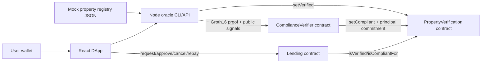

# ProofEstate

ProofEstate is an Ethereum testnet application for privacy-oriented real-estate lending. It demonstrates how a mocked property registry, an oracle verification service, a Groth16 LTV compliance proof, and role-gated lending contracts can work together without publishing plaintext property valuations or requested loan principal values on-chain.

The prototype is intentionally narrow: one property dataset, one fixed loan product, one compliance statement, and one active loan at a time per property.

## Table of Contents

- [Scope](#scope)
- [Technical Stack](#technical-stack)
- [Repository Structure](#repository-structure)
- [Architecture](#architecture)
- [ZK Compliance Design](#zk-compliance-design)
- [Smart Contracts](#smart-contracts)
- [Oracle Service](#oracle-service)
- [Frontend DApp](#frontend-dapp)
- [Security Model](#security-model)
- [Setup](#setup)
- [Local Demo](#local-demo)
- [Sepolia Deployment](#sepolia-deployment)
- [Testing and Evaluation](#testing-and-evaluation)
- [Known Limitations](#known-limitations)
- [Future Work](#future-work)

## Scope

### In Scope

- Mock property registry with 20 Singapore-style property records in `data/properties.json`.
- Deterministic property verification rules:
  - region must be `SG-CCR`, `SG-RCR`, or `SG-OCR`;
  - valuation must be at least `200000`;
  - property must have no encumbrance;
  - registry status must be `ACTIVE`.
- One lending product:
  - fixed APR: `6.5%`;
  - term: `365` days;
  - principal represented by a private commitment, not plaintext on-chain.
- One ZK compliance rule:
  - `loanPrincipal <= 80% of propertyValue`.
- One active loan per property:
  - `Requested` and `Approved` loans lock the property;
  - `Rejected`, `Cancelled`, and `Repaid` loans release the lock.
- Product-style React DApp for overview, verification, compliance proof, loan request, contracts, records, and settings.

### Out of Scope

- Production land-title integration.
- Production KYC or identity.
- Token or ETH disbursement.
- Multi-jurisdiction rules.
- Multi-loan private aggregate exposure.
- Full Hyperledger Fabric hybrid deployment.
- Enterprise monitoring, indexing, or analytics infrastructure.

## Technical Stack

### Blockchain

- Solidity `0.8.24`
- Hardhat `2.22.x`
- OpenZeppelin Contracts `5.x`
- Ethers `6.x`
- Local Hardhat chain, chain ID `31337`
- Optional Sepolia deployment

### ZK Stack

- Circom `2.1.6`
- snarkjs `0.7.x`
- circomlib and circomlibjs
- Groth16 proof system
- MiMC Sponge commitments
- Generated Solidity verifier:
  - `contracts/generated/LtvGroth16Verifier.sol`

### Backend

- Node.js
- Express
- CORS
- Ethers
- Oracle CLI and REST API

### Frontend

- Vite
- React `18`
- wagmi `2`
- viem `2`
- TanStack Query
- lucide-react
- Playwright-based layout verification

### Package Manager and Tooling

- pnpm workspace
- Hardhat tests
- Vite production build
- Local layout smoke test with headless Chrome

## Repository Structure

```text
contracts/
  PropertyVerification.sol          Oracle-written registry and compliance state
  ComplianceVerifier.sol            Groth16 proof gateway for LTV compliance
  Lending.sol                       Loan workflow and collateral locking
  generated/LtvGroth16Verifier.sol  snarkjs-generated verifier

backend/oracle/
  properties.js                     Dataset loading, verification rules, LTV input building
  service.js                        Oracle verification and compliance workflows
  contracts.js                      Ethers contract bindings
  server.js                         REST API
  cli.js                            CLI commands

circuits/
  ltv.circom                        LTV inequality and commitment circuit

zk/
  ltvCircuit.js                     JS commitment helpers matching the circuit
  prover.js                         snarkjs proof generation wrapper

frontend/
  src/App.jsx                       DApp workspace shell and workflows
  src/contracts/abis.js             Minimal frontend ABIs
  src/lib/                         API, chain formatting, and i18n helpers

scripts/
  deploy.js                         Local/Sepolia deployment
  sync-local-env.js                 Local deployment to .env sync
  local-demo-check.js               Readiness checks
  local-wallet-flow.js              CLI happy-path wallet flow
  verify-layout.mjs                 Responsive layout check
  zk-build.mjs                      Circom/snarkjs build pipeline

test/
  proofestate.test.js               Contract, oracle-rule, ZK, and lending tests
```

Generated folders such as `artifacts/`, `cache/`, `frontend/dist/`, `zk/build/`, and `zk/artifacts/` are build outputs.

## Architecture



### Data Flow

1. The oracle loads `data/properties.json`.
2. The oracle evaluates deterministic registry rules.
3. The oracle writes `setVerified(propertyId, verified, evidenceHash, valuationCommitment)`.
4. The ZK prover generates a Groth16 proof for the 80% LTV rule.
5. `ComplianceVerifier` checks the proof and writes `setCompliant(propertyId, true, proofHash, principalCommitment)`.
6. The borrower requests a loan with the same `principalCommitment`.
7. `Lending.approveLoan` checks:
   - property is verified;
   - property is compliant for that exact principal commitment;
   - loan is still in `Requested` state.
8. The property remains locked while the loan is `Requested` or `Approved`.
9. Rejection, cancellation, or repayment releases the lock.

## ZK Compliance Design

### Compliance Statement

Given private inputs:

- `propertyValue`
- `loanPrincipal`
- `valuationSalt`
- `principalSalt`

and public signals:

- `propertyKeyField`
- `valuationCommitment`
- `principalCommitment`
- `maxLtvBps`

prove:

```text
loanPrincipal * 10000 <= propertyValue * maxLtvBps
```

For this ProofEstate configuration, `maxLtvBps = 8000`, equivalent to `LTV <= 80%`.

### Commitments

The circuit uses `MiMCSponge(3, 220, 1)` with `k = 0`.

```text
valuationCommitment = MiMC(propertyKeyField, propertyValue, valuationSalt)
principalCommitment = MiMC(propertyKeyField, loanPrincipal, principalSalt)
```

The Solidity verifier receives proof calldata and public signals only. It does not receive plaintext valuation or plaintext principal.

### Circuit Files

- Circuit source: `circuits/ltv.circom`
- JS commitment mirror: `zk/ltvCircuit.js`
- Prover wrapper: `zk/prover.js`
- Generated verifier: `contracts/generated/LtvGroth16Verifier.sol`

### ZK Build

```bash
pnpm zk:build
```

This pipeline:

1. compiles the Circom circuit;
2. generates witness wasm and R1CS files;
3. runs a local Groth16 setup;
4. exports the Solidity verifier;
5. verifies that a sample proof can be generated.

This is a capstone/local trusted setup. A production system would need audited circuits, formal ceremony policy, prover hardening, and operational key controls.

## Smart Contracts

### `PropertyVerification`

Purpose: stores oracle-verified property state and verifier-written compliance state.

Important fields:

```solidity
struct VerificationRecord {
    bool verified;
    bool compliant;
    bytes32 evidenceHash;
    bytes32 complianceHash;
    uint256 valuationCommitment;
    uint256 principalCommitment;
    uint64 lastUpdated;
}
```

Important functions:

- `setVerified(bytes32 propertyId, bool verified, bytes32 evidenceHash, uint256 valuationCommitment)`
- `setCompliant(bytes32 propertyId, bool compliant, bytes32 proofHash, uint256 principalCommitment)`
- `isVerified(bytes32 propertyId)`
- `isCompliant(bytes32 propertyId)`
- `isCompliantFor(bytes32 propertyId, uint256 principalCommitment)`
- `getRecord(bytes32 propertyId)`

Roles:

- `DEFAULT_ADMIN_ROLE`: can grant roles.
- `ORACLE_ROLE`: can write verification records.
- `COMPLIANCE_ROLE`: granted to `ComplianceVerifier`, not to the deployer by default.

### `ComplianceVerifier`

Purpose: validates Groth16 proofs and writes compliance records.

Validation steps:

1. property must already be verified;
2. public signal `0` must match `propertyIdToField(propertyId)`;
3. public signal `1` must match the stored valuation commitment;
4. public signal `2` must match the submitted principal commitment;
5. public signal `3` must match `MAX_LTV_BPS`;
6. generated Groth16 verifier must return `true`.

### `Lending`

Purpose: manages loan lifecycle and property-level active-loan locking.

Loan states:

```text
0 Requested
1 Approved
2 Repaid
3 Rejected
4 Cancelled
```

Important functions:

- `requestLoan(bytes32 propertyId, uint256 principalCommitment)`
- `approveLoan(uint256 loanId)`
- `rejectLoan(uint256 loanId)`
- `cancelLoan(uint256 loanId)`
- `repay(uint256 loanId)`
- `getLoan(uint256 loanId)`
- `activeLoanIdOf(bytes32 propertyId)`
- `loanIdsOfProperty(bytes32 propertyId)`

Important rules:

- `propertyId` cannot be empty.
- `principalCommitment` cannot be zero.
- a property cannot have more than one `Requested` or `Approved` loan.
- approval requires `isCompliantFor(propertyId, principalCommitment)`.
- only `LOAN_OFFICER_ROLE` can approve or reject.
- only the borrower can cancel or repay their loan.

## Oracle Service

### REST API

Default URL:

```text
http://localhost:8787
```

Endpoints:

| Method   | Path                                     | Purpose                                        |
| -------- | ---------------------------------------- | ---------------------------------------------- |
| `GET`  | `/health`                              | Oracle health check                            |
| `GET`  | `/properties`                          | List mock registry records                     |
| `GET`  | `/properties/:propertyId/verification` | Evaluate verification rules without writing    |
| `POST` | `/verify`                              | Evaluate and optionally write verification     |
| `POST` | `/compliance`                          | Generate proof and optionally write compliance |
| `POST` | `/e2e`                                 | Run verification and compliance together       |

`/compliance` and `/e2e` require a positive integer `loanPrincipal` that fits the 64-bit circuit range.

### CLI

```bash
pnpm oracle:list
pnpm oracle:verify PROP-001
pnpm oracle:verify PROP-001 -- --write
pnpm oracle:compliance PROP-001 750000
pnpm oracle:compliance PROP-001 750000 -- --write
pnpm oracle:e2e PROP-001 750000 -- --write
```

## Frontend DApp

The DApp is organized by operational responsibility:

- Overview:
  - runtime readiness;
  - loan counts;
  - active collateral locks;
  - verification pass rate from the mock registry;
  - session proof latency;
  - session gas readings.
- Property Verification:
  - asset selection;
  - registry rule checks;
  - oracle verification action;
  - on-chain verification record.
- Compliance Proof:
  - principal input;
  - LTV meter;
  - proof generation;
  - proof and commitment state.
- Loan Request:
  - submit;
  - approve;
  - cancel;
  - repay;
  - active collateral lock status.
- Smart Contracts:
  - configured/deployed/unreachable/missing status;
  - address and latest transaction context.
- Testnet Records:
  - on-chain record;
  - loan book;
  - activity feed.
- Settings:
  - language;
  - network;
  - oracle-write mode.

The UI intentionally avoids fake historical metrics. Displayed gas and proof latency are collected from the current browser session.

## Security Model

### Assets

- Mock property records.
- Verification status.
- Compliance proof status.
- Principal and valuation commitments.
- Loan lifecycle state.
- Oracle private key.
- Loan officer key.

### Covered Risks

- Unauthorized verification writes are blocked by `ORACLE_ROLE`.
- Unauthorized compliance writes are blocked by `COMPLIANCE_ROLE`.
- The deployer does not hold `COMPLIANCE_ROLE` by default.
- Invalid or tampered Groth16 proofs cannot set compliance.
- Mismatched public signals cannot set compliance.
- A proof accepted for one principal commitment cannot approve a loan with another commitment.
- Duplicate active loans against one property revert.
- Double approval, invalid repayment, and invalid cancellation revert.
- Non-borrowers cannot cancel or repay another user's loan.

### Trust Assumptions

- The mock registry is test data, not authoritative title data.
- The oracle is trusted for deterministic rule evaluation in this testnet application.
- The loan officer role is trusted to approve through the contract path.
- Public testnet transactions and commitments are observable.

## Setup

Requirements:

- Node.js `>=20 <23`
- pnpm
- Circom installed and available on `PATH`
- Google Chrome if running `pnpm layout:check`

Install and build:

```bash
pnpm install
pnpm zk:build
pnpm compile
pnpm test
```

## Local Demo

Terminal 1:

```bash
pnpm chain:local
```

Terminal 2:

```bash
pnpm demo:deploy
pnpm oracle:api
```

Terminal 3:

```bash
pnpm frontend:dev
```

Open:

```text
http://localhost:5173/
```

`pnpm demo:deploy` deploys local contracts and syncs `.env` plus `frontend/.env`.

### Local Role Matrix

The local demo uses separated Hardhat accounts so each screen matches a real business role:

| Account | Address                                        | Role             | Demo use                                                                                |
| ------- | ---------------------------------------------- | ---------------- | --------------------------------------------------------------------------------------- |
| #0      | `0xf39Fd6e51aad88F6F4ce6aB8827279cffFb92266` | Deployer + Admin | Deploy contracts and manage roles                                                       |
| #1      | `0x70997970C51812dc3A010C7d01b50e0d17dc79C8` | Oracle           | Backend signer for registry verification writes                                         |
| #2      | `0x3C44CdDdB6a900fa2b585dd299e03d12FA4293BC` | Loan Officer     | Approve or reject requested loans                                                       |
| #3      | `0x90F79bf6EB2c4f870365E785982E1f101E93b906` | Borrower         | Owns `PROP-001`, `PROP-002`, `PROP-005`, `PROP-010`, `PROP-012`, `PROP-017` |
| #4      | `0x15d34AAf54267DB7D7c367839AAf71A00a2C6A65` | Borrower         | Owns `PROP-003`, `PROP-004`, `PROP-011`, `PROP-013`, `PROP-016`, `PROP-018` |
| #5      | `0x9965507D1a55bcC2695C58ba16FB37d819B0A4dc` | Borrower         | Owns `PROP-006`, `PROP-007`, `PROP-014`, `PROP-019`                             |
| #6      | `0x976EA74026E726554dB657fA54763abd0C3a0aa9` | Borrower         | Owns `PROP-008`, `PROP-009`, `PROP-015`, `PROP-020`                             |

The Oracle exists because the blockchain cannot independently know real-world registry facts such as property existence, address, valuation, encumbrance, or active title status. In this demo, the Oracle API is the trusted registry writer; it evaluates `data/properties.json` and writes verification/proof results on-chain. It is not a borrower or an approver.

### MetaMask Localhost Setup

- Network name: `Localhost 8545`
- RPC: `http://127.0.0.1:8545`
- Chain ID: `31337`
- Currency: `ETH`
- Import the accounts you want to demo:
  - Account #0 for Admin.
  - Account #2 for Loan Officer.
  - Account #3 through #6 for Borrower views.

Account #0 private key:

```text
0xac0974bec39a17e36ba4a6b4d238ff944bacb478cbed5efcae784d7bf4f2ff80
```

Account #2 private key:

```text
0x5de4111afa1a4b94908f83103eb1f1706367c2e68ca870fc3fb9a804cdab365a
```

Account #3 private key:

```text
0x7c852118294e51e653712a81e05800f419141751be58f605c371e15141b007a6
```

### Demo Flow

Happy path:

1. Admin deploys with `pnpm demo:deploy`.
2. Start the Oracle API with `pnpm oracle:api`.
3. Connect a Borrower wallet, open My Properties, and select an owned property.
4. Run Property Verification, then open Compliance Proof and enter the requested amount, for example `750000`.
5. Generate the compliance proof. The loan request screen will use that same amount as read-only proof data; changing amount or property requires regenerating the proof.
6. Submit the loan request from the Borrower wallet and review it in My Loan Ledger.
7. Switch MetaMask to Account #2, open Loan Approvals, and use the status tabs to approve, reject, or audit loans.
8. Switch back to the Borrower wallet and repay approved loans from the selected loan record.
9. Use Admin to review role configuration and contract status.

Failure paths:

- `PROP-004`: verification fails because the property is encumbered.
- `PROP-001` with `900000`: compliance fails because LTV exceeds 80%.
- `PROP-003` with active `500000` loan, then a second `400000` request: second request reverts due to active collateral lock.
- proof for one principal, loan request with another principal commitment: approval rejects due to proof mismatch.

Command-line happy path:

```bash
pnpm demo:flow
```

Readiness check:

```bash
pnpm demo:check
pnpm demo:ready
```

## Sepolia Deployment

Set:

```text
SEPOLIA_RPC_URL=
DEPLOYER_PRIVATE_KEY=
ORACLE_ADDRESS=
LOAN_OFFICER_ADDRESS=
```

Then run:

```bash
pnpm deploy:sepolia
```

Copy `deployments/sepolia.json` addresses into `.env` and `frontend/.env`.

## Testing and Evaluation

### Core Commands

```bash
pnpm compile
pnpm test
pnpm frontend:build
pnpm layout:check
pnpm test:gas
```

### Test Coverage

The main test suite is `test/proofestate.test.js`.

It covers:

- oracle registry rule evaluation;
- invalid oracle principal inputs;
- deployment address validation;
- least-privilege role configuration;
- verification record writes;
- unauthorized verification writes;
- blocked direct compliance writes;
- stale compliance clearing;
- valid Groth16 proof acceptance;
- unverified property proof rejection;
- mismatched public signal rejection;
- tampered proof rejection;
- above-LTV proof failure;
- invalid loan ids;
- invalid loan request inputs;
- happy-path request, approval, and repayment;
- loan officer role checks;
- double approval rejection;
- verification rejection release;
- compliance rejection release;
- proof/principal mismatch rejection;
- requested-loan collateral lock;
- cancellation release;
- approved-loan collateral lock;
- `PROP-003` duplicate active-loan over-borrow guard;
- borrower-only cancellation and repayment.

### Evaluation Metrics

Quantitative:

- gas for `setVerified`;
- gas for `verifyProofAndSetCompliance`;
- gas for `requestLoan`;
- gas for `approveLoan`;
- gas for `cancelLoan`;
- gas for `repay`;
- oracle verification latency;
- proof generation latency;
- end-to-end demo duration.

Qualitative:

- privacy improvement against plaintext valuation/principal disclosure;
- robustness of failure paths;
- clarity of trust boundaries;
- extensibility of replacing the compliance verifier without changing lending flow.

## Environment Variables

Root `.env`:

```text
LOCAL_RPC_URL=http://127.0.0.1:8545
ORACLE_PORT=8787
ORACLE_PRIVATE_KEY=
DEPLOYER_PRIVATE_KEY=
ADMIN_ADDRESS=
ORACLE_ADDRESS=
LOAN_OFFICER_ADDRESS=
PROPERTY_VERIFICATION_ADDRESS=
COMPLIANCE_VERIFIER_ADDRESS=
LENDING_ADDRESS=
SEPOLIA_RPC_URL=
```

Frontend `.env`:

```text
VITE_ORACLE_API_URL=http://localhost:8787
VITE_LOCAL_RPC_URL=http://127.0.0.1:8545
VITE_SEPOLIA_RPC_URL=
VITE_ADMIN_ADDRESS=
VITE_ORACLE_ADDRESS=
VITE_LOAN_OFFICER_ADDRESS=
VITE_PROPERTY_VERIFICATION_ADDRESS=
VITE_COMPLIANCE_VERIFIER_ADDRESS=
VITE_LENDING_ADDRESS=
VITE_DEFAULT_NETWORK=localhost
```

## Known Limitations

- The registry is mocked.
- The oracle is centralized.
- The local trusted setup is not production-grade.
- Principal and valuation are hidden, but commitments and loan state are public.
- The collateral model is conservative: one active loan per property rather than private aggregate multi-loan exposure.
- Loan repayment is state accounting only; no ETH or token principal is disbursed.
- No production KYC, title custody, lien registry, or liquidation logic.
- Property loan history is exposed through the Lending contract; the platform-level loan book still reads `nextLoanId` for operational summaries.

## Future Work

- Replace the mock registry with a regulated registry, bank, or Fabric-backed consortium source.
- Add threshold oracle governance.
- Upgrade to private aggregate exposure proofs for multiple simultaneous loans per asset.
- Add audited circuit artifacts and a formal trusted setup policy.
- Add real fund accounting, repayment amounts, delinquency, and liquidation.
- Add event indexing and monitoring.
- Add production identity and lender/borrower role separation.
