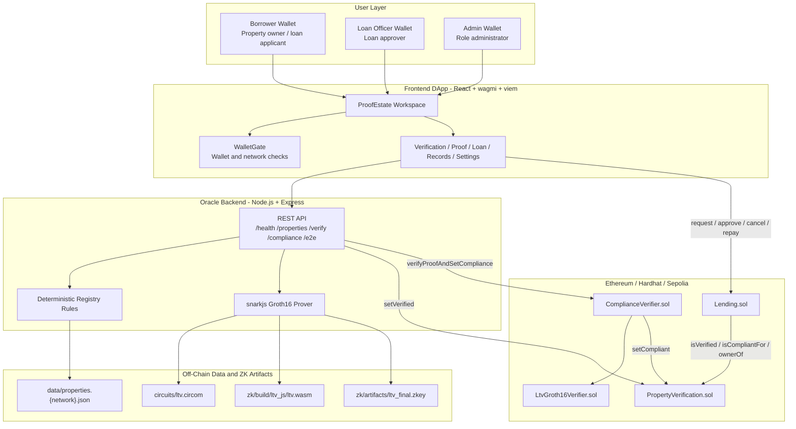
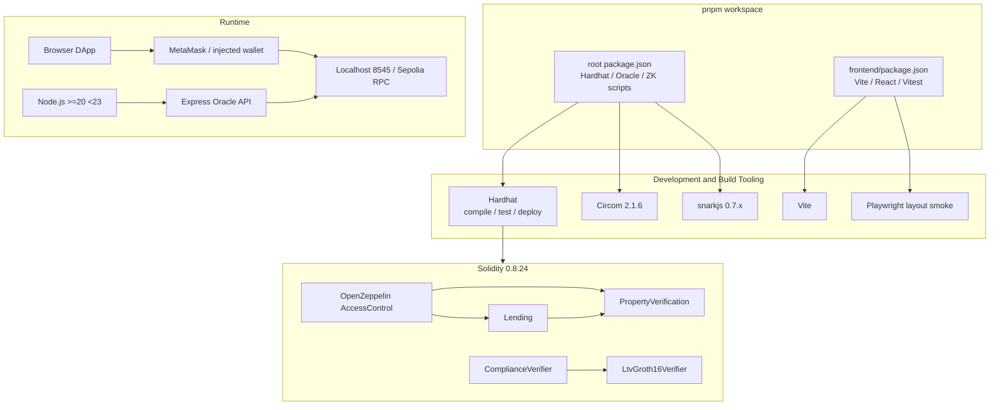
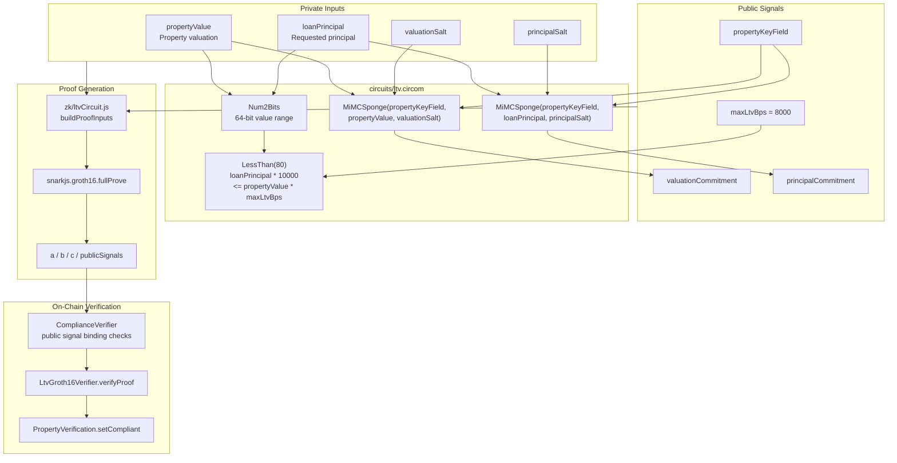
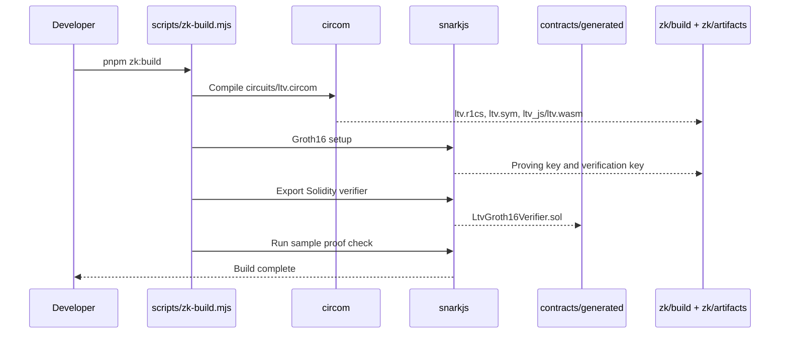
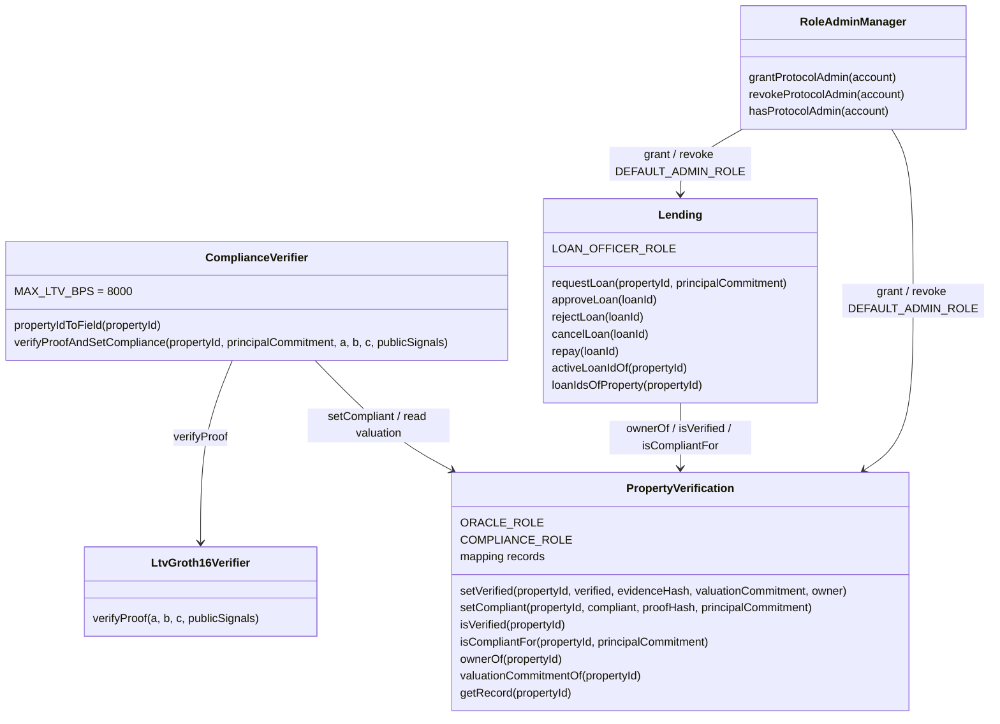
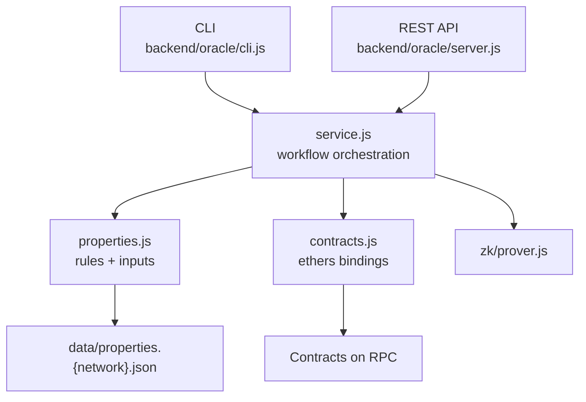
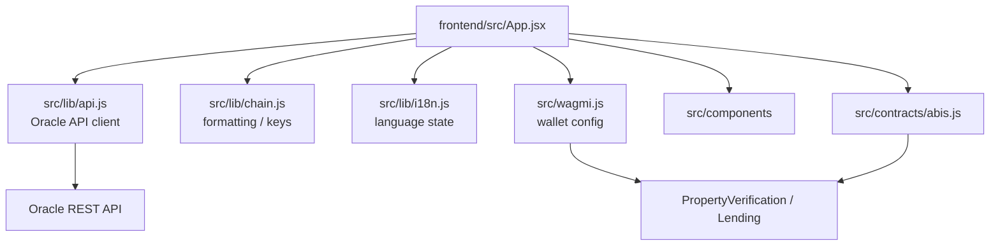
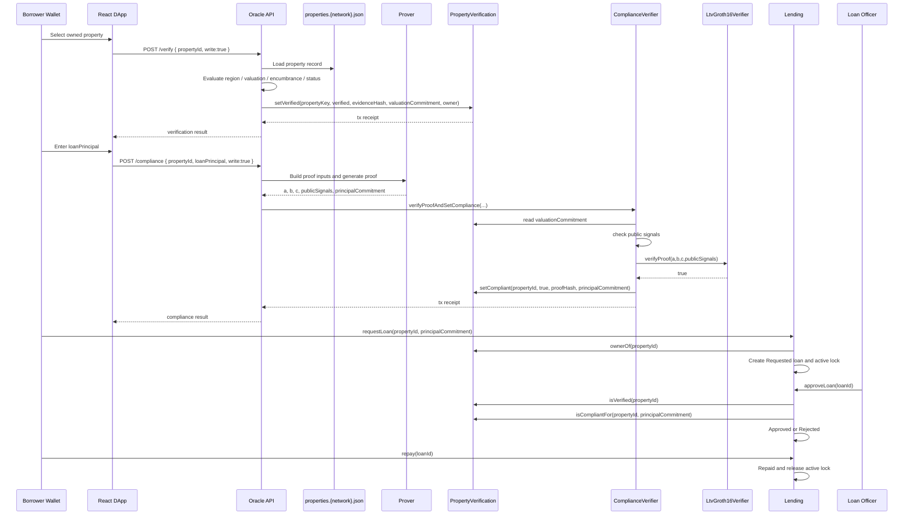
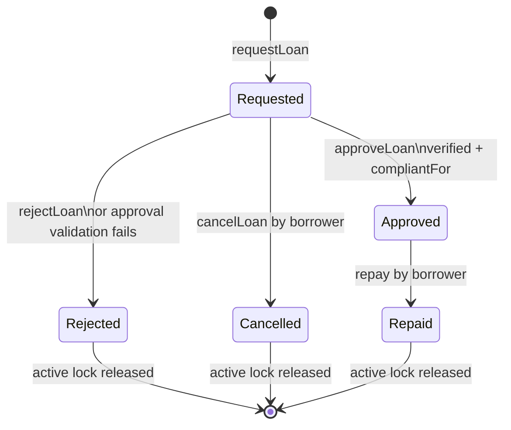

# ProofEstate

ProofEstate is an Ethereum testnet prototype for privacy-oriented real-estate lending. It combines a mocked property registry, an oracle verification service, a Groth16 LTV compliance proof, role-gated smart contracts, and a React DApp to demonstrate a lending workflow where property valuations and requested loan principals are not published on-chain in plaintext.

The system proves one narrow but important statement:

```text
loanPrincipal <= 80% of propertyValue
```

without revealing `loanPrincipal` or `propertyValue` to the blockchain. The chain stores commitments, verification records, proof hashes, ownership, and loan state.

This is a capstone / prototype implementation. It is intentionally scoped to one mocked registry dataset, one fixed loan product, one ZK compliance rule, and one active loan at a time per property.

## Table of Contents

- [System Purpose](#system-purpose)
- [Core Capabilities](#core-capabilities)
- [Repository Structure](#repository-structure)
- [System Architecture Diagram](#system-architecture-diagram)
- [Business Logic Diagram](#business-logic-diagram)
- [Technical Architecture Diagram](#technical-architecture-diagram)
- [ZKP Implementation Architecture Diagram](#zkp-implementation-architecture-diagram)
- [Smart Contract Architecture](#smart-contract-architecture)
- [Oracle Service Architecture](#oracle-service-architecture)
- [Frontend DApp Architecture](#frontend-dapp-architecture)
- [End-to-End Data Flow](#end-to-end-data-flow)
- [Loan State Machine](#loan-state-machine)
- [Security Model](#security-model)
- [Local Setup](#local-setup)
- [Sepolia Deployment](#sepolia-deployment)
- [Testing and Evaluation](#testing-and-evaluation)
- [Environment Variables](#environment-variables)
- [Known Limitations](#known-limitations)
- [Future Work](#future-work)

## System Purpose

ProofEstate is not a production lending protocol. It is a runnable reference architecture for showing how privacy-preserving lending checks can be composed from off-chain data, zero-knowledge proofs, and on-chain enforcement.

The system is designed to demonstrate four core ideas:

1. **Off-chain registry facts can be written on-chain through constrained oracle logic.** Property existence, region eligibility, valuation floor, encumbrance status, and active registry status are evaluated by the oracle from the active network registry file (`data/properties.localhost.json` or `data/properties.sepolia.json`), then committed into `PropertyVerification`.
2. **Sensitive financial values can remain hidden while still being bound to on-chain state.** Property valuation and loan principal are represented by MiMC commitments tied to the property key.
3. **Loan approval can depend on proof validity instead of plaintext disclosure.** `ComplianceVerifier` accepts a Groth16 proof only when its public signals match the on-chain property record and the submitted principal commitment.
4. **The lending workflow can prevent duplicate active borrowing against one asset.** `Lending` maintains a property-level active loan lock while a loan is `Requested` or `Approved`.

## Core Capabilities

### In Scope

- Mock Singapore-style property registries split by network: `data/properties.localhost.json` and `data/properties.sepolia.json`.
- Deterministic property verification rules:
  - `region` must be `SG-CCR`, `SG-RCR`, or `SG-OCR`;
  - `valuation >= 200000`;
  - `noEncumbrance === true`;
  - `status === ACTIVE`.
- One fixed lending product:
  - APR: `6.5%`;
  - term: `365` days;
  - principal represented by `principalCommitment`, not plaintext.
- One zero-knowledge compliance rule:
  - `loanPrincipal * 10000 <= propertyValue * 8000`;
  - equivalent to `LTV <= 80%`.
- Role-gated operations:
  - Admin manages roles.
  - Oracle writes property verification records.
  - ComplianceVerifier writes compliance records.
  - Loan Officer approves or rejects loans.
  - Borrower requests, cancels, and repays loans.
- Product-style React DApp:
  - Property Verification;
  - Compliance Proof;
  - Loan Request;
  - Loan Approvals;
  - Admin Role Access;
  - Admin Contract Ops;
  - Admin Audit Logs;
  - Settings.

### Out of Scope

- Production land-title registry integration.
- Production KYC, DID, AML, or identity proofing.
- Real ETH or ERC20 disbursement.
- Multi-jurisdiction rule engines.
- Private aggregate exposure across multiple simultaneous loans.
- Full Hyperledger Fabric hybrid deployment.
- Production-grade monitoring, indexing, liquidation, or risk infrastructure.

## Repository Structure

```text
contracts/
  PropertyVerification.sol          Oracle-written verification state and verifier-written compliance state
  ComplianceVerifier.sol            Groth16 proof gateway with public-signal binding checks
  Lending.sol                       Loan workflow, property active-loan locking, approval, repayment
  generated/LtvGroth16Verifier.sol  Solidity verifier generated by snarkjs

backend/oracle/
  properties.js                     Dataset loading, registry rules, LTV inputs, commitment construction
  service.js                        Verification, proving, and optional on-chain write workflows
  contracts.js                      ethers contract bindings
  server.js                         REST API
  cli.js                            CLI entry point

circuits/
  ltv.circom                        LTV inequality and MiMC commitment circuit

zk/
  ltvCircuit.js                     JS field and commitment helpers matching the Circom circuit
  prover.js                         snarkjs proof-generation wrapper
  build/                            R1CS, wasm, witness calculator, and related build outputs

frontend/
  src/App.jsx                       Main DApp workspace and business workflow orchestration
  src/contracts/abis.js             Minimal frontend ABIs
  src/lib/                          API client, chain formatting, i18n helpers
  src/components/                   Layout, common controls, tables, and LoanLedger

scripts/
  deploy.js                         Local and Sepolia deployment
  sync-local-env.js                 Sync local deployment addresses into .env.local and frontend/.env.local
  sync-sepolia-env.js               Sync Sepolia deployment addresses into .env.sepolia and frontend/.env.sepolia
  local-demo-check.js               Local demo readiness checks
  local-wallet-flow.js              CLI happy-path wallet workflow
  verify-layout.mjs                 Responsive layout smoke check
  zk-build.mjs                      Circom and snarkjs build pipeline

test/
  proofestate.test.js               Contract, oracle-rule, ZK, and lending workflow tests
```

Generated output folders include `artifacts/`, `cache/`, `frontend/dist/`, `zk/build/`, and `zk/artifacts/`.

## System Architecture Diagram



The architecture is split into four layers:

- **User layer:** borrowers, loan officers, and admins interact through wallets.
- **Frontend layer:** the DApp coordinates workflow state, wallet connection, network readiness, API calls, and contract writes.
- **Oracle and ZK layer:** the backend evaluates off-chain registry rules, builds proof inputs, generates Groth16 proofs, and optionally writes verified/compliant state on-chain.
- **On-chain layer:** contracts enforce permissions, proof validity, ownership, compliance matching, and the loan lifecycle.

## Business Logic Diagram

```mermaid
flowchart LR
  Start["Select property"] --> OwnCheck{"Is connected wallet\nthe property owner?"}
  OwnCheck -- No --> StopOwner["Loan request blocked"]
  OwnCheck -- Yes --> Registry["Oracle reads registry record"]
  Registry --> RuleCheck{"Registry rules pass?"}
  RuleCheck -- No --> VerifyFail["Verification fails\nwith reasons"]
  RuleCheck -- Yes --> VerifyWrite["setVerified\nverified=true\nvaluationCommitment"]
  VerifyWrite --> Principal["Enter loan principal"]
  Principal --> LtvCheck{"LTV <= 80%?"}
  LtvCheck -- No --> ProofFail["Compliance fails\nno valid proof written"]
  LtvCheck -- Yes --> ProofGen["Generate Groth16 proof\nand principalCommitment"]
  ProofGen --> ProofVerify["verifyProofAndSetCompliance"]
  ProofVerify --> Request["Borrower requestLoan"]
  Request --> Lock["Property enters active loan lock"]
  Lock --> ApproveCheck{"Loan Officer review"}
  ApproveCheck -- Proof mismatch / not compliant --> Reject["Rejected\nlock released"]
  ApproveCheck -- Valid --> Approved["Approved\nlock remains"]
  Approved --> Repay["Borrower repay"]
  Repay --> Released["Repaid\nlock released"]
  Request --> Cancel["Borrower cancel"]
  Cancel --> Released
```



The business flow is intentionally strict: verify the asset first, prove the requested principal is within policy second, and only then allow the borrower to enter the lending state machine. The loan officer does not need plaintext valuation or plaintext principal; approval depends on a commitment that has already been proven compliant.

## Technical Architecture Diagram



### Stack

| Layer | Technologies |
| --- | --- |
| Smart contracts | Solidity `0.8.24`, Hardhat `2.22.x`, OpenZeppelin Contracts `5.x` |
| ZK | Circom `2.1.6`, snarkjs `0.7.x`, circomlib, circomlibjs, Groth16, MiMC Sponge |
| Backend | Node.js, Express, CORS, ethers `6.x` |
| Frontend | Vite, React `18`, wagmi `2`, viem `2`, TanStack Query, lucide-react |
| Tooling | pnpm workspace, Hardhat tests, Vitest, Playwright layout check |
| Networks | Hardhat local chain `31337`, optional Sepolia |

## ZKP Implementation Architecture Diagram



### ZK Statement

The prover demonstrates the following statement without revealing `propertyValue` or `loanPrincipal`:

```text
loanPrincipal * 10000 <= propertyValue * maxLtvBps
maxLtvBps = 8000
```

Equivalent policy:

```text
loanPrincipal <= propertyValue * 80%
```

### Commitment Design

The circuit uses `MiMCSponge(3, 220, 1)` with `k = 0`:

```text
valuationCommitment = MiMC(propertyKeyField, propertyValue, valuationSalt)
principalCommitment = MiMC(propertyKeyField, loanPrincipal, principalSalt)
```

`propertyKeyField` is derived from the property ID:

```text
propertyKey = ethers.id(propertyId)
propertyKeyField = uint256(propertyKey) % SNARK_SCALAR_FIELD
```

This binds each commitment to a specific property context. A proof for one property or one principal commitment cannot be reused safely in another context because the verifier checks the public signals against on-chain state.

### Public Signal Binding

`ComplianceVerifier.verifyProofAndSetCompliance` does more than call the generated Groth16 verifier. It first checks that every public signal is bound to the expected contract state:

| index | public signal | Required match |
| --- | --- | --- |
| `0` | `propertyKeyField` | `propertyIdToField(propertyId)` |
| `1` | `valuationCommitment` | `PropertyVerification.valuationCommitmentOf(propertyId)` |
| `2` | `principalCommitment` | submitted `principalCommitment` |
| `3` | `maxLtvBps` | `8000` |

Only after these checks pass and `LtvGroth16Verifier.verifyProof` returns `true` does the contract write:

```text
compliant = true
complianceHash = keccak256(a, b, c, publicSignals)
principalCommitment = proven principal commitment
```

### ZK Build Flow



This is a local demonstration trusted setup. A production deployment would require audited circuits, a formal ceremony policy, hardened prover infrastructure, key management, and operational monitoring.

## Smart Contract Architecture



### `PropertyVerification`

Purpose: stores oracle-verified property state and verifier-written compliance state.

Core record:

```solidity
struct VerificationRecord {
    bool verified;
    bool compliant;
    address owner;
    bytes32 evidenceHash;
    bytes32 complianceHash;
    uint256 valuationCommitment;
    uint256 principalCommitment;
    uint64 lastUpdated;
}
```

Important rules:

- Only `ORACLE_ROLE` can call `setVerified`.
- Only `COMPLIANCE_ROLE` can call `setCompliant`.
- A new verification write clears old compliance state so stale proofs cannot remain active.
- A verified property must have a non-zero owner.
- A compliant record must have a non-zero principal commitment.

### `ComplianceVerifier`

Purpose: acts as the Groth16 proof gateway. It does not manage loan state. It validates proof context and writes compliance state only after all public signals are bound to the expected property record.

Validation steps:

1. The property must already be verified.
2. `publicSignals[0]` must equal `propertyIdToField(propertyId)`.
3. `publicSignals[1]` must equal the stored valuation commitment.
4. `publicSignals[2]` must equal the submitted principal commitment.
5. `publicSignals[3]` must equal `MAX_LTV_BPS`.
6. The generated verifier must return `true`.
7. The contract writes `PropertyVerification.setCompliant`.

### `Lending`

Purpose: manages loan lifecycle and property-level active-loan locking.

Fixed product configuration:

```text
DEFAULT_INTEREST_RATE_BPS = 650
DEFAULT_TERM_DAYS = 365
```

Loan states:

```text
0 Requested
1 Approved
2 Repaid
3 Rejected
4 Cancelled
```

Important rules:

- The caller must equal `PropertyVerification.ownerOf(propertyId)` when requesting a loan.
- `propertyId` cannot be empty.
- `principalCommitment` cannot be zero.
- One property cannot have more than one `Requested` or `Approved` loan.
- Approval requires `isVerified(propertyId)`.
- Approval requires `isCompliantFor(propertyId, principalCommitment)`.
- Only `LOAN_OFFICER_ROLE` can approve or reject.
- Only the borrower can cancel or repay.
- Rejected, cancelled, and repaid loans release the active loan lock.

## Oracle Service Architecture



The oracle exists because the blockchain cannot independently know real-world registry facts such as property existence, valuation, title status, or encumbrance. In this prototype, the oracle is the trusted registry writer.

### REST API

Default URL:

```text
http://localhost:8787
```

| Method | Path | Purpose |
| --- | --- | --- |
| `GET` | `/health` | Oracle health check |
| `GET` | `/properties?owner=0x...&network=localhost` | List mocked registry records owned by an address |
| `GET` | `/properties?role=loanOfficer&network=sepolia` | List the active network registry for privileged demo roles (`admin` or `loanOfficer`) |
| `GET` | `/properties/:propertyId/verification?network=localhost` | Evaluate verification rules without writing on-chain |
| `POST` | `/verify` | Evaluate and optionally write verification state |
| `POST` | `/compliance` | Generate proof and optionally write compliance state |
| `POST` | `/e2e` | Run verification and compliance together |

`/properties` requires either an `owner` query parameter or a privileged demo `role`. `/verify`, `/compliance`, and `/e2e` accept `network` in the JSON body; `/compliance` and `/e2e` require `loanPrincipal` to be a positive integer within the 64-bit circuit range.

### CLI

```bash
pnpm oracle:list
pnpm oracle:verify PROP-001
pnpm oracle:verify PROP-001 -- --write
pnpm oracle:compliance PROP-001 750000
pnpm oracle:compliance PROP-001 750000 -- --write
pnpm oracle:e2e PROP-001 750000 -- --write
```

## Frontend DApp Architecture



The frontend is an operational DApp workspace rather than a marketing page. It supports several user roles:

- **Borrower:** view owned properties, run verification, generate compliance proofs, submit loans, cancel requests, and repay approved loans.
- **Loan Officer:** inspect requested loans and approve or reject them.
- **Admin:** manage role access, inspect contract operations, and review audit logs.
- **Evaluator:** inspect loan records, property records, role changes, on-chain events, proof latency, gas samples, and activity logs.

The UI intentionally avoids fake historical metrics. Displayed gas usage and proof latency are collected from real actions in the current browser session.

## End-to-End Data Flow



## Loan State Machine



Active lock behavior:

| State | Property locked? |
| --- | --- |
| `Requested` | Yes |
| `Approved` | Yes |
| `Rejected` | No |
| `Cancelled` | No |
| `Repaid` | No |

## Security Model

### Assets and Sensitive Surfaces

- Mocked property records.
- Verified and compliant property status.
- `valuationCommitment`.
- `principalCommitment`.
- `evidenceHash`.
- `complianceHash`.
- Oracle private key.
- Loan Officer private key.
- Loan state and property active-loan locks.

### Covered Risks

- Unauthorized accounts cannot write property verification state.
- Unauthorized accounts cannot directly write compliance state.
- The deployer does not hold `COMPLIANCE_ROLE` by default.
- Invalid or tampered Groth16 proofs cannot set compliance.
- Public signal mismatches revert.
- A proof generated for one principal commitment cannot approve a loan using another commitment.
- One property cannot have duplicate active loans.
- Non-borrowers cannot cancel or repay another user's loan.
- Double approval, invalid repayment, and invalid cancellation revert.
- Re-verification clears stale compliance state.

### Trust Assumptions

- `data/properties.localhost.json` and `data/properties.sepolia.json` are test data, not authoritative title registries.
- The oracle is trusted in this prototype.
- The Loan Officer role is trusted to approve through the contract path.
- Public testnet transactions, commitments, and state changes are observable.
- The local Groth16 trusted setup is for demonstration only.

### Privacy Boundary

Visible on-chain:

- property key as `bytes32`;
- owner address;
- evidence hash;
- valuation commitment;
- principal commitment;
- compliance proof hash;
- loan state;
- loan timestamps.

Not published on-chain in plaintext:

- property valuation;
- requested loan principal;
- valuation salt;
- principal salt;
- proof private witness.

## Local Setup

### Requirements

- Node.js `>=20 <23`
- pnpm
- Circom installed and available on `PATH`
- Google Chrome if running `pnpm layout:check`

### Install and Build

```bash
pnpm install
pnpm zk:build
pnpm compile
pnpm test
```

### Local Demo

Terminal 1:

```bash
pnpm chain:local
```

Terminal 2:

```bash
pnpm demo:deploy
pnpm oracle:api
```

Terminal 3:

```bash
pnpm frontend:dev
```

Open:

```text
http://localhost:5173/
```

`pnpm demo:deploy` deploys local contracts and syncs `.env.local` plus `frontend/.env.local`.
Local demo commands automatically use `.env.local`. Sepolia deployment commands automatically use `.env.sepolia`.

### Demo Flow

1. Admin runs `pnpm demo:deploy`.
2. Start the Oracle API with `pnpm oracle:api`.
3. Connect a Borrower wallet, open Property Verification, and select an owned property.
4. Run Property Verification.
5. Enter a loan principal, for example `750000`.
6. Generate a Compliance Proof and write compliance on-chain.
7. The Borrower submits a loan with the same `principalCommitment`.
8. Switch to the Loan Officer wallet and approve or reject in Loan Approvals.
9. The Borrower repays the approved loan.
10. Admin can use Role Access, Contract Ops, and Audit Logs.

Command-line happy path:

```bash
pnpm demo:flow
```

Readiness checks:

```bash
pnpm demo:check
pnpm demo:ready
```

### Local Role Matrix

| Account | Address | Role | Demo use |
| --- | --- | --- | --- |
| #0 | `0xf39Fd6e51aad88F6F4ce6aB8827279cffFb92266` | Deployer + Admin | Deploy contracts and manage roles |
| #1 | `0x70997970C51812dc3A010C7d01b50e0d17dc79C8` | Oracle | Backend signer for registry verification writes |
| #2 | `0x3C44CdDdB6a900fa2b585dd299e03d12FA4293BC` | Loan Officer | Approve or reject requested loans |
| #3 | `0x90F79bf6EB2c4f870365E785982E1f101E93b906` | Borrower | Owns `PROP-001`, `PROP-002`, `PROP-005`, `PROP-010`, `PROP-012`, `PROP-017` |
| #4 | `0x15d34AAf54267DB7D7c367839AAf71A00a2C6A65` | Borrower | Owns `PROP-003`, `PROP-004`, `PROP-011`, `PROP-013`, `PROP-016`, `PROP-018` |
| #5 | `0x9965507D1a55bcC2695C58ba16FB37d819B0A4dc` | Borrower | Owns `PROP-006`, `PROP-007`, `PROP-014`, `PROP-019` |
| #6 | `0x976EA74026E726554dB657fA54763abd0C3a0aa9` | Borrower | Owns `PROP-008`, `PROP-009`, `PROP-015`, `PROP-020` |

### MetaMask Localhost Setup

- Network name: `Localhost 8545`
- RPC: `http://127.0.0.1:8545`
- Chain ID: `31337`
- Currency: `ETH`

Common local private keys:

```text
#0 Admin
0xac0974bec39a17e36ba4a6b4d238ff944bacb478cbed5efcae784d7bf4f2ff80

#2 Loan Officer
0x5de4111afa1a4b94908f83103eb1f1706367c2e68ca870fc3fb9a804cdab365a

#3 Borrower
0x7c852118294e51e653712a81e05800f419141751be58f605c371e15141b007a6
```

### Representative Failure Paths

- `PROP-004`: verification fails because the property is encumbered.
- `PROP-001` with `900000`: compliance fails because LTV exceeds 80%.
- `PROP-003` with an active `500000` loan, followed by a second `400000` request: the second request reverts due to active collateral locking.
- Proof for one principal, loan request with another principal commitment: approval rejects due to proof mismatch and releases the lock.

## Sepolia Deployment

Sepolia deployment promotes ProofEstate from a private local demo to a public Ethereum testnet deployment. It is useful for reviewer-facing demonstrations because:

- contract addresses have public bytecode and transaction history;
- MetaMask uses a real testnet network instead of Hardhat account simulation;
- oracle writes, compliance proof writes, loan requests, approvals, cancellations, and repayments are real Sepolia transactions;
- reviewers can inspect the deployment without running your local chain;
- the project demonstrates its intended Ethereum integration path while still using test ETH.

Sepolia does not make the system production-ready. The registry remains mocked, the oracle remains centralized, repayments are still modeled as state transitions only, and testnet ETH has no economic meaning.

### Sepolia Environment

```bash
cp .env.sepolia.example .env.sepolia
cp frontend/.env.sepolia.example frontend/.env.sepolia
```

Fill these required values:

```text
SEPOLIA_RPC_URL=
DEPLOYER_PRIVATE_KEY=
```

The deployer account must hold enough Sepolia ETH to deploy and run test transactions. Keep this key testnet-only.

For single-wallet Sepolia testing, set `PROPERTY_OWNER_OVERRIDE_ADDRESS` in `.env.sepolia` to the same address as your admin / deployer account. The oracle will treat every mock property as owned by that address, so you can run borrower and loan officer actions from one funded wallet. Leave it empty when you want to demonstrate borrower / loan officer role separation.

### Deploy

```bash
pnpm deploy:sepolia
```

The deploy command writes the deployment artifact and syncs addresses into both backend and frontend environment files:

```text
deployments/sepolia.json
.env.sepolia
frontend/.env.sepolia
```

The deployment artifact is intentionally local and ignored by git. Use it as the source of truth for the latest deployed addresses on your machine.

### Current Sepolia Deployment

The current demo deployment is:

| Contract / Account | Address | Explorer |
| --- | --- | --- |
| Deployer / Admin / Oracle / Loan Officer | `0xDc5DE2Dbc61179b5cA9Dec58E6f9396D406123B1` | [Etherscan](https://sepolia.etherscan.io/address/0xDc5DE2Dbc61179b5cA9Dec58E6f9396D406123B1) |
| PropertyVerification | `0x71aee2f627a2f6e9dCf98BFF05fb93d585a6cAC0` | [Etherscan](https://sepolia.etherscan.io/address/0x71aee2f627a2f6e9dCf98BFF05fb93d585a6cAC0) |
| LtvGroth16Verifier | `0x91f3Eada3Ff8C0C650d1AD3ae3474A223fC83b3c` | [Etherscan](https://sepolia.etherscan.io/address/0x91f3Eada3Ff8C0C650d1AD3ae3474A223fC83b3c) |
| ComplianceVerifier | `0x6b7Bb127664f447b22DacD3CA55c0441a2eE9F6F` | [Etherscan](https://sepolia.etherscan.io/address/0x6b7Bb127664f447b22DacD3CA55c0441a2eE9F6F) |
| Lending | `0xbb536E247e0f87118ab2f3F81e35C768087e3072` | [Etherscan](https://sepolia.etherscan.io/address/0xbb536E247e0f87118ab2f3F81e35C768087e3072) |
| RoleAdminManager | `0x7764f00a74388afFE816bA154622f9b29a2bFc7d` | [Etherscan](https://sepolia.etherscan.io/address/0x7764f00a74388afFE816bA154622f9b29a2bFc7d) |

If contracts are redeployed, update this table from `deployments/sepolia.json`.

### Run

```bash
pnpm oracle:api:sepolia
pnpm frontend:dev:sepolia
```

Then open the Vite URL, connect a wallet on Sepolia, and use the DApp with `VITE_DEFAULT_NETWORK=sepolia`. The frontend reads Sepolia contract addresses from `frontend/.env.sepolia`; the oracle service reads signer, RPC, and contract settings from `.env.sepolia`.

### Inspect On-Chain Results

Run the project-level Sepolia inspection command:

```bash
pnpm sepolia:inspect
```

Inspect a specific property key:

```bash
pnpm sepolia:inspect PROP-001
```

This command reads Sepolia through `SEPOLIA_RPC_URL` and reports:

- deployed contract addresses and Etherscan links;
- whether bytecode exists at each address;
- admin, oracle, compliance, and loan officer role checks;
- the selected property's chain owner, verification status, compliance status, commitments, and last update timestamp;
- the latest loan ids and loan states.

You can also inspect manually on Etherscan:

```text
https://sepolia.etherscan.io/address/<CONTRACT_ADDRESS>
https://sepolia.etherscan.io/tx/<TRANSACTION_HASH>
```

Use these addresses from `deployments/sepolia.json`:

```text
propertyVerification
ltvGroth16Verifier
complianceVerifier
lending
```

Because source verification is not configured in this prototype, Etherscan is mainly used for bytecode, transaction history, balances, and logs. Use `pnpm sepolia:inspect` or the DApp for ABI-based contract reads.

### Sepolia Manual Smoke Test

For a single-wallet smoke test with `PROPERTY_OWNER_OVERRIDE_ADDRESS` set to the admin / deployer address:

1. Start `pnpm oracle:api:sepolia`.
2. Start `pnpm frontend:dev:sepolia`.
3. Connect the admin / deployer wallet on Sepolia.
4. Select `PROP-001`.
5. Run Property Verification.
6. Generate and write a compliant proof with principal `750000`.
7. Request a loan.
8. Approve the loan from Loan Approvals.
9. Repay the loan.
10. Run `pnpm sepolia:inspect PROP-001` to confirm the chain state.

Useful validation commands:

```bash
pnpm sepolia:sync
pnpm frontend:build:sepolia
pnpm sepolia:inspect PROP-001
```

## Testing and Evaluation

### Core Commands

```bash
pnpm compile
pnpm test
pnpm test:oracle
pnpm frontend:test
pnpm frontend:build
pnpm layout:check
pnpm test:gas
pnpm test:all
```

### Test Coverage

The main suite is `test/proofestate.test.js`. It covers:

- oracle registry rule evaluation;
- invalid principal input rejection;
- deployment address validation;
- least-privilege role configuration;
- verification record writes;
- unauthorized verification write rejection;
- blocked direct compliance writes;
- stale compliance clearing;
- valid Groth16 proof acceptance;
- unverified property proof rejection;
- public signal mismatch rejection;
- tampered proof rejection;
- above-LTV proof failure;
- invalid loan IDs;
- invalid loan request inputs;
- request, approval, and repayment happy path;
- loan officer role checks;
- double approval rejection;
- verification rejection release;
- compliance rejection release;
- proof/principal mismatch rejection;
- requested-loan collateral lock;
- cancellation release;
- approved-loan collateral lock;
- `PROP-003` duplicate active-loan over-borrow guard;
- borrower-only cancellation and repayment.

### Evaluation Metrics

Quantitative:

- gas for `setVerified`;
- gas for `verifyProofAndSetCompliance`;
- gas for `requestLoan`;
- gas for `approveLoan`;
- gas for `cancelLoan`;
- gas for `repay`;
- oracle verification latency;
- proof generation latency;
- end-to-end demo duration.

Qualitative:

- privacy improvement compared with plaintext valuation and principal disclosure;
- robustness of failure paths;
- clarity of trust boundaries;
- ability to replace the compliance verifier without changing the lending workflow;
- ability of active loan locking to prevent duplicate collateralization.

## Environment Variables

Environment files:

- `.env.local`: local Hardhat RPC, local oracle signer, local role addresses, and local deployed contract addresses.
- `.env.sepolia`: Sepolia RPC, Sepolia deployment signer, Sepolia role addresses, and Sepolia deployed contract addresses.
- `frontend/.env.local`: Vite-visible local frontend settings. Values are generated by `pnpm demo:sync`.
- `frontend/.env.sepolia`: Vite-visible Sepolia frontend settings. Values are generated by `pnpm sepolia:sync`.

Local `.env.local`:

```text
LOCAL_RPC_URL=http://127.0.0.1:8545
ORACLE_PORT=8787
ORACLE_PRIVATE_KEY=
DEPLOYER_PRIVATE_KEY=
ADMIN_ADDRESS=
ORACLE_ADDRESS=
LOAN_OFFICER_ADDRESS=
PROPERTY_VERIFICATION_ADDRESS=
LTV_GROTH16_VERIFIER_ADDRESS=
COMPLIANCE_VERIFIER_ADDRESS=
LENDING_ADDRESS=
ROLE_ADMIN_MANAGER_ADDRESS=
```

Sepolia `.env.sepolia`:

```text
SEPOLIA_RPC_URL=
DEPLOYER_PRIVATE_KEY=
ADMIN_ADDRESS=
ORACLE_ADDRESS=
LOAN_OFFICER_ADDRESS=
PROPERTY_OWNER_OVERRIDE_ADDRESS=
PROPERTY_VERIFICATION_ADDRESS=
LTV_GROTH16_VERIFIER_ADDRESS=
COMPLIANCE_VERIFIER_ADDRESS=
LENDING_ADDRESS=
ROLE_ADMIN_MANAGER_ADDRESS=
```

Frontend `frontend/.env.local` or `frontend/.env.sepolia`:

```text
# Oracle API and RPC endpoints
VITE_ORACLE_API_URL=http://localhost:8787
VITE_LOCAL_RPC_URL=http://127.0.0.1:8545
VITE_SEPOLIA_RPC_URL=

# Role addresses displayed by the DApp
VITE_ADMIN_ADDRESS=
VITE_ORACLE_ADDRESS=
VITE_LOAN_OFFICER_ADDRESS=

# Deployed contract addresses. Local values are filled by `pnpm demo:sync`; Sepolia values are filled by `pnpm sepolia:sync`.
VITE_PROPERTY_VERIFICATION_ADDRESS=
VITE_LTV_GROTH16_VERIFIER_ADDRESS=
VITE_COMPLIANCE_VERIFIER_ADDRESS=
VITE_LENDING_ADDRESS=
VITE_ROLE_ADMIN_MANAGER_ADDRESS=

# Initial frontend network: localhost or sepolia
VITE_DEFAULT_NETWORK=localhost
```

## Known Limitations

- The property registry is mocked.
- The oracle is centralized.
- The local trusted setup is not production-grade.
- Commitments and loan state are public; only valuation, principal, salts, and witness data are hidden.
- Each property supports only one active loan; private aggregate exposure is not implemented.
- Repayment is state accounting only; there is no real ETH or ERC20 disbursement.
- There is no production KYC, title custody, lien registry, delinquency, liquidation, or auction logic.
- There is no event indexer; the frontend relies mainly on direct contract reads and session state.
- Sepolia support is for testnet demonstration only.

## Future Work

- Replace the mock registry with a regulated registry, bank source, or Fabric-backed consortium registry.
- Add threshold oracle governance or multi-sig oracle control.
- Support private aggregate exposure proofs across multiple loans.
- Add audited circuits and a formal trusted setup policy.
- Add real fund accounting, interest calculations, repayment amounts, delinquency, and liquidation.
- Add event indexing, monitoring, and risk dashboards.
- Add DID, KYC, and stronger lender/borrower role separation.
- Support additional compliance rules such as DSCR, income proof, and region-specific LTV limits.
- Move proof generation into a worker model to improve concurrency and operational isolation.
