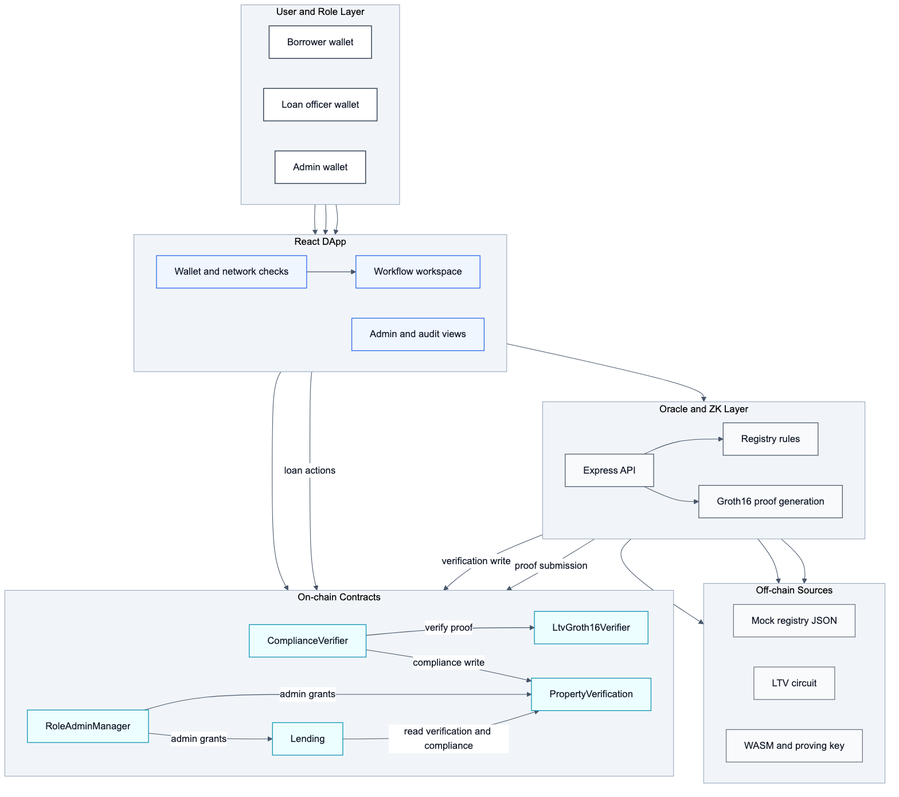
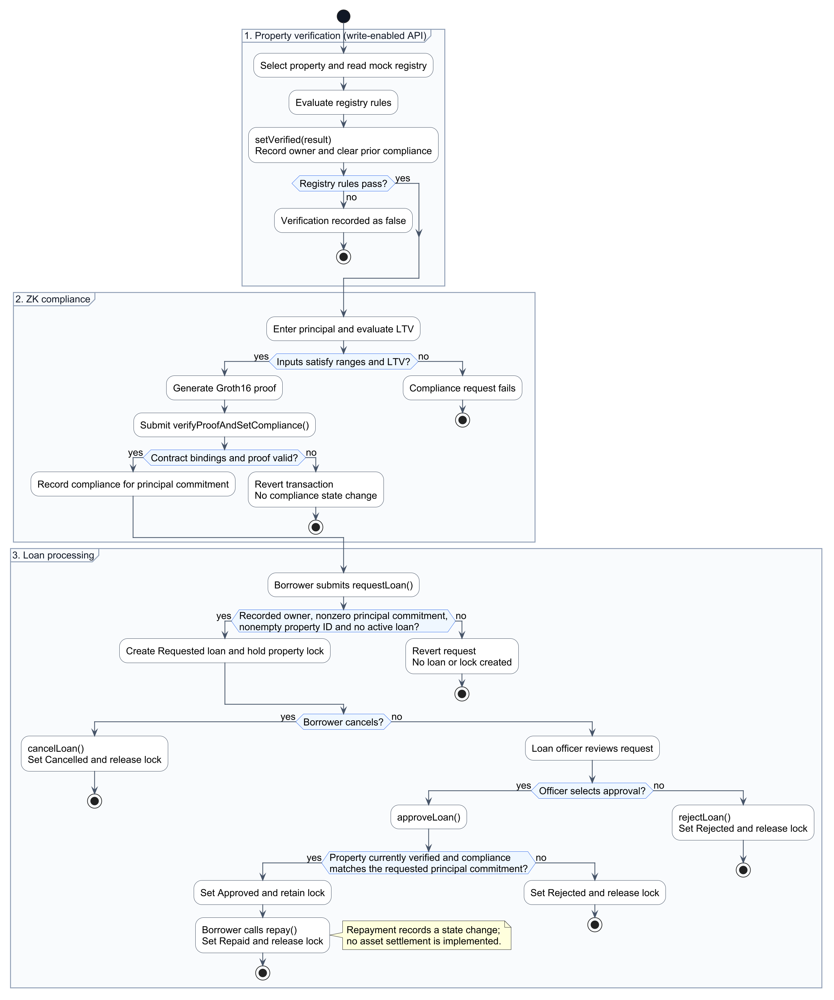
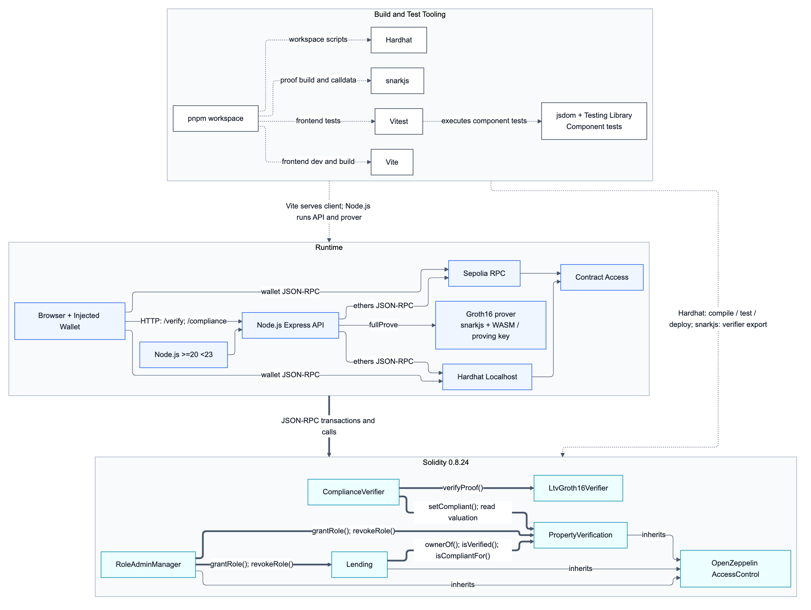
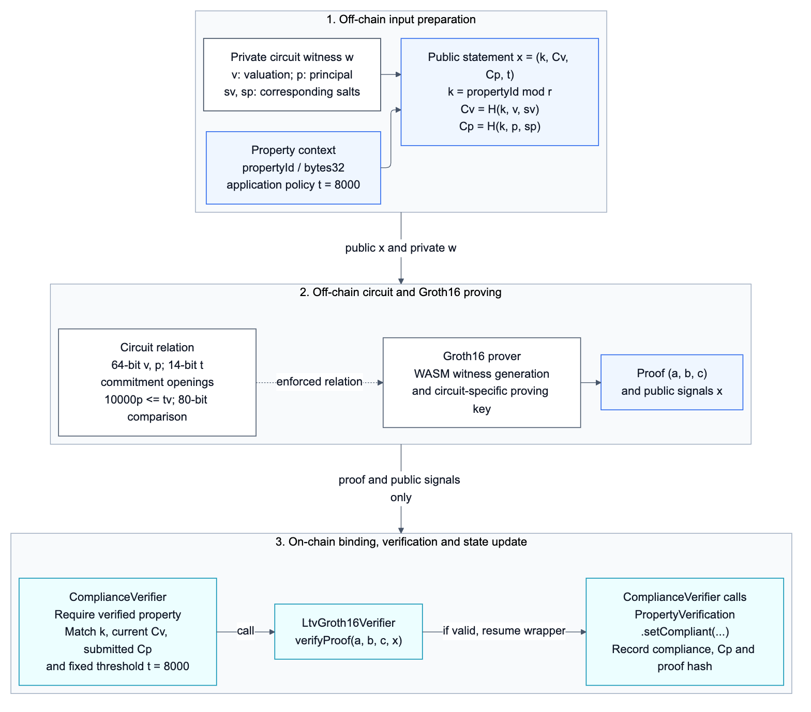
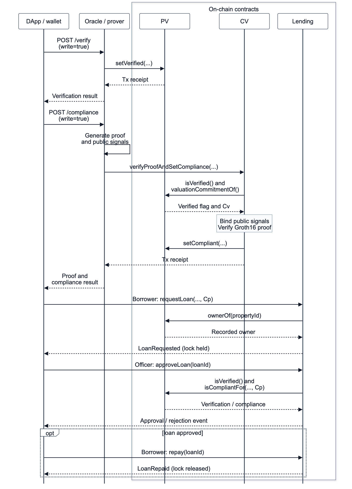
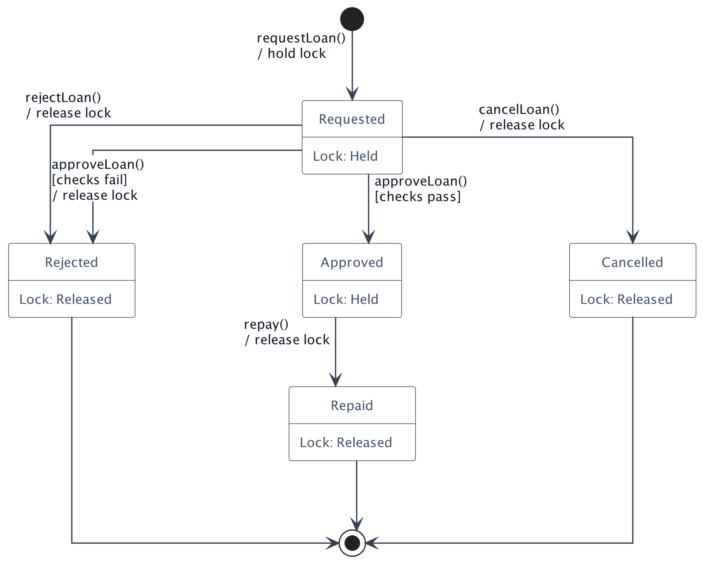

# ProofEstate

ProofEstate is an Ethereum research prototype for real-estate lending with commitment-bound zero-knowledge compliance. It combines a mock property registry, an Oracle service, Groth16 zero-knowledge proof generation, role-gated Solidity contracts, and a React DApp.

[Hosted DApp](https://proofestate.vercel.app/) · [Capstone report](thesis/docx/ProofEstate_FT5007_Capstone_Report.docx) · [Defense slides](slides/proofestate-nus-defense-presentation.pptx)

The author's original thesis, report, defense materials, and research figures are copyright protected and are not offered under an open-source or Creative Commons license. See the [copyright notice](COPYRIGHT.md).

The prototype demonstrates one core lending rule:

```text
loanPrincipal * 10000 <= propertyValue * 8000
```

This is equivalent to proving `loanPrincipal <= 80% of propertyValue` without publishing the plaintext property valuation or loan principal on-chain. The chain stores commitments, proof hashes, ownership, verification/compliance state, and loan lifecycle state.

ProofEstate is a dissertation prototype, not a production lending protocol. Real disbursement, KYC/AML, liquidation, production registry integration, monitoring, and decentralized Oracle governance are intentionally out of scope.

## Contents

- [What It Demonstrates](#what-it-demonstrates)
- [Current Evidence Snapshot](#current-evidence-snapshot)
- [Architecture](#architecture)
- [Quick Start](#quick-start)
- [Local Demo](#local-demo)
- [Sepolia Validation](#sepolia-validation)
- [Frontend](#frontend)
- [Testing](#testing)
- [Benchmark Summary](#benchmark-summary)
- [Core Contracts](#core-contracts)
- [ZK Design](#zk-design)
- [Repository Structure](#repository-structure)
- [Environment Files](#environment-files)
- [Security Notes](#security-notes)
- [Documentation Index](#documentation-index)
- [Limitations](#limitations)
- [License](#license)

## What It Demonstrates

ProofEstate models a lending workflow with four operational roles:

| Role | Responsibility |
| --- | --- |
| Protocol admin | Manages privileged protocol roles |
| Oracle operator | Writes property verification and proof-related data to chain |
| Borrower | Requests loans and manages cancellation and repayment |
| Loan officer | Approves or rejects loan requests |

The end-to-end workflow is:

```text
Property registry data
  -> Oracle verification write
  -> ZK LTV proof generation
  -> On-chain proof verification and compliance write
  -> Borrower loan request
  -> Loan officer approval
  -> Borrower repayment
```

In both local and Sepolia modes, the frontend calls the Oracle API for verification and compliance; the API signs those writes with its server-side key. Borrowers and loan officers sign loan transactions with their own wallets and call `Lending` directly.

Loan requests check the recorded owner, nonzero property ID and principal commitment, and absence of an active loan. Approval checks current verification and compliance for the request's commitment. Failed verification or compliance at approval changes the request to Rejected and releases its lock; authorization and loan-state errors revert.

## Current Evidence Snapshot

The automated evaluation comprises 37 contract and circuit tests, 12 Oracle API tests, and six frontend component tests, revalidated on 2026-10-15 under Node `v22.22.1`. Performance and gas results retain their recorded Node 20 environments and workloads in [docs/evaluation-notes.md](docs/evaluation-notes.md) and [docs/benchmarks/final-benchmarks.md](docs/benchmarks/final-benchmarks.md).

| Evidence | Status |
| --- | --- |
| Contract and circuit tests | 37 passing |
| Oracle API tests | 12 passing |
| Frontend component tests | 6 passing in jsdom |
| Frontend production build | Passing |
| Security-boundary tests | Proof substitution, arithmetic limits, reuse, ownership changes, and mutable compliance state |
| Gas snapshot | Recorded Node 20 test workload; 310,411 gas for proof verification and compliance update |
| ZK compile | Passing with circom `2.2.3` |
| Local readiness check | Passing |
| Local CLI happy path | Passing, final state `Repaid` |
| Formal local benchmark | 2026-09-25 matrix: 5 warm-up + 30 measured runs per correctness case, plus 10/30/50 stability runs |

See:

- [docs/evaluation-notes.md](docs/evaluation-notes.md)
- [docs/benchmarks/final-benchmarks.md](docs/benchmarks/final-benchmarks.md)

## Architecture

### System Architecture



<details>
<summary>Business, technical, proof, interaction, and state diagrams</summary>

### Business Workflow



### Technical Architecture



### ZK Proof Workflow



### End-to-End Interaction Sequence



### Loan State Machine



</details>

The Mermaid and PlantUML sources, rendering instructions, and manuscript figure mapping are in [docs/figures/README.md](docs/figures/README.md).

## Quick Start

Run commands from the repository root using Node 20 from `.nvmrc` and pnpm `10.9.0` from `package.json`:

```bash
nvm use
pnpm install --frozen-lockfile
```

Compile contracts:

```bash
pnpm compile
```

The matching witness WASM, proving key, and generated Solidity verifier are checked in, so the local demo does not require a new Groth16 setup.

To rebuild the ZK artifacts after changing the circuit:

```bash
pnpm zk:build
```

This command recompiles the circuit, creates new setup artifacts and a proving key, exports a matching Solidity verifier, and verifies a sample proof. Recompile and redeploy the contracts before using the new key for on-chain verification. To recompile only the witness WASM and constraint files, use `pnpm zk:compile`.

The ZK build script auto-detects `$HOME/.cargo/bin/circom` when present. If needed, set:

```bash
export CIRCOM_BIN="$HOME/.cargo/bin/circom"
```

For a step-by-step local reproduction, continue with [Local Demo](#local-demo). For public testnet validation, see [Sepolia Validation](#sepolia-validation).

## Local Demo

The local demo is the canonical reproducible path for testing, benchmarking, and project evaluation. It runs a Hardhat chain, deploys contracts locally, starts the Oracle API, and executes the full loan lifecycle.

Terminal 1:

```bash
pnpm chain:local
```

Terminal 2:

```bash
pnpm demo:deploy
pnpm oracle:api
```

Terminal 3:

```bash
pnpm demo:ready
pnpm demo:flow PROP-001 750000
```

Expected final state:

```text
Repaid
```

`pnpm demo:deploy` synchronizes the deployment addresses into `.env.local` and `frontend/.env.local`; these environment files are generated for the local demo. The CLI flow uses local borrower/officer signers and calls the Oracle service functions directly. The HTTP API is exercised separately by API tests, browser requests, and API benchmarks.

For the browser workflow, run `pnpm frontend:dev:local`, open `http://localhost:5173/`, and connect the local borrower account for `PROP-001`. Switch to the loan-officer account for approval. Account addresses are listed in the [deployment guide](docs/deployment-guide.md#local-demo-accounts).

Screenshot evidence for the browser workflow is indexed in [docs/screenshots/README.md](docs/screenshots/README.md).

The [recorded demo video](demo/proofestate-demo.mp4) is stored with Git LFS. With Git LFS installed, `git lfs pull --include="demo/*.mp4"` fetches it. The video is optional for running the application.

## Sepolia Validation

Sepolia is optional public validation, not the primary evidence path. Use it to show that the same contracts and Oracle workflow run on a public Ethereum testnet. Do not mix Sepolia latency with local benchmark tables.

The detailed Sepolia, Vercel, and deployment instructions live in [docs/deployment-guide.md](docs/deployment-guide.md). Never commit private keys or RPC secrets.

### Deploy Or Inspect

Set `SEPOLIA_RPC_URL` in the ignored `.env.sepolia` file, then inspect the recorded Sepolia deployment:

```bash
pnpm sepolia:inspect
```

Inspection checks contract bytecode, roles, selected property state, and recent loan state. To create your own deployment, configure the deployment/Oracle signers and role addresses as described in the [deployment guide](docs/deployment-guide.md#sepolia-deployment), then run `pnpm deploy:sepolia`.

For an existing deployment, `pnpm sepolia:sync` generates the matching frontend environment file without redeploying contracts. Set `VITE_ORACLE_API_URL` in `frontend/.env.sepolia` to the API you intend to use; the synchronization default is `http://localhost:8787`.

### Sepolia Validation Flow

```text
1. Start Oracle API with pnpm oracle:api:sepolia
2. Start frontend with pnpm frontend:dev:sepolia
3. Connect the PROP-011 registry owner's wallet on Sepolia
4. Select PROP-011
5. Run property verification
6. Generate compliance proof with principal 600000
7. Request loan as borrower
8. Switch to an account with the loan-officer role
9. Approve loan
10. Optionally switch back to borrower and repay
```

Sepolia transactions consume Sepolia test ETH. The Oracle pays gas for verification and compliance writes; the borrower pays gas for loan requests and repayment; the loan officer pays gas for approval or rejection.

For the current public deployment table, hosted Oracle URL, Vercel settings, and troubleshooting rules, see [docs/deployment-guide.md](docs/deployment-guide.md).

## Frontend

Run the local DApp against the local Hardhat deployment:

```bash
pnpm frontend:dev:local
```

Run the local DApp against Sepolia:

```bash
pnpm frontend:dev:sepolia
```

Build commands:

```bash
pnpm frontend:build:local
pnpm frontend:build:sepolia
```

The local DApp expects:

- Hardhat RPC at `http://127.0.0.1:8545`;
- Oracle API at `http://localhost:8787`;
- deployment addresses in `frontend/.env.local`.

The Sepolia DApp expects:

- Sepolia RPC in `frontend/.env.sepolia`;
- Oracle API at `VITE_ORACLE_API_URL`;
- Sepolia contract addresses in `frontend/.env.sepolia`.

## Testing

Core commands:

```bash
pnpm compile
pnpm test
pnpm test:oracle
pnpm frontend:test
pnpm frontend:build
pnpm test:gas
pnpm test:all
```

The main contract suite covers:

- role configuration and revocation;
- registry rule evaluation;
- malformed input rejection;
- property verification writes;
- stale compliance clearing;
- Groth16 proof acceptance and tampering rejection;
- public signal mismatch rejection;
- exact 80% LTV, maximum 64-bit values, and overflow rejection;
- proof replay boundaries;
- loan request, approval, rejection, cancellation, and repayment;
- duplicate active-loan locking;
- borrower-only and loan-officer-only actions.

## Benchmark Summary

Formal local benchmark command for the primary compliant path:

```bash
pnpm benchmark:local --warmups=5 --runs=30 --property=PROP-001 --principal=750000 --api=http://127.0.0.1:8787
```

Primary raw data:

```text
docs/benchmarks/raw/local-2026-09-25T08-40-22-730Z.json
```

The final benchmark set also includes 30-run boundary, non-compliant, and invalid-registry cases, plus 10/30/50 repeated-run stability snapshots. See [docs/benchmarks/final-benchmarks.md](docs/benchmarks/final-benchmarks.md) for the complete raw-data matrix.

Primary compliant-path summary:

| Metric | Median | Mean | P95 |
| --- | ---: | ---: | ---: |
| Build verification input | 3.05 ms | 3.22 ms | 4.77 ms |
| Build compliance inputs | 3.73 ms | 4.01 ms | 5.31 ms |
| Generate Groth16 proof | 399.53 ms | 407.55 ms | 469.53 ms |
| Read-only Oracle `/verify` | 5.98 ms | 6.78 ms | 11.45 ms |
| Read-only Oracle `/compliance` | 409.16 ms | 413.27 ms | 480.30 ms |

Correctness matrix summary:

| Case | Property | Principal | Result |
| --- | --- | ---: | --- |
| Compliant | `PROP-001` | 750000 | Proof generated |
| Boundary | `PROP-001` | 784000 | Proof generated at exactly 80% LTV |
| Non-compliant | `PROP-001` | 784001 | Oracle rejection; proof skipped |
| Invalid registry | `PROP-004` | 100000 | Registry-rule rejection; proof skipped |

API timings use `write: false` and exclude transaction submission and confirmation. Direct proving and API compliance use separate proof invocations; their similar latency scale is consistent with proving dominating the successful path, but their median difference does not measure API overhead. Functional tests assert policy behavior; the timing harness records generation and skip outcomes for these workloads.

See [docs/benchmarks/final-benchmarks.md](docs/benchmarks/final-benchmarks.md) for quantile definitions, raw data, the gas workload, circuit size, and frontend bundle size. `pnpm test:gas` measures the current test suite; its aggregate method costs can differ from the recorded gas table when the exercised paths or call counts differ.

## Core Contracts

| Contract | Purpose |
| --- | --- |
| `PropertyVerification` | Stores Oracle-written verification state and verifier-written compliance state |
| `ComplianceVerifier` | Binds public proof signals to on-chain property state and calls the generated Groth16 verifier |
| `LtvGroth16Verifier` | snarkjs-generated verifier for `circuits/ltv.circom` |
| `Lending` | Manages loan requests, approvals, rejections, cancellations, repayments, and active property locks |
| `RoleAdminManager` | Coordinates protocol admin grants and revocations |

Detailed interfaces are documented in [docs/smart-contract-interface-spec.md](docs/smart-contract-interface-spec.md).

## ZK Design

The public signals are:

- `propertyKeyField`;
- `valuationCommitment`;
- `principalCommitment`;
- `maxLtvBps`.

The private inputs are:

- `propertyValue`;
- `loanPrincipal`;
- `valuationSalt`;
- `principalSalt`.

The circuit uses `MiMCSponge(3, 220, 1)` with its MiMC key fixed to zero, 64-bit range checks for valuation and principal, a 14-bit range check for `maxLtvBps`, and an 80-bit product comparison. The property identifier is mapped to the scalar field outside the circuit. The deployed wrapper fixes `maxLtvBps = 8000` and binds the public signals to the property, current valuation commitment, and submitted principal commitment before calling the generated verifier.

Detailed proof design is documented in [docs/zk-proof-design.md](docs/zk-proof-design.md).

## Repository Structure

```text
contracts/
  PropertyVerification.sol
  ComplianceVerifier.sol
  Lending.sol
  RoleAdminManager.sol
  generated/LtvGroth16Verifier.sol

backend/oracle/
  properties.js
  service.js
  contracts.js
  server.js
  cli.js

data/
  properties.localhost.json
  properties.sepolia.json

circuits/
  ltv.circom

zk/
  ltvCircuit.js
  prover.js
  build/
  artifacts/

frontend/
  src/

scripts/
  chain/             # deployment, address synchronization, Sepolia inspection
  local/             # local readiness, wallet workflow, timing benchmarks
  e2e/               # browser smoke tests and layout checks
  thesis/            # manuscript checks, Word builds, and defense slide source
  load-env.js        # shared environment loader
  zk-build.mjs

test/
  proofestate.test.js

docs/
  figures/
  benchmarks/
  screenshots/

thesis/
  thesis.md
  jisa.md
  docx/

slides/
  assets/nus-logo.png
  proofestate-nus-defense-presentation.pptx
```

Run scripts through the `pnpm` commands documented above. `pnpm thesis:check` checks manuscript references, captions, abstract/keyword limits, and timing summaries without writing files; it verifies the referenced archives and also accepts new benchmark runs. `pnpm thesis:docx` rebuilds both Word manuscripts in `thesis/docx` and requires Pandoc and `python-docx`. If the current Python lacks `python-docx`, the builder uses the Codex-managed document runtime when available. Use `pnpm thesis:docx --only thesis` or `--only jisa` to rebuild one manuscript. The two Markdown manuscripts are the content sources; keep content changes there before rebuilding Word.

`pnpm thesis:docx --only report` generates the separate [FT5007 Capstone report](thesis/docx/ProofEstate_FT5007_Capstone_Report.docx) from `thesis/thesis.md`. It adds a formal cover, roman-numbered front matter, and an editable two-level Word table of contents; the main text starts at page 1. The report cover information is stored in `REPORT_COVER` in [scripts/thesis/build-docx.py](scripts/thesis/build-docx.py). This option also requires `pypdf` and LibreOffice to populate and verify contents page numbers; the Codex-managed LibreOffice is used when available. The generated contents already contain verified page numbers. Automatic field updates on opening are disabled; after editing the report in Word, right-click the table of contents and update the entire table. It does not rewrite either original manuscript.

`pnpm thesis:slides` rebuilds the editable 15-slide defense deck from [scripts/thesis/build-slides.mjs](scripts/thesis/build-slides.mjs). The script contains slide content, layout, citations, evidence paths, and the complete read-aloud speaker Notes. Defense citations refer to the full [thesis](thesis/thesis.md) and its implementation or experimental evidence; the JISA manuscript is the separate journal version. The builder reuses the existing DApp screenshots and the NUS logo in `slides/assets`.

The slide builder requires the Codex-bundled `@oai/artifact-tool` presentation runtime (version 2.7.3 or newer), which is separate from the application dependencies and is not installed by `pnpm install`. It detects the managed runtime automatically; `ARTIFACT_TOOL_PATH` can specify the package directory elsewhere. For review, use `pnpm thesis:slides --out <file.pptx> --preview-dir <directory>` to export a copy and slide previews without replacing the final deck. Keep slide edits in the source before rebuilding; rebuilding replaces direct PowerPoint edits.

## Environment Files

Ignored runtime files:

```text
.env.local
.env.sepolia
frontend/.env.local
frontend/.env.sepolia
```

`deployments/localhost.json` and `deployments/sepolia.json` are public address manifests used by the frontend build. They should not contain private keys.

Generated build/runtime folders:

```text
artifacts/
cache/
frontend/dist/
zk/build/
zk/artifacts/
```

The witness files under `zk/build/` and `zk/artifacts/ltv_final.zkey` are checked-in reproduction assets, alongside `contracts/generated/LtvGroth16Verifier.sol`. Other setup artifacts are generated locally.

Do not commit private keys, RPC secrets, or ignored deployment state.

## Security Notes

- The Oracle is centralized and trusted in this prototype.
- Plaintext valuation, principal, and salts are omitted from the chain but exposed through the mock registry and compliant API responses. The implementation does not establish application-wide confidentiality.
- The API has no caller authentication. Client-supplied owner/role filters do not authorize privileged signer use.
- The browser never needs private keys beyond the user's connected wallet.
- `ORACLE_PRIVATE_KEY` must remain server-side only.
- Hardhat default accounts are public and must not be funded on public networks.
- Sepolia is useful for public transaction evidence, but it is not a benchmark environment.
- RPC endpoints used in frontend env files are public to browser users.

For deeper analysis, see [docs/security-evaluation-report.md](docs/security-evaluation-report.md).

## Documentation Index

| Document | Purpose |
| --- | --- |
| [docs/evaluation-notes.md](docs/evaluation-notes.md) | Final functional, environment, and gas evidence |
| [docs/benchmarks/final-benchmarks.md](docs/benchmarks/final-benchmarks.md) | Formal local benchmark results |
| [docs/zk-proof-design.md](docs/zk-proof-design.md) | ZK statement, signals, circuit behavior, replay/freshness boundaries |
| [docs/smart-contract-interface-spec.md](docs/smart-contract-interface-spec.md) | Contract interface and revert/event specification |
| [docs/security-evaluation-report.md](docs/security-evaluation-report.md) | Threat model, mitigations, assumptions, residual risks |
| [docs/design-decisions.md](docs/design-decisions.md) | Architecture decisions, alternatives, and qualitative comparison |
| [docs/limitations-and-extensions.md](docs/limitations-and-extensions.md) | Prototype boundaries, future work, and candidate applications |
| [docs/deployment-guide.md](docs/deployment-guide.md) | Local and Sepolia reproduction guide |
| [docs/figures/README.md](docs/figures/README.md) | Diagram sources, rendering commands, and manuscript figure mapping |
| [docs/screenshots/README.md](docs/screenshots/README.md) | Local DApp screenshot evidence index |
| [thesis/thesis.md](thesis/thesis.md) | Final Markdown thesis text using the final benchmark evidence |
| [thesis/jisa.md](thesis/jisa.md) | JISA manuscript and submission security evidence |
| [thesis/docx/ProofEstate_Thesis_Full_Version.docx](thesis/docx/ProofEstate_Thesis_Full_Version.docx) | Editable full thesis |
| [thesis/docx/ProofEstate_JISA_Manuscript.docx](thesis/docx/ProofEstate_JISA_Manuscript.docx) | Editable JISA manuscript |
| [thesis/docx/ProofEstate_FT5007_Capstone_Report.docx](thesis/docx/ProofEstate_FT5007_Capstone_Report.docx) | Capstone report with cover, deployment link, and contents |
| [slides/proofestate-nus-defense-presentation.pptx](slides/proofestate-nus-defense-presentation.pptx) | 15-slide NUS-style defense deck with complete read-aloud speaker notes |

## Limitations

- Registry data is mocked.
- Oracle trust is centralized.
- Groth16 setup artifacts are prototype-grade.
- No real ETH/ERC20 disbursement is implemented.
- No production KYC/AML/DID is implemented.
- No liquidation, delinquency, or risk engine is implemented.
- Proof freshness is not bound to expiry, borrower, nonce, or loan ID.
- Ownership is checked at request time, without approval-time revalidation.
- Each property has one mutable compliance record; another principal's accepted proof replaces it.
- Approved loans retain their state and lock after later verification or compliance changes.
- Sepolia support is testnet validation only.

See [docs/limitations-and-extensions.md](docs/limitations-and-extensions.md) for the full limitations and future-work discussion.

## License

The author's original academic materials, including the thesis, manuscript, capstone report, defense slides and speaker notes, and research figures, are reserved under copyright. No general permission to reproduce, adapt, translate, redistribute, or republish those materials is granted. Prior written permission is required unless the use is permitted by applicable law, GitHub's Terms of Service, or a separate existing license. Attribution alone does not authorize uses that otherwise require permission. See [COPYRIGHT.md](COPYRIGHT.md) for scope and contact details.

Software files and third-party components retain their existing licenses and copyright notices, including the MIT notices in the business contracts and the GPL notice in the generated Groth16 verifier. This academic-material notice does not revoke those permissions or introduce a new repository-wide software license. Third-party marks and materials, including the NUS logo, remain subject to their respective owners' rights.
