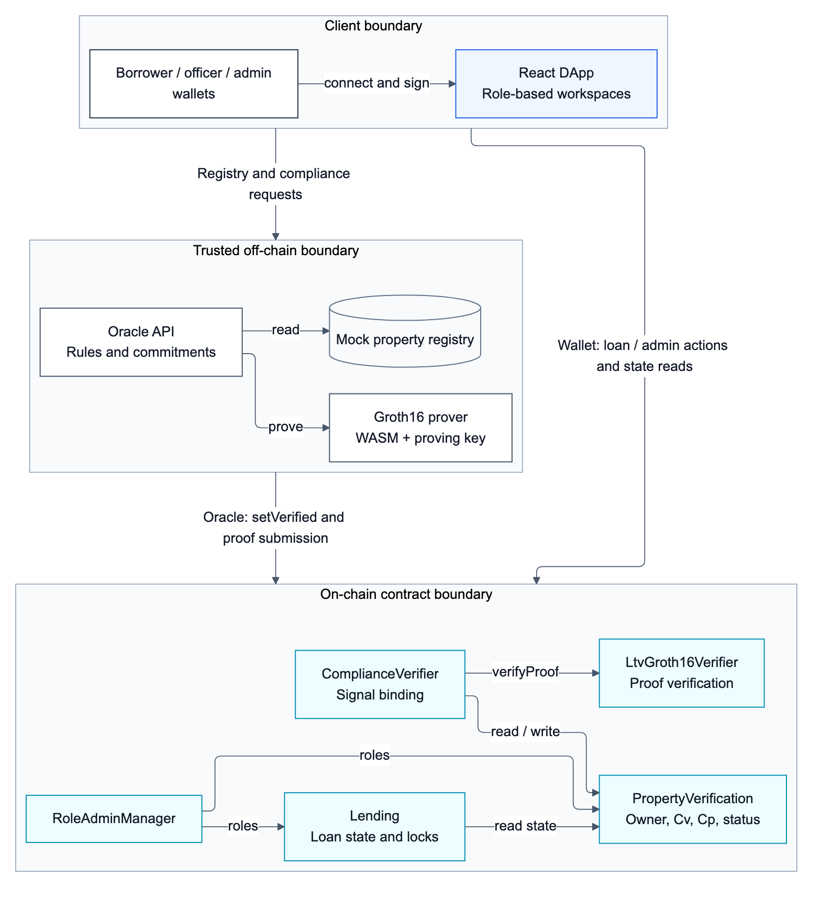
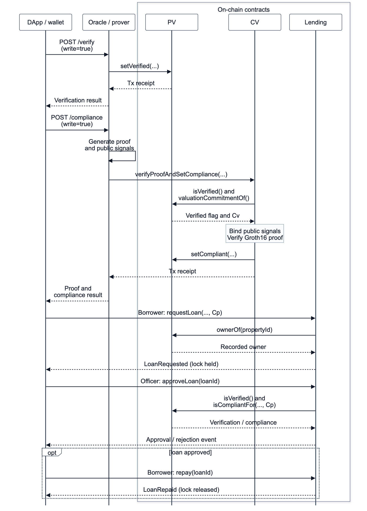

# ProofEstate: Blockchain-Based Real Estate Lending Platform with ZK Compliance and Property Verification

**Manuscript type:** Research Article  
**Author:** ZHANG TIANYI\
**Affiliation:** National University of Singapore, Singapore\
**Corresponding author:** ZHANG TIANYI, e1554005@u.nus.edu  
**Source code:** https://github.com/Alan42x/proofestate

## Abstract

Public blockchains can audit lending decisions, but direct verification of a loan-to-value (LTV) rule exposes financial inputs. A zero-knowledge proof must be bound to the relevant application state before its result can safely authorize lending. This paper presents ProofEstate, a reproducible real-estate lending prototype combining a trusted oracle, MiMC commitments, a Groth16 proof, and role-gated smart contracts. The circuit proves that a committed principal does not exceed 80% of a committed valuation. Before writing compliance, the verifier checks the property field identifier, current valuation commitment, principal commitment, and fixed policy threshold. Approval requires current verification and compliance for the request's commitment. The evaluation includes 37 passing contract and circuit tests, 12 oracle API tests, six frontend component tests, a complete local workflow, and sequential timing sessions. In the primary 30-run session, median proof generation and read-only oracle compliance response times are 399.53 ms and 409.16 ms; these timings exclude blockchain transactions. The measured average cost of proof verification and compliance update is 310,411 gas. Security-boundary tests demonstrate substitution rejection and expose limits in freshness, ownership revalidation, and mutable compliance state. The prototype omits financial plaintext from the blockchain but exposes values through its mock registry and unauthenticated API; application-wide confidentiality is not established. The result is a concrete pattern for binding private proof relations to public workflow state, conditional on oracle, setup, commitment, and role assumptions.

## Keywords

Zero-knowledge proofs; smart contracts; loan-to-value verification; oracle security; blockchain lending; selective disclosure

## 1. Introduction

Blockchain-based financial applications are attractive when multiple parties need a shared record of decisions, permissions, and state transitions. A lending workflow is a representative example: a borrower requests credit against collateral, an independent source verifies the collateral, a compliance rule determines whether the requested amount is acceptable, and an authorized lender approves or rejects the loan. Smart contracts can make these transitions auditable and resistant to unilateral modification.

The same transparency that improves auditability creates a security and privacy problem. In real-estate lending, property valuation and requested principal are sensitive financial facts. A direct on-chain implementation would disclose these values through calldata, event logs, or contract storage. Even if a contract stores only derived decisions, a naïve workflow may still leak values during verification or allow compliance evidence to be replayed for a different asset, a stale valuation, or a different loan amount. The security challenge is therefore not only to hide the numerical values, but also to ensure that a private compliance proof is bound to the exact on-chain state transition it authorizes.

This paper studies that challenge through ProofEstate, an end-to-end prototype for privacy-preserving real-estate lending compliance. ProofEstate enforces one bounded policy: the requested principal must be no more than 80% of the property valuation. The policy is intentionally narrow because it isolates the core application-security question: can an Ethereum-compatible contract enforce a compliance claim over private financial values while retaining enough public state to support auditability and lending workflow control?

ProofEstate combines commitments, a zero-knowledge proof, a trusted oracle, and role-gated contracts. The proof has four public signals: a property identifier mapped into the scalar field, the valuation commitment, the principal commitment, and the LTV threshold in basis points. Valuation, principal, and salts are private circuit inputs, although the surrounding prototype API exposes them. The verifier checks the public signals against the current property record and submitted principal commitment. Ownership is checked when the borrower requests a loan; approval subsequently checks verification and compliance for that request's commitment. This separation makes both the guarantee and the ownership continuity limitation explicit.

The contribution is an information-security application pattern rather than a new proof system. ProofEstate shows how to connect a conventional off-chain compliance source to an auditable on-chain workflow without publishing the sensitive values that determine compliance. The paper makes four contributions:

1. It specifies a compliance architecture that omits valuation and principal plaintext from the blockchain while enforcing a proof-backed lending decision.
2. It makes the proof-binding design and its conditional security argument explicit, including the distinction between state reset and proof freshness.
3. It implements a complete prototype with Solidity contracts, a Circom/Groth16 circuit, a Node.js oracle service, and a React application covering borrower, loan-officer, oracle, and administrator flows.
4. It provides reproducible local measurements and executable security-boundary tests, including accepted behaviors that limit the system's confidentiality and approval guarantees.

The remainder of the paper is organized as follows. Section 2 reviews related work. Section 3 defines the system model, design requirements, and threat model. Section 4 presents the architecture. Section 5 describes the implementation. Section 6 reports the evaluation. Section 7 analyzes security and privacy properties. Section 8 discusses limitations and production hardening. Section 9 concludes.

## 2. Background and related work

### 2.1 Smart contracts and blockchain lending

Blockchains provide a shared ledger whose transactions can be independently checked [1]. Ethereum-compatible smart contracts extend this model with programmable state machines [2,3]. Contract state can encode loan requests, approvals, repayment status, and role-restricted administrative operations. Decentralized finance protocols have demonstrated that collateralized lending can be automated through smart contracts [4,5]. Existing DeFi lending systems, however, usually operate over liquid on-chain assets whose values and balances are either public or obtained from price feeds. Real-estate lending differs because the collateral is an off-chain asset and the valuation is a sensitive value derived from external records.

### 2.2 Oracles and off-chain facts

Smart contracts cannot directly inspect property registries, appraisal records, credit documents, or other off-chain facts. Oracle systems bridge this gap by importing external data into contract execution. Prior work has studied authenticated data feeds and oracle networks, including Town Crier, DECO, and decentralized oracle-network architectures [6–8]. ProofEstate follows this line of work but focuses on a narrower application-security boundary: the oracle is trusted to observe the property registry and private values, while the contract verifies that the proof and on-chain state are consistently bound before updating compliance. The prototype therefore exposes a clear trust boundary instead of assuming that oracle decentralization has already been solved.

### 2.3 Commitments and zero-knowledge proofs

Commitments can bind a system to a value, with hiding additionally dependent on their construction and randomness. Zero-knowledge proofs establish statements about private witness values. Groth16 provides succinct pairing-based proofs [9], while MiMC is suited to arithmetic circuits because it has low multiplicative complexity [10]. Zerocash and Hawk show how such proofs can protect blockchain values or contract inputs [11,12]. ProofEstate applies these foundations to an illustrative lending predicate. Its fixed 80% threshold is an experimental policy parameter, not a claim of compliance with a particular jurisdiction's mortgage regulations.

### 2.4 Gap addressed by this paper

ProofEstate examines practical binding between private compliance evidence and public lending state. Its contribution combines an explicit statement over property, valuation commitment, principal commitment, and threshold with checks against the state used for approval. The related systems provide architectural context; the experiments characterize this integration and its security boundaries.

## 3. System model, requirements and threat model

### 3.1 Actors

ProofEstate models four operational roles.

*Table 1. Operational actors.*

| Actor | Responsibility |
| --- | --- |
| Borrower | Requests a loan against a property recorded as owned by the borrower. |
| Oracle operator | Reads registry data, computes commitments, generates proofs, and writes privileged verification transactions. |
| Loan officer | Approves or rejects requested loans through a role-gated function. |
| Protocol administrator | Grants and revokes privileged protocol roles. |

The public blockchain records verification state, commitments, compliance state, proof hashes, loan state, and role-governed actions. Plaintext valuation, principal, and private witness material, including salts, are kept off chain.

### 3.2 Design requirements

The design is driven by six requirements.

**R1: omission of financial plaintext from the blockchain.** Property valuation and requested principal must not be directly published in transaction arguments, contract storage, or events. This does not by itself establish confidentiality across the API and registry.

**R2: on-chain enforceability.** A loan officer must be unable to approve a requested loan unless the relevant compliance state is present on chain.

**R3: property-state binding.** Compliance evidence must be tied to the current property record and valuation commitment.

**R4: principal binding.** Compliance evidence must be tied to the exact principal commitment used by the loan request.

**R5: role separation.** Property verification, compliance writing, loan approval, borrower actions, and role administration must be separated by access-control checks.

**R6: reproducibility.** The prototype must include tests, benchmark artifacts, and documentation sufficient for independent inspection of the implemented workflow.

### 3.3 Threat model

The adversary may observe all public blockchain data, submit transactions to public contract functions, replay previously observed proof calldata, submit malformed oracle API requests, attempt to approve loans without the required role, request loans against properties owned by other accounts, or attempt to use compliance evidence for a different property or principal commitment. The adversary may also attempt to exploit stale compliance state after a property verification record changes.

The oracle is trusted to read the correct registry record and to handle plaintext values during proof generation. The prototype does not protect against a compromised oracle signing key, a dishonest property registry, a malicious trusted setup, a broken underlying proof system, Ethereum consensus failure, or implementation bugs in external dependencies. The model isolates compliance binding from source authenticity, infrastructure compromise, and dependency correctness.

### 3.4 Conditional security claim

Assume Groth16 soundness for the deployed circuit, uncompromised setup, commitment binding, an honest oracle valuation record, and maintained roles in which only the designated verifier writes compliance. An Approved transition requires a currently verified property and a compliant record for the loan request's principal commitment. That record must have been accepted for a proof satisfying the 80% LTV relation and the current valuation commitment.

The claim concerns the approval transition. It does not establish approval-time ownership, proof age, confidentiality of API data, authentic legal title, ongoing collateral sufficiency, real settlement, or regulatory completeness. Section 7 presents the control-flow argument and executable boundaries.

## 4. ProofEstate architecture

### 4.1 Workflow overview

ProofEstate implements the workflow summarized in Figure 1:

```text
Mock property registry
  -> oracle verification and valuation commitment
  -> zero-knowledge LTV proof generation
  -> on-chain proof verification and compliance write
  -> borrower loan request
  -> loan-officer approval or rejection
  -> repayment or terminal loan state
```

The browser application never receives oracle signing credentials. In local and testnet configurations, the frontend calls the oracle API, and the oracle service signs privileged transactions with its configured key. The on-chain contracts still enforce role checks, so contract authorization does not depend on frontend behavior.

{width=6.2in}

*Figure 1. ProofEstate architecture and the registry, oracle/prover, client, and contract boundaries. The API handles plaintext witness data; the on-chain layer receives commitments, proofs, and public signals.*

### 4.2 Commitment design

For a property identifier mapped to a field element `propertyKeyField`, the oracle computes two MiMC commitments:

```text
valuationCommitment = MiMC(propertyKeyField, propertyValue, valuationSalt)
principalCommitment = MiMC(propertyKeyField, loanPrincipal, principalSalt)
```

The property key is included in both commitments. The valuation commitment is stored in the verification record, and the request's principal commitment is checked against the compliance record. Property identifiers are Keccak-derived 256-bit values reduced modulo the BN254 scalar field; binding assumes the identifiers used do not collide under that mapping. The valuation salt is deterministic and publicly computable from available property context, so strong valuation hiding is not established. Random principal salts are used by default, but the current API returns them with proof inputs. Section 7.2 distinguishes proof privacy from application confidentiality.

### 4.3 Zero-knowledge statement

The circuit takes four public signals:

```text
propertyKeyField
valuationCommitment
principalCommitment
maxLtvBps
```

It takes four private inputs:

```text
propertyValue
loanPrincipal
valuationSalt
principalSalt
```

Writing `p` for principal, `v` for valuation, and `t` for the threshold in basis points, the circuit recomputes both commitments and enforces:

$$10{,}000p \le tv. \qquad (1)$$

The wrapper fixes `maxLtvBps = 8000`. The circuit constrains valuation and principal to unsigned 64-bit integers and the threshold to 14 bits. Each scaled product is below `2^78`; adding one to the right-hand side for an inclusive comparison remains within the 80-bit comparator and below the scalar-field modulus. Thus the comparison represents the intended integer inequality without field wraparound. Salts are field elements. The circuit itself permits zero valuation or principal; the honest oracle's minimum-valuation and positive-principal rules are separate application checks.

### 4.4 On-chain proof binding

The `ComplianceVerifier` contract is the critical binding component. Before calling the generated Groth16 verifier, it checks that:

1. the property is currently verified;
2. public signal 0 equals the contract's field mapping of the property identifier;
3. public signal 1 equals the current on-chain valuation commitment;
4. public signal 2 equals the submitted principal commitment;
5. public signal 3 equals the fixed `MAX_LTV_BPS` value.

Only after these checks pass does the contract call the generated verifier and write compliance state through the property-verification contract. This ordering prevents a valid proof from being detached from the property, valuation commitment, principal commitment, or policy threshold it was meant to authorize. Figure 2 places these checks within the end-to-end workflow.

{width=6.2in}

*Figure 2. Representative end-to-end sequence with write-enabled API calls. PV denotes PropertyVerification; CV, ComplianceVerifier; Cv and Cp, the valuation and principal commitments. The oracle/prover groups registry lookup and proving; CV summarizes binding and generated-verifier execution. Section 4.5 describes loan-state alternatives.*

### 4.5 Lending-state enforcement

The lending contract separates request and approval. Request checks the recorded owner, a nonzero commitment, and the active-loan lock, but does not require verification or compliance. Approval requires the officer role, Requested state, current verification, and compliance for the same principal commitment. A failed verification or compliance check changes the loan to Rejected and releases the lock rather than reverting. Ownership is not rechecked at approval. There is one mutable compliance record per property, so another principal's accepted proof can invalidate a pending request. Approved loans are not automatically revalidated after later registry or compliance changes. Repayment records a state transition; it does not transfer funds.

### 4.6 Data visibility boundary

*Table 2. Data visibility across the chain and application.*

| Data item | Visibility |
| --- | --- |
| Property identifier | Public on chain |
| Borrower address | Public on chain |
| Property valuation | Off chain; exposed in the mock registry and oracle responses |
| Requested principal | Off chain; exposed in compliant API proof inputs |
| Valuation salt and principal salt | Private circuit inputs; exposed in compliant API responses |
| Valuation commitment | Public on chain |
| Principal commitment | Public on chain |
| Proof hash | Public on chain |
| Compliance status | Public on chain |
| Loan lifecycle state | Public on chain |

The demonstrated property is omission of financial plaintext from the chain. A public observer with access to the artifact registry or unauthenticated API can recover these values. Wallet, property, timing, and lifecycle metadata remain public, so neither application-wide confidentiality nor borrower anonymity is demonstrated.

## 5. Implementation

ProofEstate is implemented as a reproducible local-first software artifact with Solidity contracts, a Node.js oracle service, a Circom circuit, generated Groth16 verifier code, scripts, tests, benchmark artifacts, and a React frontend.

### 5.1 Smart contracts

`PropertyVerification` stores the current verification record. The oracle role writes verification state, owner, evidence hash, and valuation commitment. Every refresh clears compliance and principal binding. A proof bound to a different valuation commitment then fails the wrapper check, but an old proof remains reusable if its valuation commitment is unchanged.

`ComplianceVerifier` receives Groth16 proof calldata, performs the public-signal binding checks, calls the generated verifier, hashes the accepted proof, and writes compliance state. It uses a constant `MAX_LTV_BPS = 8000` and rejects public-signal mismatches before invoking the verifier.

`Lending` stores loan requests and lifecycle state. It checks property ownership at request time, enforces one active loan per property, restricts approval and rejection to the loan-officer role, and checks compliance for the exact principal commitment before approval.

`RoleAdminManager` coordinates administrative grants and prevents removal of its final manager administrator. Individual role operations can still create partial administration across contracts, so this safeguard does not prove complete administrative continuity [15].

### 5.2 Oracle service

The oracle loads mock registry records, validates inputs, computes commitments, generates proofs, and optionally writes transactions. It exposes property-listing, verification, and compliance endpoints. In write mode it signs privileged transactions with its configured key; read-only responses do not write to chain. Both modes can return plaintext data, and a compliant response includes witness values and salts. These interfaces have input validation but no caller authentication or authorization to use the signer.

### 5.3 Circuit and proving pipeline

The LTV circuit is written in Circom [16] and compiled for BN254. It uses MiMC Sponge commitments, range checks, and a comparator. The generated Solidity verifier is deployed separately and called by `ComplianceVerifier`. Proof generation uses `snarkjs.groth16.fullProve` and a WebAssembly witness generator [17]. The checked-in setup is a prototype artifact; no independently audited ceremony or toxic-waste disposal assurance is claimed.

### 5.4 Frontend and operational views

The React application exposes borrower, loan-officer, administrator, readiness, and audit views. The frontend helps exercise the workflow but is not trusted for security. Contract role checks, proof verification, and oracle signing boundaries remain server-side or on-chain.

### 5.5 Reproducibility materials

The repository includes contract tests, oracle API tests, frontend tests, build scripts, deployment scripts, local workflow scripts, benchmark summaries, raw benchmark JSON, architecture figures, and evaluation notes. The local evaluation uses deterministic development-chain accounts and a mock registry to support independent inspection of the complete compliance path without requiring public-chain funds or external property data.

## 6. Evaluation

### 6.1 Evaluation questions

The evaluation addresses five questions.

**EQ1:** Does the prototype enforce the intended success and failure paths for verification, compliance, and loan approval?

**EQ2:** Do boundary and rejection cases behave correctly at and around the 80% LTV threshold?

**EQ3:** What is the local latency of the oracle verification and compliance path, and how stable is the repeated local proof-generation workload?

**EQ4:** What is the gas cost of the on-chain verification and lending functions?

**EQ5:** What are the size and structure of the implemented zero-knowledge circuit?

### 6.2 Experimental setup

The evaluation is local-first. Local execution provides deterministic accounts, reproducible deployment, stable gas measurement, and independence from public RPC availability, faucet balances, and testnet congestion. The primary compliant-path benchmark command is:

```bash
pnpm benchmark:local --warmups=5 --runs=30 \
  --property=PROP-001 --principal=750000 \
  --api=http://127.0.0.1:8787
```

The correctness-matrix commands are:

```bash
pnpm benchmark:local --warmups=5 --runs=30 \
  --property=PROP-001 --principal=784000 \
  --api=http://127.0.0.1:8787
pnpm benchmark:local --warmups=5 --runs=30 \
  --property=PROP-001 --principal=784001 \
  --api=http://127.0.0.1:8787
pnpm benchmark:local --warmups=5 --runs=30 \
  --property=PROP-004 --principal=100000 \
  --api=http://127.0.0.1:8787
```

The bounded repeated-run stability commands use the compliant path with 10, 30, and 50 measured runs. The first five iterations in each run are warm-up runs and are excluded from the summary. The measured workload uses property `PROP-001`, whose mock registry valuation is `980000`. Under an 80% policy, the maximum compliant principal is `784000`, so principal `750000` exercises the successful compliance path, principal `784000` tests the exact boundary, and principal `784001` tests the one-unit-above rejection path.

Each iteration measures stages sequentially. Direct proving and API compliance generate separate proofs. API requests use `write: false`, excluding transaction submission and confirmation. Medians and P95 use nearest-rank quantiles (`ceil(p*n)`), and standard deviation uses denominator `n`. For even `n`, this median is the lower central observation. P95 is omitted for `n < 20`. No confidence intervals or inferential comparison are reported.

The six raw JSON files retain environment, workload parameters, observations, and source commit `5f512070cbfc8c0b40d50d2be50d6595b17f29a7` with `dirty: true`. Their recorded untracked paths concern benchmark/documentation artifacts; the dirty snapshot is not an immutable executable release. The evaluation notes map each result to its raw file. Automated functional suites were executed under Node v22.22.1; latency and gas measurements use Node 20 and their recorded workloads. Each evidence type is reported with its own runtime and measurement scope.

*Table 3. Local performance-measurement environment.*

| Item | Value |
| --- | --- |
| OS | Darwin 23.1.0 x64 |
| CPU | Intel Core i7-9750H CPU at 2.60 GHz |
| Node.js | v20.20.2 |
| pnpm | 10.9.0 |
| Hardhat | 2.28.6 |
| snarkjs | 0.7.6 |
| circom | 2.2.3 |
| Network | local Hardhat chain and local Oracle API |
| Primary measured runs | 30 |
| Correctness-matrix measured runs | 30 per case |
| Stability measured runs | 10, 30, and 50 |

### 6.3 Functional evidence

*Table 4. Functional evaluation results.*

| Evidence | Result |
| --- | --- |
| Contract and circuit tests | 37 passing |
| Oracle API tests | 12 passing |
| Frontend tests | 6 passing |
| Frontend production build | Passing |
| Gas snapshot | Passing |
| ZK compile | Passing |
| Local readiness check | Passing |
| Local end-to-end workflow | Passing, final state `Repaid` |

The automated evaluation comprises 37 contract and circuit tests, 12 oracle API tests, and six frontend component tests. Contract coverage includes roles, verification, proof acceptance, commitment mismatch, tampered proofs, compliance reset, loan states, active locks, and administrator safeguards. Security-boundary cases cover cross-property substitution, threshold-signal tampering, unchanged-commitment proof reuse, owner changes before approval, principal replacement, and compliance reset after approval. Oracle tests cover readiness, property filtering, input validation, and selected rejection responses. Frontend tests cover wallet-gate and table/detail components, not the full browser transaction lifecycle.

All contract tests share `test/proofestate.test.js`. Arithmetic tests verify the exact 80% boundary on chain and circuit rejection one unit above it, the maximum 64-bit valuation and its maximum compliant principal, and valuation/principal overflow. Consistent commitments are recomputed before direct proving, so these observations test circuit constraints independently of API validation. The principal overflow case uses a valid raw-circuit policy input of 10001 to satisfy the inequality and isolate the range constraint; the application wrapper requires 8000.

### 6.4 Scenario and boundary evidence

`PROP-001` has a mock registry valuation of `980000`. Under the 80% LTV rule, the maximum compliant principal is `784000`. The matrix therefore tests a compliant principal, the exact boundary, a one-unit-above-boundary rejection, and a registry-failure rejection.

*Table 5. Policy scenarios and recorded proving behavior.*

| Scenario | Property | Principal | Policy expectation | Recorded proving behavior |
| --- | --- | ---: | --- | --- |
| Compliant | `PROP-001` | 750000 | Within 80% limit | Proof generated |
| Exact boundary | `PROP-001` | 784000 | Equals 80% limit | Proof generated |
| Above boundary | `PROP-001` | 784001 | Exceeds 80% limit | Proving skipped: non-compliant |
| Registry failure | `PROP-004` | 100000 | Encumbrance rule fails | Proving skipped: `NO_ENCUMBRANCE` |

Each scenario has 30 measured iterations and no recorded timing exceptions. Valuation and principal use the same abstract integer unit; no currency conversion or floating-point monetary arithmetic is performed.

Passing scenarios generate proofs; rejected scenarios skip proving. Here “failures” means caught exceptions or non-success HTTP status, not policy rejection. The timing harness does not independently assert every response's decision or verify each proof on chain. The recorded skip reasons and implementation tests provide separate evidence of policy behavior. Registry rejection is an oracle rule, not a predicate proved by the LTV circuit.

### 6.5 Latency results

Primary compliant path: `PROP-001`, principal `750000`, five warm-up iterations and 30 measured iterations, with no recorded timing exceptions. All values below are milliseconds; minimum and maximum values remain in the raw artifact.

*Table 6. Primary sequential latency measurements in milliseconds.*

| Stage | Median | Mean | P95 | Standard deviation |
| --- | ---: | ---: | ---: | ---: |
| Verification input | 3.05 | 3.22 | 4.77 | 1.09 |
| Compliance inputs | 3.73 | 4.01 | 5.31 | 0.79 |
| Groth16 proof | 399.53 | 407.55 | 469.53 | 24.66 |
| Read-only `/verify` | 5.98 | 6.78 | 11.45 | 1.91 |
| Read-only `/compliance` | 409.16 | 413.27 | 480.30 | 22.65 |

Proof generation and successful compliance responses have similar latency scales, whereas input construction takes a few milliseconds. This is consistent with proving dominating the successful path. Their medians cannot be subtracted to estimate API overhead because they time separate proof invocations. Independent invocations also explain why the boundary-session API median can be lower than the direct-proof median.

Boundary and rejection paths behave as expected:

*Table 7. Boundary and rejection-path timings.*

| Case | Metric | n | Fail. | Median ms | Mean ms | Notes |
| --- | --- | ---: | ---: | ---: | ---: | --- |
| Boundary | Generate Groth16 proof | 30 | 0 | 437.08 | 471.37 | Proof generated at exactly 80% LTV |
| Boundary | Oracle `/compliance` latency | 30 | 0 | 432.62 | 451.57 | Includes proof generation |
| Non-compliant | Build compliance inputs | 30 | 0 | 3.24 | 3.37 | Rejects above 80% LTV |
| Non-compliant | Oracle `/compliance` latency | 30 | 0 | 5.38 | 5.54 | Proof generation skipped |
| Invalid registry | Build compliance inputs | 30 | 0 | 0.19 | 0.19 | Fails registry validation |
| Invalid registry | Oracle `/compliance` latency | 30 | 0 | 1.56 | 1.66 | Proof generation skipped |

The repeated-run stability snapshot uses the compliant path with the same local Oracle API:

*Table 8. Sequential timing-session summaries.*

| Measured runs | Fail. | Median proof ms | Mean proof ms | P95 proof ms | Median `/compliance` ms | P95 `/compliance` ms |
| ---: | ---: | ---: | ---: | ---: | ---: | ---: |
| 10 | 0 | 441.43 | 455.58 | n/a | 428.45 | n/a |
| 30 | 0 | 399.53 | 407.55 | 469.53 | 409.16 | 480.30 |
| 50 | 0 | 406.01 | 413.36 | 440.06 | 408.36 | 475.02 |

The 10/30/50-run results show zero failures and similar median proof-generation latency. They characterize repeated local proof-generation stability, not production scalability or concurrent public-chain throughput.

### 6.6 Gas results

Gas was measured with the Hardhat gas reporter in the local test suite.

*Table 9. Method gas averages for the measured workload.*

| Contract | Method | Average gas |
| --- | --- | ---: |
| `PropertyVerification` | `setVerified` | 115,996 |
| `ComplianceVerifier` | `verifyProofAndSetCompliance` | 310,411 |
| `Lending` | `requestLoan` | 233,609 |
| `Lending` | `approveLoan` | 81,464 |
| `Lending` | `cancelLoan` | 52,694 |
| `Lending` | `rejectLoan` | 52,620 |
| `Lending` | `repay` | 57,219 |
| `RoleAdminManager` | `grantProtocolAdmin` | 120,499 |
| `RoleAdminManager` | `revokeProtocolAdmin` | 55,099 |

The 310,411-gas average includes signal checks, pairing verification, compliance writes, and events; it is not pure verifier gas. Reporter averages aggregate the measured transaction workload. Approval-method calls can cover approval and rejection paths, and verification writes span different storage states. These results describe the workload rather than a guaranteed cost for every successful transaction. Economic feasibility at a particular gas price or public-network throughput is not established.

### 6.7 Circuit size

`snarkjs r1cs info` reports the following circuit size.

*Table 10. Circuit structure.*

| Metric | Value |
| --- | ---: |
| Curve | bn-128 |
| Wires | 4,198 |
| Constraints | 4,196 |
| Private inputs | 4 |
| Public inputs | 4 |
| Public outputs | 0 |

The circuit is intentionally small because it proves one inequality and two commitment openings. Adding registry attestations, borrower binding, expiry, nonces, multiple policy rules, or KYC predicates would increase circuit size and proving cost.

### 6.8 End-to-end workflow

The local CLI happy path completes the full sequence:

```text
oracle verification
-> compliance proof generation
-> on-chain proof verification
-> loan request
-> loan officer approval
-> repayment
```

One local CLI run for `PROP-001` with principal `750000` completed in 1.82 seconds and ended in Repaid state. This single observation includes local transactions as well as proving; it is distinct from the read-only API benchmark and is not a replicated latency estimate or a measure of public-chain finality. Repayment changes state without moving assets.

### 6.9 Interpretation

The evaluation supports the implemented workflow and selected security boundaries through automated tests and local measurements. Direct proving and read-only compliance responses have similar latency scales, consistent with proving dominating the successful path. Whole-operation gas measurements describe the measured transaction workload. The timing harness is not an independent correctness test; API overhead and economic feasibility remain unmeasured.

The experimental scope is a controlled prototype with one oracle process, a mock registry, local Hardhat execution, selected boundary and rejection cases, and repeated proof-generation workloads. Public-network behavior and concurrent throughput require broader evaluation.

## 7. Security and privacy analysis

### 7.1 Approval integrity and supporting evidence

Let the public statement be x = (k, Cv, Cp, t), and the witness be w = (v, p, sv, sp). The circuit enforces unsigned 64-bit v and p, a 14-bit t, both MiMC commitment openings, and 10000*p <= t*v. The contract fixes t = 8000. Section 4.3 explains why the bounded arithmetic implements an integer comparison.

Under the assumptions in Section 3.4, the approval property follows from the write path. Only the designated verifier writes compliant records. It checks the four signals and verifies the proof before writing. A verification refresh clears that record. Approval requires current verification and a compliant record with the request's principal commitment. Thus absent or mismatched current compliance cannot produce an Approved transition. This is an argument from the implemented control flow, not a machine-checked protocol proof; the trusted oracle still determines which valuation the record represents.

*Table 11. Approval mechanisms and supporting tests.*

| Property | Enforcement | Evidence |
| --- | --- | --- |
| Privileged writes require assigned roles | Oracle/compliance role checks | Role and authorization tests |
| A valid proof cannot authorize another noncolliding property | Signal 0 matches the property's field encoding | Cross-property substitution test |
| Valuation and principal commitments must match | Signals 1 and 2 match current/submitted commitments | Commitment-mismatch tests |
| Calldata cannot change the fixed threshold | Signal 3 equals 8000 | Threshold-tampering test |
| Modified proof calldata is rejected | Generated Groth16 verification | Proof-tampering test |
| Refresh clears stored compliance | Verification update resets the record | Compliance-reset and proof-reuse tests |
| Approval requires the request's current compliance record | Verification and commitment equality checks | Loan lifecycle and compliance-replacement tests |
| A property has at most one active loan | Contract-local active-loan lock | Collateral-lock and lifecycle tests |

The security-boundary evaluation also examines accepted proof-lifecycle behaviors and their implications for the security claim:

*Table 12. Proof-lifecycle boundary cases and observed behavior.*

| Scenario | Observed behavior | Limit on the claim |
| --- | --- | --- |
| Refresh retains the valuation commitment | The same proof restores cleared compliance | Reset does not enforce freshness |
| Owner changes after a request; the valuation commitment is retained | The original borrower's request can be approved after proof resubmission | Ownership is not rechecked at approval |
| Another principal's proof replaces compliance | On approval, the old request becomes Rejected and its lock is released | Compliance is one mutable slot per property |
| Refresh clears compliance after approval | Approved state and active lock remain | Approval is a snapshot decision |

These are deterministic security-boundary observations from the contract suite in `test/proofestate.test.js`. The ownership test explicitly allows the trusted oracle to change the owner while retaining the valuation commitment; it demonstrates a contract boundary, not a bypass of the oracle-role check. Coverage is limited to these deterministic scenarios under the stated trust assumptions.

### 7.2 Proof privacy and application disclosure

The witness is absent from the Groth16 public signals and financial plaintext is not passed to the contracts. These properties do not imply confidentiality of the whole application. The public mock registry contains valuations, and unauthenticated oracle responses return property data and compliant proof inputs, including valuation, principal, and salts.

The deterministic valuation salt is derived from property context and an owner hash. An observer with those inputs can recompute it and test candidate valuations against the commitment. A fresh random principal salt improves blinding only while secret; the API currently returns it. Zero knowledge does not hide information revealed by commitments or auxiliary interfaces. No full-system confidentiality proof, indistinguishability experiment, or valuation-domain entropy analysis is reported.

Wallet addresses, property identifiers, commitments, proof hashes, compliance state, and loan events remain public and linkable. The supported privacy result is selective omission of financial plaintext from the blockchain under a trusted prover, not confidentiality against an observer with API access or borrower anonymity.

### 7.3 Replay, replacement and freshness

A proof for different public signals fails the wrapper checks or cryptographic verification. However, a verification refresh does not force generation of a new proof if the valuation commitment stays unchanged. Previously accepted calldata can restore compliance, as the proof-reuse test confirms.

The statement contains no borrower, loan ID, chain ID, deployment address, timestamp, expiry, registry version, or consumed nonce. It can be reused wherever its signals and verification key remain compatible. Approval checks current compliance but not proof age or current ownership. A production freshness design must define its domain, prove the required nonce/version/context, and check or consume that context on chain.

Compliance replacement also matters: anyone can submit a valid proof to the permissionless wrapper, and the property stores only the latest principal commitment. Replacing it can invalidate a pending request. Separating loan-specific attestations would avoid this shared mutable slot, but requires explicit lifecycle and revocation rules.

### 7.4 Oracle, API and governance assumptions

The oracle observes the witness, interprets registry rules, and signs privileged verification writes. A compromised or dishonest oracle can attest false valuations; the proof establishes arithmetic over the committed value, not authenticity of an external appraisal. Administrators can alter role assignments, including adding compliance writers, which would invalidate the approval argument's role assumption.

The API lacks caller authentication, request signing, rate limiting, and restricted response schemas. Property filters and self-declared roles are query parameters, not verified wallet authorization. Public write-enabled requests can use the configured signer and consume prover resources or chain funds. Contract roles constrain which signer writes on chain but do not authorize the caller who triggered that signer. CORS does not supply this authorization. Restricted responses, authenticated requests, transaction policies, quotas, and protected key custody are required before deployment beyond a controlled demonstration.

## 8. Discussion and limitations

### 8.1 Practical significance

ProofEstate separates a public approval predicate from direct publication of its financial inputs in blockchain transactions. An auditor can inspect the proof-backed state transition and its public context. Such inspection establishes satisfaction of the specified arithmetic relation under the stated assumptions, not authentic appraisal data or complete regulatory compliance. Other threshold workflows may use the same pattern, but require their own source-authenticity, commitment-hiding, freshness, and authorization analysis.

### 8.2 Comparison with alternative architectures

A plaintext design directly exposes valuation and principal. An off-chain-only decision does not give the blockchain independently verified evidence of the inequality. Commitments alone can bind values, with hiding dependent on secret randomness, but do not prove the LTV relation. ProofEstate adds a checked proof relation to committed state. These are qualitative architectural comparisons; no baseline implementation, ablation timing, or quantified performance advantage is reported.

Alternative proof systems could change the trade-off. Groth16 gives small proofs and efficient EVM verification but requires a trusted setup. PLONK can reduce circuit-specific setup burden, and STARKs offer transparency and post-quantum security at the cost of larger proofs and different verification economics [13,14]. ProofEstate uses Groth16 because the prototype target is a narrow Ethereum-compatible compliance proof.

### 8.3 Limitations

The prototype has several limitations.

- Property data comes from a mock JSON registry rather than a production land-title or appraisal source.
- The oracle is centralized and trusted.
- Groth16 setup artifacts are prototype-grade.
- Proof freshness is not enforced with a nonce, expiry, or registry version.
- Deterministic valuation salts, a public mock registry, and unauthenticated API responses prevent a strong application-confidentiality claim.
- Ownership is checked at request time, not approval, and approved loans are not continuously revalidated.
- One mutable compliance slot per property permits proof replacement to invalidate a pending request.
- Owner addresses and loan lifecycle state remain public.
- The frontend is a prototype interface, not a production banking application.
- KYC, AML, DID credentials, credit scoring, settlement, liquidation, delinquency, and servicing are out of scope.
- Hosted oracle authentication, monitoring, rate limiting, and key management require production hardening.
- The benchmark covers local compliant, boundary, rejection, and repeated-run stability cases, but does not measure public-chain latency or multi-user throughput.

### 8.4 Future work

Immediate correctness and confidentiality priorities are authenticated source attestations, restricted API responses, secret valuation blinding, loan-specific compliance, approval-time ownership revalidation, and explicit proof freshness/domain binding. Further empirical work should compare binding checks with a controlled baseline, measure verifier-only and complete transaction costs separately, time proving inside API requests, and evaluate concurrent workloads and public-chain confirmation. Matched comparisons would quantify efficiency, while concurrent and public-chain experiments would characterize capacity and transaction latency. Broader identity policies, alternative proof systems, and real settlement are subsequent extensions.

## 9. Conclusion

ProofEstate implements an LTV proof relation and binds it to a public lending state machine. The verifier checks the property field identifier, current valuation commitment, principal commitment, and fixed 80% threshold before writing compliance; approval checks that record against the request. Under the declared assumptions, absent or mismatched current compliance cannot produce an Approved transition.

Local evidence comprises functional tests, a complete local workflow, circuit and gas inspection, four benchmark scenarios, and sequential timing sessions. The primary reported proof median is 399.53 ms and the read-only API median is 409.16 ms; complete verification and compliance update average 310,411 gas in the measured workload. The security-boundary evaluation exposes proof-reuse, ownership, replacement, and post-approval limits. The privacy result is omission of financial plaintext from the blockchain, not secrecy across the registry and API. Comparative efficiency, production throughput, and real lending security remain unestablished.

## References

[1] S. Nakamoto, Bitcoin: A Peer-to-Peer Electronic Cash System, 2008. https://bitcoin.org/bitcoin.pdf.

[2] V. Buterin, Ethereum Whitepaper: A Next-Generation Smart Contract and Decentralized Application Platform, 2014. https://ethereum.org/whitepaper/.

[3] G. Wood, Ethereum: A Secure Decentralised Generalised Transaction Ledger, Ethereum Yellow Paper. https://github.com/ethereum/yellowpaper.

[4] F. Schär, Decentralized finance: On blockchain- and smart contract-based financial markets, Federal Reserve Bank of St. Louis Review 103(2) (2021) 153–174. https://doi.org/10.20955/r.103.153-74.

[5] Aave, Aave V3 Technical Paper. https://github.com/aave/aave-v3-core/blob/master/techpaper/Aave_V3_Technical_Paper.pdf.

[6] F. Zhang, E. Cecchetti, K. Croman, A. Juels, E. Shi, Town Crier: An authenticated data feed for smart contracts, in: Proceedings of ACM CCS, 2016, pp. 270–282. https://doi.org/10.1145/2976749.2978326.

[7] F. Zhang, D. Maram, H. Malvai, S. Goldfeder, A. Juels, DECO: Liberating web data using decentralized oracles for TLS, in: Proceedings of ACM CCS, 2020, pp. 1919–1938. https://doi.org/10.1145/3372297.3417239.

[8] Chainlink, Chainlink 2.0 and the Future of Decentralized Oracle Networks. https://chain.link/whitepaper.

[9] J. Groth, On the size of pairing-based non-interactive arguments, in: Advances in Cryptology - EUROCRYPT 2016, LNCS 9666, 2016, pp. 305–326. https://doi.org/10.1007/978-3-662-49896-5_11.

[10] M.R. Albrecht, L. Grassi, C. Rechberger, A. Roy, T. Tiessen, MiMC: Efficient encryption and cryptographic hashing with minimal multiplicative complexity, in: Advances in Cryptology - ASIACRYPT 2016, 2016, pp. 191–219. https://doi.org/10.1007/978-3-662-53887-6_7.

[11] E. Ben-Sasson, A. Chiesa, C. Garman, M. Green, I. Miers, E. Tromer, M. Virza, Zerocash: Decentralized anonymous payments from Bitcoin, in: Proceedings of IEEE Symposium on Security and Privacy, 2014, pp. 459–474. https://doi.org/10.1109/SP.2014.36.

[12] A. Kosba, A. Miller, E. Shi, Z. Wen, C. Papamanthou, Hawk: The blockchain model of cryptography and privacy-preserving smart contracts, in: Proceedings of IEEE Symposium on Security and Privacy, 2016, pp. 839–858. https://doi.org/10.1109/SP.2016.55.

[13] A. Gabizon, Z.J. Williamson, O. Ciobotaru, PLONK: Permutations over Lagrange-bases for Oecumenical Noninteractive arguments of Knowledge, IACR Cryptology ePrint Archive, Report 2019/953, 2019. https://eprint.iacr.org/2019/953.

[14] E. Ben-Sasson, I. Bentov, Y. Horesh, M. Riabzev, Scalable, transparent, and post-quantum secure computational integrity, IACR Cryptology ePrint Archive, Report 2018/046, 2018. https://eprint.iacr.org/2018/046.

[15] OpenZeppelin, Access Control, OpenZeppelin Contracts 5.x Documentation. https://docs.openzeppelin.com/contracts/5.x/access-control.

[16] iden3, Circom 2 Documentation. https://docs.circom.io/.

[17] iden3, snarkjs: zkSNARK implementation in JavaScript and WASM. https://github.com/iden3/snarkjs.
