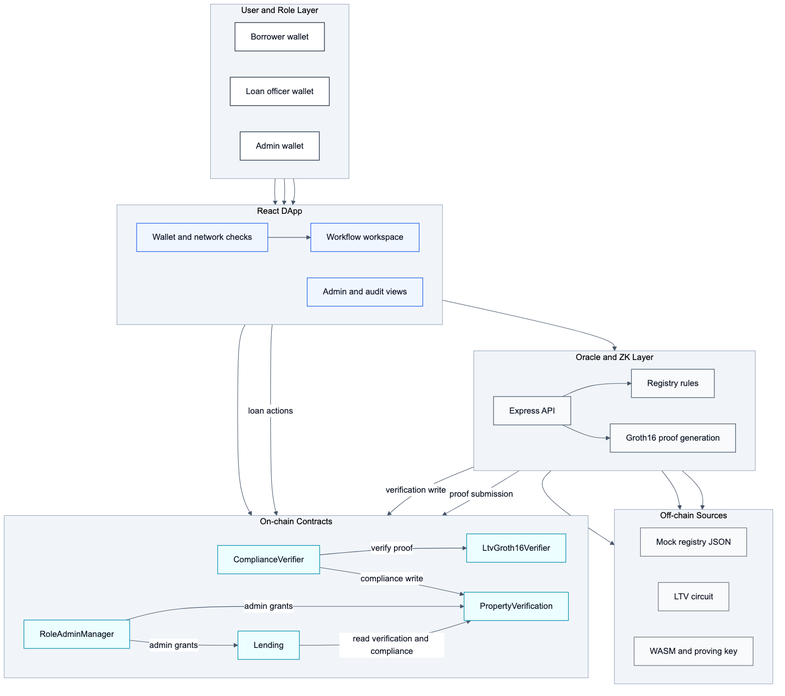
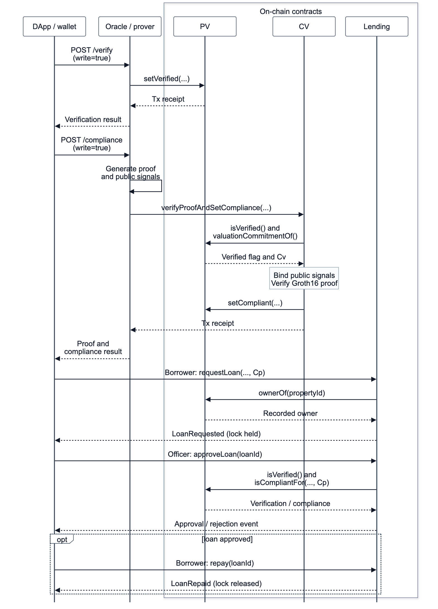

# Privacy-Preserving Compliance Enforcement for Blockchain-Based Real-Estate Lending Using Zero-Knowledge Proofs

**Manuscript type:** Research Article  
**Author(s):** ZHANG TIANYI  
**Affiliation(s):** National University of Singapore, Singapore  
**Corresponding author:** ZHANG TIANYI, e1554005@u.nus.edu  
**Repository or supplementary artifact:** https://github.com/Alan42x/proofestate

## Abstract

Public blockchains provide an auditable substrate for asset-backed lending, but their transparency conflicts with the confidentiality requirements of real-estate finance. Loan-to-value (LTV) compliance depends on property valuations and requested principal amounts, both sensitive financial values that should not be exposed through contract storage, events, logs, or calldata. This paper presents ProofEstate, a privacy-preserving compliance architecture and reproducible prototype for blockchain-based real-estate lending. ProofEstate combines a trusted property-oracle service, MiMC commitments, a Groth16 zero-knowledge proof, role-gated Ethereum-compatible smart contracts, and a web application. The proof statement establishes that a requested principal is at most 80% of a property valuation without publishing either plaintext value on chain. The central mechanism is explicit public-signal binding: the on-chain verifier checks that the proof is linked to the current property identifier, valuation commitment, principal commitment, and fixed LTV threshold before updating compliance state. The lending contract approves a loan only when the borrower owns the verified property and the requested principal commitment matches the verified compliance record. A local evaluation reports 28 passing contract tests, 12 oracle API tests, 6 frontend tests, a passing production build, a successful end-to-end workflow, circuit-size inspection, gas measurement, a 30-run compliant-path benchmark, a 30-run correctness matrix for boundary and rejection cases, and a bounded 10/30/50 repeated-run stability snapshot. Median Groth16 proof generation is 399.53 ms, median oracle compliance latency is 409.16 ms, and average gas for proof verification and compliance update is 310,411. The results show that zero-knowledge enforcement is practical for this narrow compliance rule, while identifying the trusted oracle, prototype setup, and missing freshness nonce as production-hardening boundaries.

## Keywords

Information security; privacy-preserving compliance; zero-knowledge proofs; smart contracts; blockchain lending; oracle security; real-estate finance

## 1. Introduction

Blockchain-based financial applications are attractive when multiple parties need a shared record of decisions, permissions, and state transitions. A lending workflow is a representative example: a borrower requests credit against collateral, an independent source verifies the collateral, a compliance rule determines whether the requested amount is acceptable, and an authorized lender approves or rejects the loan. Smart contracts can make these transitions auditable and resistant to unilateral modification.

The same transparency that improves auditability creates a security and privacy problem. In real-estate lending, property valuation and requested principal are sensitive financial facts. A direct on-chain implementation would disclose these values through calldata, event logs, or contract storage. Even if a contract stores only derived decisions, a naïve workflow may still leak values during verification or allow compliance evidence to be replayed for a different asset, a stale valuation, or a different loan amount. The security challenge is therefore not only to hide the numerical values, but also to ensure that a private compliance proof is bound to the exact on-chain state transition it authorizes.

This paper studies that challenge through ProofEstate, an end-to-end prototype for privacy-preserving real-estate lending compliance. ProofEstate enforces one bounded policy: the requested principal must be no more than 80% of the property valuation. The policy is intentionally narrow because it isolates the core application-security question: can an Ethereum-compatible contract enforce a compliance claim over private financial values while retaining enough public state to support auditability and lending workflow control?

ProofEstate answers this question by combining commitments, a zero-knowledge proof, a trusted oracle, and role-gated contracts. The oracle reads a property record, computes a valuation commitment, and generates a Groth16 proof for the LTV predicate. The proof exposes only four public signals: the property identifier mapped into the scalar field, the valuation commitment, the principal commitment, and the maximum LTV in basis points. The plaintext valuation, plaintext principal, and salts remain private witness values. The on-chain compliance verifier accepts a proof only if the public signals match the current property record and the submitted principal commitment. The lending contract then requires the borrower to be the recorded property owner and requires the compliance record to match the same principal commitment.

The contribution is an information-security application pattern rather than a new proof system. ProofEstate shows how to connect a conventional off-chain compliance source to an auditable on-chain workflow without publishing the sensitive values that determine compliance. The paper makes four contributions:

1. It defines a privacy-preserving compliance architecture for blockchain-based real-estate lending in which valuation and principal are hidden but the compliance decision remains enforceable on chain.
2. It introduces an explicit proof-binding design that checks the property key, valuation commitment, principal commitment, and LTV policy before any compliance state is written.
3. It implements a complete prototype with Solidity contracts, a Circom/Groth16 circuit, a Node.js oracle service, and a React application covering borrower, loan-officer, oracle, and administrator flows.
4. It provides a reproducible local evaluation covering functional tests, gas measurement, circuit size, an end-to-end lending workflow, a 30-run compliant-path benchmark, boundary and rejection cases, and bounded repeated-run stability evidence.

The remainder of the paper is organized as follows. Section 2 reviews related work. Section 3 defines the system model, design requirements, and threat model. Section 4 presents the architecture. Section 5 describes the implementation. Section 6 reports the evaluation. Section 7 analyzes security and privacy properties. Section 8 discusses limitations and production hardening. Section 9 concludes.

## 2. Background and related work

### 2.1 Smart contracts and blockchain lending

Ethereum-compatible smart contracts provide deterministic state machines whose execution can be independently verified by blockchain participants [1--3]. This property is useful for lending workflows because contract state can encode requests, approvals, repayment status, and role-restricted administrative operations. Decentralized finance protocols have demonstrated that collateralized lending can be automated through smart contracts [4,5]. Existing DeFi lending systems, however, usually operate over liquid on-chain assets whose values and balances are either public or obtained from price feeds. Real-estate lending differs because the collateral is an off-chain asset and the valuation is a sensitive value derived from external records.

### 2.2 Oracles and off-chain facts

Smart contracts cannot directly inspect property registries, appraisal records, credit documents, or other off-chain facts. Oracle systems bridge this gap by importing external data into contract execution. Prior work has studied authenticated data feeds and oracle networks, including Town Crier, DECO, and decentralized oracle-network architectures [6--8]. ProofEstate follows this line of work but focuses on a narrower application-security boundary: the oracle is trusted to observe the property registry and private values, while the contract verifies that the proof and on-chain state are consistently bound before updating compliance. The prototype therefore exposes a clear trust boundary instead of assuming that oracle decentralization has already been solved.

### 2.3 Commitments and zero-knowledge proofs

Commitments allow a system to bind to a value without disclosing it. Zero-knowledge proofs allow a prover to convince a verifier that a statement about private witness values is true. Groth16 provides succinct pairing-based proofs with efficient on-chain verification [9], while MiMC is a hash design suited to arithmetic circuits because it has low multiplicative complexity [10]. Privacy-preserving blockchain systems such as Zerocash and Hawk showed how zero-knowledge proofs can protect values or contract inputs in blockchain applications [11,12]. ProofEstate applies these ideas to a regulatory-style lending predicate rather than anonymous payments or a general private smart-contract model.

### 2.4 Gap addressed by this paper

The relevant gap is practical binding between private compliance evidence and public lending state. A proof that merely establishes an inequality over hidden values is insufficient for a smart-contract lending workflow. The verifier must also know which property record, valuation commitment, loan principal commitment, and policy threshold the proof authorizes. ProofEstate addresses this gap by making those bindings explicit public signals and by checking them against contract state before compliance can affect loan approval.

## 3. System model, requirements and threat model

### 3.1 Actors

ProofEstate models four operational roles.

| Actor | Responsibility |
| --- | --- |
| Borrower | Requests a loan against a property recorded as owned by the borrower. |
| Oracle operator | Reads registry data, computes commitments, generates proofs, and writes privileged verification transactions. |
| Loan officer | Approves or rejects requested loans through a role-gated function. |
| Protocol administrator | Grants and revokes privileged protocol roles. |

The public blockchain records verification state, commitments, compliance state, proof hashes, loan state, and role-governed actions. It does not record plaintext valuation, plaintext principal, witness values, salts, or proof-generation inputs.

### 3.2 Design requirements

The design is driven by six requirements.

**R1: confidentiality of selected financial values.** The property valuation and requested principal must not be published on chain as plaintext values.

**R2: on-chain enforceability.** A loan officer must be unable to approve a requested loan unless the relevant compliance state is present on chain.

**R3: property-state binding.** Compliance evidence must be tied to the current property record and valuation commitment.

**R4: principal binding.** Compliance evidence must be tied to the exact principal commitment used by the loan request.

**R5: role separation.** Property verification, compliance writing, loan approval, borrower actions, and role administration must be separated by access-control checks.

**R6: reproducibility.** The prototype must include tests, benchmark artifacts, and documentation sufficient for independent inspection of the implemented workflow.

### 3.3 Threat model

The adversary may observe all public blockchain data, submit transactions to public contract functions, replay previously observed proof calldata, submit malformed oracle API requests, attempt to approve loans without the required role, request loans against properties owned by other accounts, or attempt to use compliance evidence for a different property or principal commitment. The adversary may also attempt to exploit stale compliance state after a property verification record changes.

The oracle is trusted to read the correct registry record and to handle plaintext values during proof generation. The prototype does not protect against a compromised oracle signing key, a dishonest property registry, a malicious trusted setup, a broken underlying proof system, Ethereum consensus failure, or implementation bugs in external dependencies. These assumptions are explicit because the prototype is designed to evaluate the compliance-binding pattern, not to claim production-grade lending security.

### 3.4 Security claim

The bounded security claim is:

```text
If the oracle writes a correct property verification record and the Groth16 verifier
corresponds to the implemented LTV circuit, then a loan can be approved only for
a property/principal commitment pair that has passed the 80% LTV proof and the
current on-chain binding checks.
```

The claim covers private LTV compliance enforcement and loan-state gating. It does not assert full borrower anonymity, decentralized oracle trust, real asset settlement, credit-risk correctness, or regulatory completeness.

## 4. ProofEstate architecture

### 4.1 Workflow overview

ProofEstate implements the following workflow:

```text
Mock property registry
  -> oracle verification and valuation commitment
  -> zero-knowledge LTV proof generation
  -> on-chain proof verification and compliance write
  -> borrower loan request
  -> loan-officer approval or rejection
  -> repayment or terminal loan state
```

The browser application never receives oracle signing credentials. In local and testnet configurations, the frontend calls the oracle API, and the oracle service signs privileged transactions with its configured key. The on-chain contracts still enforce role checks, so contract authorization does not depend on frontend behavior.

{width=5.0in}

*Figure 1. ProofEstate system architecture, showing the off-chain user, frontend, oracle/prover, and on-chain contract boundaries.*

### 4.2 Commitment design

For a property identifier mapped to a field element `propertyKeyField`, the oracle computes two MiMC commitments:

```text
valuationCommitment = MiMC(propertyKeyField, propertyValue, valuationSalt)
principalCommitment = MiMC(propertyKeyField, loanPrincipal, principalSalt)
```

The property key is included in both commitments to avoid cross-property substitution. The valuation commitment is stored in the property-verification record. The principal commitment is later submitted with the loan request and checked against the compliance record. In the reproducible prototype, the valuation salt is deterministic so that local evidence can be regenerated; a production deployment should use high-entropy secret salts or registry-signed blinded attestations for stronger commitment hiding.

### 4.3 Zero-knowledge statement

The circuit takes four public signals:

```text
propertyKeyField
valuationCommitment
principalCommitment
maxLtvBps
```

It takes four private inputs:

```text
propertyValue
loanPrincipal
valuationSalt
principalSalt
```

The circuit recomputes both commitments and enforces the LTV predicate:

```text
loanPrincipal * 10000 <= propertyValue * maxLtvBps
```

The implemented policy sets `maxLtvBps = 8000`, corresponding to 80% LTV. The circuit uses 64-bit ranges for the valuation and principal, a 14-bit range for the LTV basis-point threshold, and an 80-bit comparison width for the scaled products.

### 4.4 On-chain proof binding

The `ComplianceVerifier` contract is the critical binding component. Before calling the generated Groth16 verifier, it checks that:

1. the property is currently verified;
2. public signal 0 equals the contract's field mapping of the property identifier;
3. public signal 1 equals the current on-chain valuation commitment;
4. public signal 2 equals the submitted principal commitment;
5. public signal 3 equals the fixed `MAX_LTV_BPS` value.

Only after these checks pass does the contract call the generated verifier and write compliance state through the property-verification contract. This ordering prevents a valid proof from being detached from the property, valuation commitment, principal commitment, or policy threshold it was meant to authorize.

{width=5.2in}

*Figure 2. End-to-end data and control flow from borrower interaction through oracle verification, Groth16 proving, on-chain compliance verification, and loan-officer approval.*

### 4.5 Lending-state enforcement

The lending contract separates loan request and loan approval. A borrower can request a loan only for a property whose recorded owner matches the caller. The request stores the principal commitment, not the plaintext principal. A loan officer can approve the request only if the property remains verified and the property-verification contract reports compliance for the same principal commitment. If the property is not verified, or if compliance is absent or bound to another principal commitment, the approval path rejects the loan and releases the active-loan lock.

### 4.6 Data visibility boundary

| Data item | Visibility |
| --- | --- |
| Property identifier | Public on chain |
| Borrower address | Public on chain |
| Property valuation | Private to oracle/prover |
| Requested principal | Private to oracle/prover |
| Valuation salt and principal salt | Private to oracle/prover |
| Valuation commitment | Public on chain |
| Principal commitment | Public on chain |
| Proof hash | Public on chain |
| Compliance status | Public on chain |
| Loan lifecycle state | Public on chain |

The system therefore provides confidentiality for selected financial values, not general transaction privacy. Public observers can still see which property identifier is verified, which address owns it, when compliance is written, and how the loan state changes.

## 5. Implementation

ProofEstate is implemented as a reproducible local-first software artifact with Solidity contracts, a Node.js oracle service, a Circom circuit, generated Groth16 verifier code, scripts, tests, benchmark artifacts, and a React frontend.

### 5.1 Smart contracts

`PropertyVerification` stores the current property-verification record. The oracle role can write verification state, owner address, evidence hash, and valuation commitment. When verification is refreshed, the contract clears compliance state and principal binding. This avoids preserving a compliance decision after the valuation commitment has changed.

`ComplianceVerifier` receives Groth16 proof calldata, performs the public-signal binding checks, calls the generated verifier, hashes the accepted proof, and writes compliance state. It uses a constant `MAX_LTV_BPS = 8000` and rejects public-signal mismatches before invoking the verifier.

`Lending` stores loan requests and lifecycle state. It checks property ownership at request time, enforces one active loan per property, restricts approval and rejection to the loan-officer role, and checks compliance for the exact principal commitment before approval.

`RoleAdminManager` supports administrative role operations and prevents removal of the final protocol administrator, reducing the chance of administrative lockout during local operation.

### 5.2 Oracle service

The oracle service loads property records from a mock registry, validates request inputs, computes commitments, generates proof inputs, invokes the proving pipeline, and optionally writes transactions to the configured chain. The service exposes endpoints for property listing, verification, and compliance checking. In write mode, it signs verification and compliance transactions using the configured oracle signer. This design keeps privileged keys out of the browser and makes the oracle trust boundary explicit.

### 5.3 Circuit and proving pipeline

The LTV circuit is written in Circom and compiled for the BN254 curve. It uses MiMC Sponge commitments, range checks, and a comparison gadget. The generated Solidity verifier is deployed as a separate contract and called by `ComplianceVerifier`. Proof generation uses `snarkjs` and a WebAssembly witness generator. The prototype uses Groth16 because its small proof size and efficient verifier are well suited to Ethereum-compatible verification.

### 5.4 Frontend and operational views

The React application exposes borrower, loan-officer, administrator, readiness, and audit views. The frontend helps exercise the workflow but is not trusted for security. Contract role checks, proof verification, and oracle signing boundaries remain server-side or on-chain.

### 5.5 Reproducibility materials

The repository includes contract tests, oracle API tests, frontend tests, build scripts, deployment scripts, local workflow scripts, benchmark summaries, raw benchmark JSON, architecture figures, and evaluation notes. The local evaluation uses deterministic development-chain accounts and a mock registry so that reviewers can inspect the complete compliance path without requiring public-chain funds or external property data.

## 6. Evaluation

### 6.1 Evaluation questions

The evaluation addresses five questions.

**EQ1:** Does the prototype enforce the intended success and failure paths for verification, compliance, and loan approval?

**EQ2:** Do boundary and rejection cases behave correctly at and around the 80% LTV threshold?

**EQ3:** What is the local latency of the oracle verification and compliance path, and how stable is the repeated local proof-generation workload?

**EQ4:** What is the gas cost of the on-chain verification and lending functions?

**EQ5:** What are the size and structure of the implemented zero-knowledge circuit?

### 6.2 Experimental setup

The evaluation is local-first. Local execution provides deterministic accounts, reproducible deployment, stable gas measurement, and independence from public RPC availability, faucet balances, and testnet congestion. The primary compliant-path benchmark command is:

```bash
pnpm benchmark:local --warmups=5 --runs=30 --property=PROP-001 --principal=750000 --api=http://127.0.0.1:8787
```

The correctness-matrix commands are:

```bash
pnpm benchmark:local --warmups=5 --runs=30 --property=PROP-001 --principal=784000 --api=http://127.0.0.1:8787
pnpm benchmark:local --warmups=5 --runs=30 --property=PROP-001 --principal=784001 --api=http://127.0.0.1:8787
pnpm benchmark:local --warmups=5 --runs=30 --property=PROP-004 --principal=100000 --api=http://127.0.0.1:8787
```

The bounded repeated-run stability commands use the compliant path with 10, 30, and 50 measured runs. The first five iterations in each run are warm-up runs and are excluded from the summary. The measured workload uses property `PROP-001`, whose mock registry valuation is `980000`. Under an 80% policy, the maximum compliant principal is `784000`, so principal `750000` exercises the successful compliance path, principal `784000` tests the exact boundary, and principal `784001` tests the one-unit-above rejection path.

| Item | Value |
| --- | --- |
| OS | Darwin 23.1.0 x64 |
| CPU | Intel Core i7-9750H CPU at 2.60 GHz |
| Node.js | v20.20.2 |
| pnpm | 10.9.0 |
| Hardhat | 2.28.6 |
| snarkjs | 0.7.6 |
| circom | 2.2.3 |
| Network | local Hardhat chain and local Oracle API |
| Primary measured runs | 30 |
| Correctness-matrix measured runs | 30 per case |
| Stability measured runs | 10, 30, and 50 |

### 6.3 Functional evidence

| Evidence | Result |
| --- | --- |
| Contract tests | 28 passing |
| Oracle API tests | 12 passing |
| Frontend tests | 6 passing |
| Frontend production build | Passing |
| Gas snapshot | Passing |
| ZK compile | Passing |
| Local readiness check | Passing |
| Local end-to-end workflow | Passing, final state `Repaid` |

The contract tests cover deployment, role configuration, property verification, proof acceptance, public-signal mismatch rejection, tampered proof rejection, stale compliance clearing, loan lifecycle transitions, duplicate active-loan prevention, borrower-only restrictions, loan-officer enforcement, and administrator protection. Oracle API tests cover service readiness, property listing, network validation, property ID validation, principal validation, and non-compliant behavior. Frontend tests cover representative readiness and rendering behavior.

### 6.4 Correctness matrix

`PROP-001` has a mock registry valuation of `980000`. Under the 80% LTV rule, the maximum compliant principal is `784000`. The matrix therefore tests a compliant principal, the exact boundary, a one-unit-above-boundary rejection, and a registry-failure rejection.

| Case | Property | Principal | Expected result | Observed result | Proof generation |
| --- | --- | ---: | --- | --- | --- |
| Compliant | `PROP-001` | 750000 | Pass | Pass, 0 failures across 30 measured runs | Generated |
| Boundary | `PROP-001` | 784000 | Pass at exactly 80% LTV | Pass, 0 failures across 30 measured runs | Generated |
| Non-compliant | `PROP-001` | 784001 | Reject above 80% LTV | Reject, 0 failures across 30 measured runs | Skipped, `NON_COMPLIANT_OR_MISSING_PROOF_INPUTS` |
| Invalid registry | `PROP-004` | 100000 | Reject failed registry verification | Reject, 0 failures across 30 measured runs | Skipped, `NO_ENCUMBRANCE` |

Passing cases generate Groth16 proofs. Rejected cases return compliance failure without invoking proof generation, which is the intended behavior because there is no valid proof statement to submit on chain.

### 6.5 Latency results

Primary compliant path: `PROP-001`, principal `750000`, 5 warm-up runs and 30 measured runs.

| Metric | Runs | Failures | Min ms | Median ms | Mean ms | P95 ms | Max ms | Std dev |
| --- | ---: | ---: | ---: | ---: | ---: | ---: | ---: | ---: |
| Build verification input | 30 | 0 | 1.91 | 3.05 | 3.22 | 4.77 | 7.94 | 1.09 |
| Build compliance inputs | 30 | 0 | 3.19 | 3.73 | 4.01 | 5.31 | 6.72 | 0.79 |
| Generate Groth16 proof | 30 | 0 | 372.42 | 399.53 | 407.55 | 469.53 | 481.21 | 24.66 |
| Oracle `/verify` latency | 30 | 0 | 5.02 | 5.98 | 6.78 | 11.45 | 12.54 | 1.91 |
| Oracle `/compliance` latency | 30 | 0 | 377.61 | 409.16 | 413.27 | 480.30 | 487.67 | 22.65 |

Proof generation dominates the compliance path. Median proof generation is 399.53 ms, while median `/compliance` latency is 409.16 ms. The 9.63 ms difference indicates that API overhead and input construction are small relative to proving time in this local configuration.

Boundary and rejection paths behave as expected:

| Case | Metric | Runs | Failures | Median ms | Mean ms | Notes |
| --- | --- | ---: | ---: | ---: | ---: | --- |
| Boundary | Generate Groth16 proof | 30 | 0 | 437.08 | 471.37 | Proof generated at exactly 80% LTV |
| Boundary | Oracle `/compliance` latency | 30 | 0 | 432.62 | 451.57 | Includes proof generation |
| Non-compliant | Build compliance inputs | 30 | 0 | 3.24 | 3.37 | Rejects above 80% LTV |
| Non-compliant | Oracle `/compliance` latency | 30 | 0 | 5.38 | 5.54 | Proof generation skipped |
| Invalid registry | Build compliance inputs | 30 | 0 | 0.19 | 0.19 | Fails registry validation |
| Invalid registry | Oracle `/compliance` latency | 30 | 0 | 1.56 | 1.66 | Proof generation skipped |

The repeated-run stability snapshot uses the compliant path with the same local Oracle API:

| Measured runs | Failures | Median proof ms | Mean proof ms | P95 proof ms | Median `/compliance` ms | P95 `/compliance` ms |
| ---: | ---: | ---: | ---: | ---: | ---: | ---: |
| 10 | 0 | 441.43 | 455.58 | n/a | 428.45 | n/a |
| 30 | 0 | 399.53 | 407.55 | 469.53 | 409.16 | 480.30 |
| 50 | 0 | 406.01 | 413.36 | 440.06 | 408.36 | 475.02 |

The 10/30/50-run results show zero failures and similar median proof-generation latency. They characterize repeated local proof-generation stability, not production scalability or concurrent public-chain throughput.

### 6.6 Gas results

Gas was measured with the Hardhat gas reporter in the local test suite.

| Contract | Method | Average gas |
| --- | --- | ---: |
| `PropertyVerification` | `setVerified` | 115,996 |
| `ComplianceVerifier` | `verifyProofAndSetCompliance` | 310,411 |
| `Lending` | `requestLoan` | 233,609 |
| `Lending` | `approveLoan` | 81,464 |
| `Lending` | `cancelLoan` | 52,694 |
| `Lending` | `rejectLoan` | 52,620 |
| `Lending` | `repay` | 57,219 |
| `RoleAdminManager` | `grantProtocolAdmin` | 120,499 |
| `RoleAdminManager` | `revokeProtocolAdmin` | 55,099 |

`verifyProofAndSetCompliance` is the most expensive runtime function in the proof path because it includes pairing-based Groth16 verification and the compliance-state write. The ordinary loan lifecycle functions are cheaper. The results suggest that EVM verification is practical for a narrow, infrequent compliance event, but that proof verification should be avoided on high-frequency paths unless batching, aggregation, or alternative proof systems are introduced.

### 6.7 Circuit size

`snarkjs r1cs info` reports the following circuit size.

| Metric | Value |
| --- | ---: |
| Curve | bn-128 |
| Wires | 4,198 |
| Constraints | 4,196 |
| Private inputs | 4 |
| Public inputs | 4 |
| Public outputs | 0 |

The circuit is intentionally small because it proves one inequality and two commitment openings. Adding registry attestations, borrower binding, expiry, nonces, multiple policy rules, or KYC predicates would increase circuit size and proving cost.

### 6.8 End-to-end workflow

The local CLI happy path completes the full sequence:

```text
oracle verification
-> compliance proof generation
-> on-chain proof verification
-> loan request
-> loan officer approval
-> repayment
```

The final local run for `PROP-001` with principal `750000` completed in 1.82 seconds and ended in state `Repaid`. This duration includes oracle verification, proof generation, on-chain verification on the local chain, loan request, approval, and repayment.

### 6.9 Interpretation

The evaluation supports three conclusions. First, the implementation is functionally complete within the declared prototype scope: core success and failure paths are covered by tests, end-to-end workflow evidence, and a 30-run correctness matrix. Second, local compliance latency is dominated by proof generation rather than ordinary API processing. Third, on-chain proof verification is more expensive than ordinary lending transitions but remains feasible for a low-frequency real-estate compliance event.

The evaluation does not claim production throughput, public-testnet latency, or real-registry integration. It characterizes a controlled prototype with one oracle process, a mock registry, local Hardhat execution, selected boundary and rejection cases, and repeated local proof-generation workloads.

## 7. Security and privacy analysis

### 7.1 Implemented security properties

| Property | Mechanism | Evidence |
| --- | --- | --- |
| Unauthorized property writes are rejected | `ORACLE_ROLE` on verification writes | Contract tests |
| Unauthorized compliance writes are rejected | `COMPLIANCE_ROLE` on compliance state | Contract tests |
| Proofs cannot be moved to another property | Public signal 0 checked against property ID field mapping | Contract tests |
| Proofs cannot use a stale valuation commitment | Public signal 1 checked against current on-chain commitment | Contract tests |
| Proofs cannot authorize a different principal | Public signal 2 checked against submitted principal commitment | Contract tests |
| LTV threshold cannot be changed by calldata | Public signal 3 checked against `MAX_LTV_BPS` | Contract tests |
| Tampered proof calldata is rejected | Generated Groth16 verifier must return true | Contract tests |
| Refreshed property verification clears compliance | Verification update resets compliance and principal binding | Contract tests |
| Loan approval requires matching compliance | `isCompliantFor(propertyId, principalCommitment)` | Contract tests |
| Active double-borrowing is blocked | One active loan per property | Contract tests |

The security evaluation also treats common misuse cases as adversarial tests rather than only functional tests. The matrix below summarizes the tested attack or failure surfaces.

| Category | Scenario | Expected behavior | Evidence |
| --- | --- | --- | --- |
| Role misuse | Unauthorized oracle, verifier, loan-officer, or borrower action | Revert or guarded failure | Contract tests |
| Proof misuse | Tampered proof or mismatched property, valuation, principal, or threshold signal | Compliance update rejected | Contract tests |
| Boundary abuse | Principal at `784000` or `784001` for `PROP-001` | Exact boundary passes; one-unit over-limit case rejects without proof generation | Benchmark matrix |
| Registry failure | Encumbered `PROP-004` is used for compliance | Registry validation rejects and proof generation is skipped | Oracle API tests; benchmark matrix |
| State replay | Property verification is refreshed after compliance | Stale compliance and principal binding are cleared | Contract tests |
| Collateral reuse | Borrower attempts a second active loan against the same property | Duplicate active borrowing is rejected | Contract tests |
| API abuse | Unsupported network, malformed property ID, or invalid principal | API returns validation failure without server error | Oracle API tests |

This is a prototype-level adversarial evaluation, not a third-party production audit.

### 7.2 Privacy guarantees and leakage

ProofEstate avoids publishing the two sensitive numerical values needed for LTV compliance: property valuation and requested principal. The public chain sees commitments and a compliance decision, not the plaintext values or witness inputs. The principal commitment uses a fresh random salt by default, while the valuation salt in the reproducible artifact is deterministic to support repeatable local evaluation.

The privacy guarantee is therefore selective and prototype-bounded. The system protects against direct plaintext exposure on the public chain, but a production deployment should use high-entropy valuation salts, blinded registry attestations, or another domain-separation mechanism that prevents dictionary-style testing over small valuation domains. The property identifier, owner address, verification event, compliance status, proof hash, principal commitment, and loan lifecycle remain public. The oracle observes plaintext values during proof generation. The system protects private compliance inputs from public-chain observers, not from the trusted oracle.

### 7.3 Replay and freshness

The implemented binding prevents a proof from being replayed across different properties, valuation commitments, principal commitments, or LTV thresholds. Reusing proof calldata for a different public state causes a signal mismatch before verifier execution.

The prototype does not bind the proof to a borrower address, loan identifier, timestamp, expiry, or single-use nonce. Reuse of the same proof for the same property and principal commitment can refresh the same compliance state. In the implemented workflow, this does not bypass owner checks or the active-loan lock, but a production system should add nonce, expiry, registry-version, borrower, or loan-specific binding.

### 7.4 Oracle and API exposure

The oracle is the main trust concentration. It observes plaintext values, generates witnesses, and signs privileged transactions. If a hosted oracle exposes write-enabled endpoints without authentication, a public caller could trigger proof generation or transactions from the oracle signer. Contract role checks still prevent arbitrary accounts from writing privileged state, but the service can spend CPU time and testnet funds. A production oracle should use authentication, request signing, origin policy, rate limits, transaction allowlists, quotas, monitoring, hardware-backed or threshold key management, and separation between read-only and write-enabled deployments.

### 7.5 Access-control boundary

ProofEstate uses role-based access control to separate property verification, compliance writing, loan approval, and administration. This reduces accidental privilege overlap in the prototype, but it does not remove the need for production governance. In a deployed system, role assignment should be governed by multisignature or timelocked administration, monitored for unexpected changes, and paired with operational incident-response procedures.

## 8. Discussion and limitations

### 8.1 Practical significance

The main practical value of ProofEstate is the separation of public enforceability from private financial inputs. A lender, borrower, auditor, or regulator can inspect that an on-chain loan passed a specific compliance state transition without seeing the valuation or requested principal. This pattern is relevant beyond real-estate lending: any workflow that requires public enforcement of a private inequality or threshold condition can use the same commitment-and-binding structure, provided that the oracle and data-source assumptions are made explicit.

### 8.2 Comparison with alternative architectures

A plaintext on-chain design would be simple and fully auditable but would expose valuation and principal. An off-chain-only design would protect privacy but would leave the blockchain unable to enforce compliance. A commitment-only design would hide values but would not prove that the LTV relation holds. ProofEstate occupies the middle ground: the public chain sees commitments and a proof-backed compliance state, while the private witness values remain off chain.

Alternative proof systems could change the trade-off. Groth16 gives small proofs and efficient EVM verification but requires a trusted setup. PLONK can reduce circuit-specific setup burden, and STARKs offer transparency and post-quantum security at the cost of larger proofs and different verification economics [13,14]. ProofEstate uses Groth16 because the prototype target is a narrow Ethereum-compatible compliance proof.

### 8.3 Limitations

The prototype has several limitations.

- Property data comes from a mock JSON registry rather than a production land-title or appraisal source.
- The oracle is centralized and trusted.
- Groth16 setup artifacts are prototype-grade.
- Proof freshness is not enforced with a nonce, expiry, or registry version.
- The valuation salt is deterministic for reproducibility in the current artifact; production deployments should replace it with stronger salt or attestation handling.
- Owner addresses and loan lifecycle state remain public.
- The frontend is a prototype interface, not a production banking application.
- KYC, AML, DID credentials, credit scoring, settlement, liquidation, delinquency, and servicing are out of scope.
- Hosted oracle authentication, monitoring, rate limiting, and key management require production hardening.
- The benchmark covers local compliant, boundary, rejection, and repeated-run stability cases, but does not measure public-chain latency or multi-user throughput.

### 8.4 Future work

The highest-value extensions are to reduce oracle trust with signed registry attestations or threshold oracle verification, add proof freshness through nonce and expiry binding, bind proofs to borrowers or loan IDs, incorporate registry-version identifiers, integrate decentralized identity credentials, extend the circuit to multiple compliance predicates, evaluate PLONK/STARK alternatives, and test the system under public-chain and multi-user workloads.

## 9. Conclusion

ProofEstate demonstrates a privacy-preserving compliance architecture for blockchain-based real-estate lending. The prototype proves that a requested principal is at most 80% of a property valuation without publishing either plaintext value on chain. The key security mechanism is public-signal binding: the on-chain verifier checks the property identifier, current valuation commitment, submitted principal commitment, and fixed LTV threshold before compliance can affect loan approval.

The local evaluation shows a reproducible implementation with passing contract, oracle, and frontend tests; a successful end-to-end lending workflow; circuit-size inspection; gas measurement; a 30-run compliant-path benchmark; a 30-run correctness matrix; and bounded 10/30/50 repeated-run stability evidence. Median proof generation is 399.53 ms, median oracle compliance latency is 409.16 ms, and average gas for proof verification and compliance update is 310,411. These results indicate that zero-knowledge enforcement is feasible for a low-frequency compliance rule, while proof generation, oracle trust, and freshness binding remain the main engineering boundaries for production deployment.

## Declarations

### Funding

This research received no external funding.

### Competing interests

The author declares that there are no known competing financial interests or personal relationships that could have appeared to influence the work reported in this paper.

### Ethics approval

This study uses a software prototype, mock registry data, and local blockchain execution. It does not involve human participants, human-subject data, animal subjects, or clinical data.

### Author contributions

Conceptualization: ZHANG TIANYI. Methodology: ZHANG TIANYI. Software: ZHANG TIANYI. Validation: ZHANG TIANYI. Investigation: ZHANG TIANYI. Writing - original draft: ZHANG TIANYI. Writing - review and editing: ZHANG TIANYI.

### Data and code availability

The implementation package includes Solidity contracts, the Circom circuit, generated verifier code, oracle service code, frontend code, deployment scripts, local workflow scripts, tests, benchmark summaries, raw benchmark JSON, and documentation. The source code and artifact materials are available at https://github.com/Alan42x/proofestate.

### Declaration of generative AI and AI-assisted technologies in the writing process

During the preparation of this work, the author(s) used OpenAI ChatGPT/Codex to assist with language editing, organization, and clarity improvements. After using this tool, the author(s) reviewed and edited the content as needed and take full responsibility for the content of the publication.

## References

[1] S. Nakamoto, Bitcoin: A Peer-to-Peer Electronic Cash System, 2008. https://bitcoin.org/bitcoin.pdf.

[2] V. Buterin, Ethereum Whitepaper: A Next-Generation Smart Contract and Decentralized Application Platform, 2014. https://ethereum.org/whitepaper/.

[3] G. Wood, Ethereum: A Secure Decentralised Generalised Transaction Ledger, Ethereum Yellow Paper. https://github.com/ethereum/yellowpaper.

[4] F. Schaer, Decentralized finance: On blockchain- and smart contract-based financial markets, Federal Reserve Bank of St. Louis Review 103(2) (2021) 153--174. https://doi.org/10.20955/r.103.153-74.

[5] Aave, Aave V3 Technical Paper. https://github.com/aave/aave-v3-core/blob/master/techpaper/Aave_V3_Technical_Paper.pdf.

[6] F. Zhang, E. Cecchetti, K. Croman, A. Juels, E. Shi, Town Crier: An authenticated data feed for smart contracts, in: Proceedings of ACM CCS, 2016, pp. 270--282. https://doi.org/10.1145/2976749.2978326.

[7] F. Zhang, D. Maram, H. Malvai, S. Goldfeder, A. Juels, DECO: Liberating web data using decentralized oracles for TLS, in: Proceedings of ACM CCS, 2020, pp. 1919--1938. https://doi.org/10.1145/3372297.3417239.

[8] Chainlink, Chainlink 2.0 and the Future of Decentralized Oracle Networks. https://chain.link/whitepaper.

[9] J. Groth, On the size of pairing-based non-interactive arguments, in: Advances in Cryptology - EUROCRYPT 2016, LNCS 9666, 2016, pp. 305--326. https://doi.org/10.1007/978-3-662-49896-5_11.

[10] M.R. Albrecht, L. Grassi, C. Rechberger, A. Roy, T. Tiessen, MiMC: Efficient encryption and cryptographic hashing with minimal multiplicative complexity, in: Advances in Cryptology - ASIACRYPT 2016, 2016, pp. 191--219. https://doi.org/10.1007/978-3-662-53887-6_7.

[11] E. Ben-Sasson, A. Chiesa, C. Garman, M. Green, I. Miers, E. Tromer, M. Virza, Zerocash: Decentralized anonymous payments from Bitcoin, in: Proceedings of IEEE Symposium on Security and Privacy, 2014, pp. 459--474. https://doi.org/10.1109/SP.2014.36.

[12] A. Kosba, A. Miller, E. Shi, Z. Wen, C. Papamanthou, Hawk: The blockchain model of cryptography and privacy-preserving smart contracts, in: Proceedings of IEEE Symposium on Security and Privacy, 2016, pp. 839--858. https://doi.org/10.1109/SP.2016.55.

[13] A. Gabizon, Z.J. Williamson, O. Ciobotaru, PLONK: Permutations over Lagrange-bases for Oecumenical Noninteractive arguments of Knowledge, IACR Cryptology ePrint Archive, Report 2019/953, 2019. https://eprint.iacr.org/2019/953.

[14] E. Ben-Sasson, I. Bentov, Y. Horesh, M. Riabzev, Scalable, transparent, and post-quantum secure computational integrity, IACR Cryptology ePrint Archive, Report 2018/046, 2018. https://eprint.iacr.org/2018/046.

[15] OpenZeppelin, Access Control, OpenZeppelin Contracts Documentation. https://docs.openzeppelin.com/contracts/.

[16] iden3, Circom 2 Documentation. https://docs.circom.io/.

[17] iden3, snarkjs: zkSNARK implementation in JavaScript and WASM. https://github.com/iden3/snarkjs.
