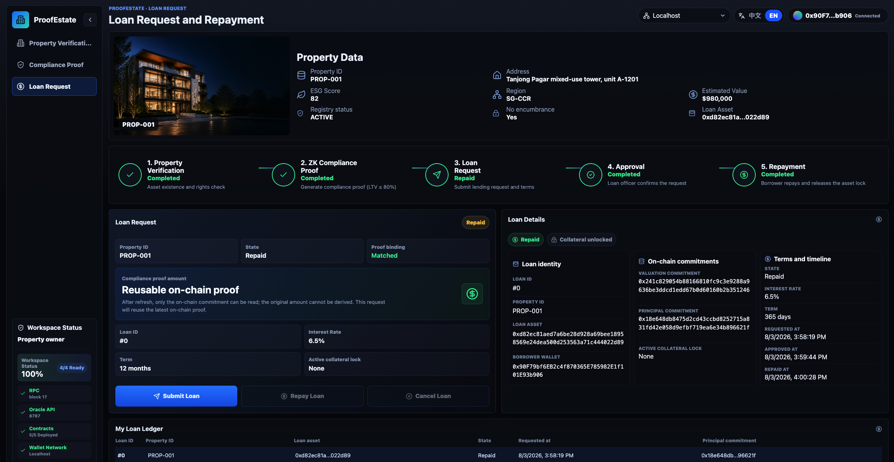

# ProofEstate: Blockchain-Based Real-Estate Lending Platform with Zero-Knowledge Compliance and Property Verification

## Abstract

Real-estate lending depends on verifiable facts: property ownership, property valuation, borrower authorization, and policy constraints such as maximum loan-to-value (LTV). Public blockchains can make the resulting approval workflow auditable and programmatically enforceable, but their transparency also makes naive implementations unsuitable for sensitive lending data. If valuation and requested-principal values are submitted directly to a smart contract, they may become permanently visible through calldata, events, or contract state. This creates a central design tension: the workflow benefits from public enforcement, while the facts that determine eligibility should remain confidential.

This thesis presents ProofEstate, an end-to-end prototype for privacy-preserving real-estate lending verification. ProofEstate combines a mock property registry, a trusted oracle service, MiMC commitments, a Groth16 zero-knowledge proof, Ethereum-compatible smart contracts, and a React decentralized application. The implemented proof statement is intentionally narrow:

```text
loanPrincipal * 10000 <= propertyValue * 8000
```

The proof establishes that the requested principal is no more than 80 percent of the property valuation without publishing either plaintext value on chain. The blockchain records commitments, proof hashes, ownership and verification state, compliance state, and loan lifecycle state; it does not store plaintext valuation, plaintext principal, salts, or witness files.

The prototype implements a complete local workflow in which the oracle verifies a mock property record, computes commitments, generates Groth16 proof calldata, submits proof data to an on-chain verifier, and enables a role-gated lending contract to approve or reject a loan only when compliance is bound to the relevant property and principal commitment. The accompanying DApp exposes borrower, loan-officer, administrator, readiness, and audit views for inspection and evaluation.

The evaluation is local-first to preserve reproducibility. It includes 28 passing contract tests, 12 passing oracle API tests, 6 passing frontend tests, a passing frontend production build, a gas baseline, circuit-size inspection, local end-to-end workflow evidence, a 30-run compliant-path benchmark, a 30-run correctness matrix for boundary and rejection cases, and a bounded 10/30/50 repeated-run stability snapshot. The benchmark shows that Groth16 proof generation dominates local latency: median proof generation is 399.53 ms, while median oracle `/compliance` latency is 409.16 ms. The measured average gas for `ComplianceVerifier.verifyProofAndSetCompliance` is 310411.

ProofEstate is not a production lending protocol. It uses a mock registry, a centralized oracle, prototype Groth16 setup artifacts, and no real ETH/ERC20 disbursement, KYC/AML, liquidation, production monitoring, or decentralized oracle governance. Its contribution is a bounded but complete architecture pattern: sensitive off-chain facts can be committed, proven against a specific compliance rule in zero knowledge, and used to drive auditable smart-contract state without revealing the underlying values on chain.

**Keywords:** zero-knowledge proofs, smart contracts, real-estate lending, privacy-preserving compliance, Groth16, oracle, commitments

## 1. Introduction

### 1.1 Motivation

Blockchain systems are attractive for workflows that require transparent state transitions, programmable enforcement, and auditable records. Ethereum-style smart contracts can encode rules, restrict functions to authorized roles, emit events, and preserve application state in a form that can be independently inspected [1], [2]. These properties are relevant to lending because property verification, loan approval, collateral state, repayment state, and administrative actions should be reliable, traceable, and resistant to unilateral modification.

The same transparency creates a privacy problem. Contract calldata, logs, and storage can be inspected by external observers. In real-estate lending, sensitive information can include property valuation, requested principal, borrower identity, ownership history, income evidence, and lender-specific risk decisions. A plaintext contract design could verify a loan-to-value (LTV) rule by accepting valuation and principal values directly, but that design would permanently reveal the financial facts used in the decision.

Zero-knowledge proofs provide a mechanism for separating validity from disclosure. A prover can demonstrate that private witness values satisfy a public statement without revealing those witness values. For a lending rule, this means a system can prove that a requested principal is within a maximum LTV threshold while keeping both the property valuation and the requested principal off chain.

ProofEstate explores this design through a concrete end-to-end prototype. It does not attempt to implement a full mortgage system or decentralized finance lending market. Instead, it focuses on a narrower research objective: enabling private off-chain property and loan values to influence public smart-contract state through commitments, proof verification, and explicit application-level binding checks.

### 1.2 Research Question

The main research question is:

```text
Can a real-estate lending workflow enforce an LTV compliance rule on chain without revealing the underlying property valuation or requested loan principal?
```

The question is decomposed into five design and evaluation subquestions:

1. How can off-chain property facts be represented on chain without publishing plaintext valuation data?
2. How can a zero-knowledge proof be bound to a specific property and requested principal commitment?
3. How can smart contracts prevent loan approval when compliance is missing, stale, or bound to a different principal?
4. What are the proof-generation, API-latency, circuit-size, and gas costs of the design in a reproducible local environment?
5. What trust assumptions remain after introducing zero-knowledge proofs?

### 1.3 Contributions

This thesis makes the following contributions:

1. An end-to-end architecture for privacy-preserving real-estate lending verification, combining a trusted oracle service, MiMC commitments, Groth16 proof generation, Solidity contracts, and a React DApp.
2. A concrete zero-knowledge LTV statement with four public inputs, four private inputs, property-bound commitments, range checks, and an inclusive 80 percent policy threshold.
3. An application-level binding design that connects proof public signals to current on-chain property state and principal commitments before a loan can be approved.
4. A reproducible evaluation package covering contract tests, oracle API tests, frontend tests, gas measurements, proof-generation benchmarks, circuit-size inspection, frontend build output, and local end-to-end workflow evidence.
5. A comparative analysis of plaintext on-chain verification, off-chain-only verification, the selected Groth16 design, alternative proof systems, and alternative oracle models.
6. A bounded security and privacy analysis that separates the implemented guarantees from remaining trust assumptions, residual risks, limitations, and production-hardening requirements.

### 1.4 Scope and Non-Goals

The implemented compliance rule is:

```text
loanPrincipal * 10000 <= propertyValue * 8000
```

This is equivalent to proving:

```text
loanPrincipal <= 80 percent of propertyValue
```

The rule is intentionally narrow. A single lending policy can be specified, implemented, tested, benchmarked, and explained rigorously. ProofEstate does not implement real disbursement, fiat settlement, ETH/ERC20 transfers, KYC/AML, credit scoring, liquidation, delinquency handling, production registry integration, production monitoring, or decentralized oracle governance. These omissions define the boundary of the research prototype rather than hidden production claims.

### 1.5 Thesis Organization

Section 2 introduces background concepts, related work, and the research gap. Section 3 describes the system design. Section 4 presents the implementation. Section 5 reports the evaluation methodology and results. Section 6 analyzes security and privacy. Section 7 compares architectural alternatives and discusses generalization. Section 8 presents limitations and future work. Section 9 concludes.

## 2. Background and Related Work

### 2.1 Ethereum-Compatible Smart Contracts

Smart contracts are deterministic programs deployed to a blockchain. Ethereum-compatible contracts execute on the Ethereum Virtual Machine (EVM), where they can store state, validate transactions, emit events, and call other contracts. Because contract execution is replicated and validated by the network, smart contracts are useful when participants need shared state and predictable enforcement [1], [2].

ProofEstate uses Solidity contracts on a local Hardhat network, with optional Sepolia deployment support. The local network is the canonical evaluation environment because it provides deterministic execution, stable accounts, repeatable gas measurement, and independence from public testnet RPC or faucet conditions.

### 2.2 Role-Based Access Control

Lending workflows require distinct permissions for different actors. A property oracle should be able to write verification records, but it should not approve loans. A loan officer should be able to approve or reject requested loans, but it should not overwrite property valuations. A protocol administrator should manage roles, while accidental removal of the final administrator should be prevented.

ProofEstate uses role-based access control patterns based on OpenZeppelin Contracts [3]. The main roles are:

- `ORACLE_ROLE` for property verification writes;
- `COMPLIANCE_ROLE` for compliance writes by `ComplianceVerifier`;
- `LOAN_OFFICER_ROLE` for loan approval and rejection;
- `DEFAULT_ADMIN_ROLE` for role administration.

This role separation supports least privilege and makes the system's security boundary easier to audit.

### 2.3 Oracles

Blockchains cannot directly read external systems such as property registries, identity providers, land-title databases, or bank records. Oracles bridge external data into smart-contract applications. Decentralized oracle networks are commonly used to reduce reliance on a single operator, while centralized oracles are simpler and easier to reproduce in a prototype [12].

ProofEstate uses a centralized oracle service. It reads a mock property registry, evaluates deterministic verification rules, computes commitments, constructs proof inputs, generates Groth16 proof calldata, and can submit verification and compliance transactions. This choice is appropriate for a reproducible research prototype, but it introduces a clear trust assumption: the oracle sees plaintext witness values and is trusted to interpret registry facts honestly.

### 2.4 Commitments

A commitment binds a value without revealing it. ProofEstate uses commitments so that smart contracts can refer to hidden valuation and principal values without storing them directly. The circuit computes:

```text
valuationCommitment = MiMC(propertyKeyField, propertyValue, valuationSalt)
principalCommitment = MiMC(propertyKeyField, loanPrincipal, principalSalt)
```

MiMC is selected because it is designed for low multiplicative complexity and is efficient in arithmetic-circuit settings [5]. Ethereum-native hashes such as Keccak are natural on chain, but expensive inside Circom-style arithmetic circuits. Including `propertyKeyField` in both commitments binds the hidden values to a property context and reduces straightforward replay across unrelated properties.

### 2.5 Zero-Knowledge Proofs

A zero-knowledge proof allows a prover to convince a verifier that a statement is true without revealing the private witness. ProofEstate uses Groth16, a succinct non-interactive argument system whose compact proofs and practical verifier cost make it widely used in blockchain applications [4].

Groth16's main trade-off is trusted setup. It requires proving and verification artifacts tied to a specific circuit. In ProofEstate, these artifacts are prototype-grade and suitable for local reproducibility and research evaluation. A production system would need a documented trusted setup ceremony or a proof system with different setup assumptions. The circuit is written in Circom and proof generation is performed with snarkjs [6], [7].

### 2.6 Loan-to-Value Policy

Loan-to-value ratio compares a loan amount with collateral value:

```text
LTV = loanPrincipal / propertyValue
```

ProofEstate implements an 80 percent maximum LTV policy. Instead of division, the circuit and contracts use integer multiplication in basis points:

```text
loanPrincipal * 10000 <= propertyValue * 8000
```

This avoids decimal arithmetic and gives the circuit a precise integer constraint.

### 2.7 Related Systems

Decentralized lending protocols such as Compound and Aave demonstrate how smart contracts can manage collateralized borrowing, interest, liquidity pools, and repayment state [10], [11]. These protocols primarily operate with crypto-native assets and public on-chain collateral values. Broader DeFi analysis also emphasizes transparency, composability, and the use of smart contracts to recreate financial-market functions without traditional intermediaries [13]. ProofEstate differs by focusing on real-estate-style collateral, where relevant facts originate off chain and may be private.

Oracle systems such as Chainlink and related decentralized oracle designs illustrate how external data and off-chain computation can be connected to on-chain applications [12]. Research systems such as Town Crier and DECO further show that authenticated data feeds, trusted execution, TLS provenance, and zero-knowledge statements can be used to bridge web data into smart-contract settings [14], [15]. ProofEstate uses a simpler centralized oracle to keep the prototype reproducible. This choice is not production-grade, but it isolates the research contribution from the separate problem of oracle decentralization.

Zero-knowledge proof systems differ in setup assumptions, proof size, prover time, verifier time, and implementation maturity. Groth16 provides compact proofs and efficient verification but requires circuit-specific setup [4]. PLONK-style systems can support universal or updatable setup, making them attractive for applications with evolving circuits [8]. STARK-style systems avoid trusted setup and provide transparency, but proof size and EVM verification cost can be higher [9].

Zerocash shows how zk-SNARKs can hide transaction metadata in a ledger-based currency, while Hawk studies privacy-preserving smart contracts more generally [16], [17]. ProofEstate does not attempt to provide full payment anonymity or a general private-contract compiler. Instead, it uses the same broad principle of selective disclosure for a narrower compliance problem: proving that a lending policy is satisfied without publishing the underlying valuation and principal.

ProofEstate belongs to the broader category of privacy-preserving compliance systems: applications that prove a user, asset, or transaction satisfies a policy without revealing all underlying data. Similar patterns can apply to income verification, identity eligibility, insurance claims, accredited-investor checks, and asset-backed lending. The important design principle is minimal disclosure. ProofEstate hides valuation and principal from public-chain observers, but it does not hide the property key, owner address, compliance state, proof hash, or loan lifecycle state. This bounded privacy claim is more defensible than a claim of full borrower anonymity.

### 2.8 Research Gap and Positioning

The related systems leave a specific gap for a dissertation-scale implementation. Existing DeFi lending systems demonstrate robust on-chain loan accounting, but they generally assume crypto-native collateral and public collateral values. Oracle systems address off-chain data availability and authenticity, but oracle design is a separate problem from private policy enforcement. General privacy-preserving smart-contract systems show that zero-knowledge proofs can protect transaction data, but they are broader and more complex than needed for one auditable lending rule.

ProofEstate is positioned at the intersection of these areas. Its contribution is not a new proof system, a decentralized oracle network, or a production lending market. Instead, it gives a concrete, reproducible architecture for a narrower question: how an off-chain real-estate fact can be committed, proven against a fixed LTV policy, checked against current on-chain state, and used to drive a loan lifecycle without publishing the underlying valuation or requested principal.

The following table summarizes the positioning:

| Area | What existing work provides | Remaining gap addressed by ProofEstate |
| --- | --- | --- |
| DeFi lending | On-chain collateral accounting, loan lifecycle logic, public state transitions | Private off-chain collateral facts and property-specific compliance binding |
| Oracles | External data delivery, authenticated feeds, decentralized or attested data-source designs | End-to-end integration of oracle-written commitments with ZK policy proofs and lending approval |
| ZK payments and private smart contracts | Stronger privacy models and general private computation patterns | A narrow, auditable compliance workflow that is small enough to implement, test, and benchmark |
| Smart-contract access control | Role separation and administrative permissions | Role-gated lending workflow tied to proof-bound property compliance |

## 3. System Design

### 3.1 Design Requirements

ProofEstate is designed around five requirements:

1. The property valuation and requested principal must not be stored in plaintext on chain.
2. The on-chain verifier must reject proofs whose public signals do not match the target property and requested principal commitment.
3. The lending contract must reject loan approval when compliance is absent, stale, or bound to a different principal commitment.
4. The prototype must be reproducible in a local environment without depending on public testnet availability.
5. The remaining trust assumptions must be explicit rather than hidden behind the zero-knowledge proof.

These requirements shape the architecture. The oracle handles off-chain registry interpretation and proof generation. Commitments represent private values on chain. The zero-knowledge proof verifies policy satisfaction. Smart contracts bind proof outputs to application state and enforce the loan lifecycle.

### 3.2 Architecture Overview

ProofEstate combines off-chain fact processing with on-chain verification and enforcement.


*Figure 1. ProofEstate system architecture showing the off-chain registry/oracle layer, zero-knowledge proving workflow, and on-chain verification and lending contracts.*

The architecture contains the following components:

- a React DApp for user interaction;
- a Node.js oracle API;
- a mock property registry;
- a Circom/snarkjs Groth16 proving workflow;
- Solidity contracts for verification, compliance, lending, and role administration;
- a local Hardhat chain as the canonical reproduction and evaluation environment.

The high-level data flow is:

```text
Property registry
-> oracle verification
-> commitment generation
-> ZK proof generation
-> on-chain proof verification
-> loan request
-> loan approval or rejection
-> repayment or closure
```

### 3.3 Actors

The main actors are:

| Actor | Responsibility |
| --- | --- |
| Property owner / borrower | Initiates verification, compliance proof generation, loan request, cancellation, and repayment |
| Oracle service | Reads registry data, computes commitments, generates proofs, and writes verification/compliance transactions |
| Loan officer | Approves or rejects requested loans |
| Protocol admin | Manages protocol administration roles |
| Auditor / evaluator | Reviews contract state, events, benchmark results, screenshots, and documentation |

### 3.4 Workflow


*Figure 2. End-to-end data flow from property-registry lookup to proof-bound compliance verification, loan approval, and repayment.*

The workflow proceeds as follows:

1. The borrower connects a wallet to the DApp.
2. The DApp requests property verification from the oracle API.
3. The oracle reads the mock registry and checks eligibility rules.
4. The oracle writes a verified property record with a valuation commitment.
5. The borrower requests compliance proof generation for a principal.
6. The oracle constructs witness inputs and public signals.
7. The oracle generates a Groth16 proof.
8. `ComplianceVerifier` checks all public signals against on-chain state.
9. The generated verifier validates the proof.
10. `PropertyVerification` records compliance and the principal commitment.
11. The borrower requests a loan with the property ID and principal commitment.
12. `Lending` checks property ownership, verification, compliance, and principal binding.
13. A loan officer approves or rejects the loan.
14. The borrower repays the approved loan, releasing the active collateral lock.

### 3.5 Data Visibility Boundary

The system is designed for confidentiality against public-chain observers for two values: property valuation and requested principal. These values are private witness inputs to the circuit and are represented on chain only through commitments.

The system deliberately leaves some information public. The property key, owner address, valuation commitment, principal commitment, proof hash, compliance state, and loan lifecycle state are visible. This visibility is sufficient for auditable contract enforcement, but it does not provide anonymity. The oracle also sees plaintext witness values during proof construction. ProofEstate therefore demonstrates privacy-preserving compliance, not anonymous lending and not oracle-private computation.

### 3.6 Design Invariants

The implementation is structured around five invariants:

| Invariant | Enforcement point |
| --- | --- |
| Plaintext valuation and principal are not written to contract storage | Commitments are stored; witness values remain off chain |
| A proof must match the current property and principal context | `ComplianceVerifier` checks all public signals before calling the generated verifier |
| A refreshed property verification cannot reuse stale compliance | `PropertyVerification.setVerified` clears compliance and principal binding |
| Loan approval requires proof-bound compliance for the same principal commitment | `Lending.approveLoan` calls `isCompliantFor(propertyId, principalCommitment)` |
| The frontend is not a security boundary | Contracts and oracle API validate roles, state, network labels, property IDs, and principal values |

These invariants connect the cryptographic statement to application-level state. The proof alone establishes only that a private witness satisfies the LTV relation for a set of public signals. The contracts must additionally ensure that those public signals correspond to the property record and loan request currently being acted upon.

### 3.7 Local-First Evaluation Strategy

Local execution is the canonical evidence path. It avoids public testnet instability, faucet availability problems, RPC congestion, and variable transaction inclusion time. Sepolia support remains useful as optional public validation, but local data is the only source used for final performance claims.

This design choice improves reproducibility. An evaluator can run tests, gas snapshots, proof generation, and the local workflow without depending on external infrastructure.

## 4. Implementation

### 4.1 Repository Structure

The repository is organized as follows:

```text
contracts/
backend/oracle/
circuits/
zk/
frontend/
scripts/
test/
docs/
```

The `contracts/` folder contains Solidity contracts and the generated Groth16 verifier. The `backend/oracle/` folder contains the oracle API and property-verification logic. The `circuits/` and `zk/` folders contain the Circom circuit, ZK build outputs, and proof-generation helpers. The `frontend/` folder contains the React DApp. The `scripts/` folder contains deployment, synchronization, local workflow, ZK build, and benchmark scripts. The `docs/` folder contains design, benchmark, security, deployment, and screenshot evidence.

### 4.2 Smart Contracts

The security-critical on-chain layer is divided into five core contracts.

#### PropertyVerification

`PropertyVerification` stores oracle-written property verification records and verifier-written compliance records. It tracks:

- whether a property is verified;
- owner address;
- evidence hash;
- valuation commitment;
- compliance status;
- proof hash;
- principal commitment;
- update timestamp.

`setVerified` requires `ORACLE_ROLE`. When a property is refreshed, stale compliance and stale principal binding are cleared. This prevents an old proof from remaining valid after a property record changes.

`setCompliant` requires `COMPLIANCE_ROLE`. In deployment, that role is granted to `ComplianceVerifier`, preventing arbitrary accounts from writing compliance state directly.

#### ComplianceVerifier

`ComplianceVerifier` is the bridge between application state and the generated Groth16 verifier. It does not accept a proof merely because the verifier returns true. Before proof verification, it checks each public signal against the current application state:

| Public signal | Required value |
| ---: | --- |
| 0 | `propertyIdToField(propertyId)` |
| 1 | `PropertyVerification.valuationCommitmentOf(propertyId)` |
| 2 | submitted `principalCommitment` |
| 3 | fixed `MAX_LTV_BPS`, currently `8000` |

Only after these checks pass does it call `LtvGroth16Verifier.verifyProof`. If the proof is valid, it writes compliant status, proof hash, and principal commitment to `PropertyVerification`.

This binding is essential. Without it, a proof could be mathematically valid but unrelated to the target property, valuation, or principal used in loan approval.

#### Lending

`Lending` manages the loan lifecycle:

```text
Requested
-> Approved
-> Repaid
```

or:

```text
Requested
-> Rejected / Cancelled
```

The contract requires the caller to be the recorded property owner when requesting a loan. During approval, it checks:

- the property is verified;
- the property is compliant;
- compliance is bound to the same principal commitment;
- the caller has `LOAN_OFFICER_ROLE`;
- no invalid state transition is attempted.

The contract also enforces one active loan per property. This prevents duplicate active borrowing against the same collateral within the prototype model.


*Figure 3. Loan lifecycle state machine for the prototype lending contract. Requested loans may be approved, rejected, cancelled, or repaid according to role and borrower checks.*

#### RoleAdminManager

`RoleAdminManager` coordinates protocol admin grants and revocations across `PropertyVerification`, `Lending`, and itself. It also prevents removal of the final admin. This reduces the risk of accidental administrative lockout during testing and evaluation.

#### Generated Groth16 Verifier

`LtvGroth16Verifier` is generated from the Groth16 proving artifacts. It performs the pairing-based proof verification used by `ComplianceVerifier`. The generated verifier is treated as part of the proof-system artifact set and is tied to the current circuit.

### 4.3 Oracle Service

The oracle service performs four responsibilities:

1. It reads mock property records.
2. It evaluates deterministic property verification rules.
3. It computes commitments and proof inputs.
4. It generates and optionally submits compliance proof transactions.

The service exposes API endpoints for health checks, property listing, property verification, and compliance proof generation. It validates property IDs, network labels, and principal values before building proof inputs. Invalid requests fail explicitly rather than causing unhandled server errors.

The oracle is trusted in the prototype. It observes plaintext valuation and principal during proof generation. The privacy claim is therefore on-chain privacy, not oracle-private computation. Future work should replace or reduce this centralized trust point through signed registry attestations, threshold oracle verification, or a stronger credential model.

### 4.4 ZK Circuit

The circuit source is:

```text
circuits/ltv.circom
```

It proves:

```text
loanPrincipal * 10000 <= propertyValue * maxLtvBps
```

with `maxLtvBps = 8000`.

{width=3.25in}

*Figure 4. Zero-knowledge proof workflow showing witness construction, commitment generation, Groth16 proof generation, public-signal binding, and on-chain verification.*

The public inputs are:

| Input | Meaning |
| --- | --- |
| `propertyKeyField` | property ID mapped into the SNARK scalar field |
| `valuationCommitment` | commitment to property valuation |
| `principalCommitment` | commitment to requested principal |
| `maxLtvBps` | maximum LTV threshold in basis points |

The private inputs are:

| Input | Meaning |
| --- | --- |
| `propertyValue` | plaintext valuation from the mock registry |
| `loanPrincipal` | plaintext requested principal |
| `valuationSalt` | salt for valuation commitment |
| `principalSalt` | salt for principal commitment |

The circuit uses `MiMCSponge(3, 220, 1)` with `k = 0`. It applies 64-bit range checks to `propertyValue` and `loanPrincipal`, a 14-bit range check to `maxLtvBps`, and an 80-bit comparison for the multiplied values.

Circomlib's `LessThan` proves strict less-than. ProofEstate needs an inclusive less-than-or-equal condition. The circuit therefore checks:

```text
loanPrincipal * 10000 < propertyValue * maxLtvBps + 1
```

For integer arithmetic, this is equivalent to:

```text
loanPrincipal * 10000 <= propertyValue * maxLtvBps
```

### 4.5 React DApp

The React DApp supports the end-to-end inspection workflow. It includes:

- wallet readiness;
- property browsing;
- property verification;
- compliance proof generation;
- loan request;
- loan officer approval;
- repayment;
- role administration;
- contract readiness;
- event and audit views.

The DApp improves usability and observability, but it does not replace contract validation. The contracts and oracle API remain responsible for enforcing security-critical checks. The screenshots below use local mock values for evaluation visibility; they should not be interpreted as evidence that plaintext valuation or principal values are stored on chain.


*Figure 5. DApp compliance proof workspace after successful proof generation for `PROP-001` and principal `750000`. The view shows the calculated LTV, maximum borrow amount, principal commitment, proof verification status, and matched proof binding.*

### 4.6 Reproducibility Artifacts

The repository includes implementation and evidence artifacts intended to support independent review:

- contract interface documentation;
- ZK proof design documentation;
- security evaluation notes;
- benchmark summaries and raw benchmark JSON;
- local deployment and workflow instructions;
- local DApp screenshot evidence;
- a final experiment-matrix benchmark set covering compliant, boundary, rejection, and repeated-run stability cases.

The final benchmark summary is:

```text
docs/benchmarks/final-benchmarks.md
```

The primary compliant-path raw file is:

```text
docs/benchmarks/raw/local-2026-09-25T08-40-22-730Z.json
```

The September 2026 raw files record git commit `5f512070cbfc8c0b40d50d2be50d6595b17f29a7` with `dirty: true` because manuscript and documentation updates were intentionally in progress while the final experiment-matrix evidence was collected.

## 5. Evaluation

### 5.1 Methodology

The evaluation is local-first. This choice is deliberate: local execution is reproducible, independent of public RPC availability, and suitable for consistent proof-generation, API-latency, and gas measurements. The results should therefore be interpreted as controlled prototype measurements, not public-network throughput claims.

The September 2026 evaluation adds a correctness matrix and bounded repeated-run stability snapshot to the earlier compliant-path benchmark. The primary compliant-path command was:

```bash
pnpm benchmark:local --warmups=5 --runs=30 --property=PROP-001 --principal=750000 --api=http://127.0.0.1:8787
```

The boundary and failure-case commands were:

```bash
pnpm benchmark:local --warmups=5 --runs=30 --property=PROP-001 --principal=784000 --api=http://127.0.0.1:8787
pnpm benchmark:local --warmups=5 --runs=30 --property=PROP-001 --principal=784001 --api=http://127.0.0.1:8787
pnpm benchmark:local --warmups=5 --runs=30 --property=PROP-004 --principal=100000 --api=http://127.0.0.1:8787
```

The bounded repeated-run stability commands were:

```bash
pnpm benchmark:local --warmups=5 --runs=10 --property=PROP-001 --principal=750000 --api=http://127.0.0.1:8787
pnpm benchmark:local --warmups=5 --runs=30 --property=PROP-001 --principal=750000 --api=http://127.0.0.1:8787
pnpm benchmark:local --warmups=5 --runs=50 --property=PROP-001 --principal=750000 --api=http://127.0.0.1:8787
```

Warm-up iterations are excluded from summary statistics. Sepolia transaction latency is excluded from local performance claims.

The final benchmark environment is:

| Item | Value |
| --- | --- |
| OS | Darwin 23.1.0 x64 |
| CPU | Intel(R) Core(TM) i7-9750H CPU @ 2.60GHz |
| Node | v20.20.2 |
| pnpm | 10.9.0 |
| Hardhat | 2.28.6 |
| snarkjs | 0.7.6 |
| circom | 2.2.3 at `$HOME/.cargo/bin/circom` |
| Git commit | `5f512070cbfc8c0b40d50d2be50d6595b17f29a7` |
| Git dirty flag | `true` during manuscript/documentation updates |
| Network label | `localhost` |

### 5.2 Evaluation Questions

The evaluation is organized around six questions that correspond to the research question and design requirements:

| ID | Evaluation question | Evidence used |
| --- | --- | --- |
| EQ1 | Does the implementation enforce the intended role and state-transition rules? | Contract tests, role tests, loan lifecycle tests |
| EQ2 | Does the ZK proof bind to the intended property, valuation commitment, principal commitment, and LTV threshold? | Circuit design, proof-verifier tests, public-signal mismatch tests |
| EQ3 | Does the local workflow complete end to end without publishing plaintext valuation or principal on chain? | Local CLI workflow, DApp screenshots, contract state inspection |
| EQ4 | Do boundary and failure cases behave correctly? | Correctness matrix for compliant, boundary, non-compliant, and invalid-registry cases |
| EQ5 | What are the main local performance costs of the successful proof-generation path? | 30-run benchmark, 10/30/50 repeated-run stability snapshot, gas snapshot, circuit-size inspection |
| EQ6 | What assumptions and residual risks remain after introducing zero-knowledge proofs? | Security analysis, threat model, limitations, hosted Oracle API analysis |

### 5.3 Metrics and Evidence Mapping

The measured metrics are selected to match the prototype's security and performance claims rather than to estimate production throughput.

| Metric category | Metric | Interpretation |
| --- | --- | --- |
| Functional correctness | Passing contract, oracle, and frontend tests | Whether implementation behavior matches intended role, proof, API, and UI assumptions |
| Boundary correctness | Compliant, exact-boundary, non-compliant, and invalid-registry cases | Whether the policy accepts and rejects the intended input classes |
| Proof performance | Groth16 proof-generation latency | Main off-chain cryptographic cost of the compliance path |
| API performance | `/verify` and `/compliance` latency | End-user visible oracle-service latency in the local path |
| On-chain cost | Gas for verification, compliance, and loan lifecycle methods | Cost distribution across proof verification and ordinary lending state transitions |
| Circuit complexity | Wires, constraints, public/private inputs | Size of the implemented proof statement and likely direction of scaling pressure |
| Reproducibility | Raw benchmark JSON, command, environment, git commit, dirty flag | Whether another evaluator can inspect and rerun the evidence path |

### 5.4 Functional Evidence

The final functional evidence is:

| Evidence | Result |
| --- | --- |
| Contract tests | 28 passing |
| Oracle API tests | 12 passing |
| Frontend tests | 6 passing |
| Frontend production build | Passing |
| Gas snapshot | Passing |
| ZK compile | Passing with circom 2.2.3 |
| Local readiness check | Passing |
| Local CLI happy path | Passing, final state `Repaid` |
| DApp screenshot evidence | Captured local workflow states from readiness to audit log |

The contract tests cover deployment, role configuration, property verification, compliance verification, public signal mismatch rejection, tampered proof rejection, stale compliance clearing, loan lifecycle transitions, duplicate active-loan prevention, borrower-only restrictions, loan officer enforcement, and admin protection.

The oracle API tests cover service readiness, owner-scoped property listing, unsupported network rejection, property ID validation, principal validation, non-compliant behavior, and registry verification failure behavior.

The frontend tests cover representative wallet-readiness and table-rendering behavior. The frontend production build passes, with a known Vite chunk-size warning that does not fail the build.

### 5.5 Correctness Matrix

`PROP-001` has a mock registry valuation of `980000`. Under the 80 percent LTV rule:

```text
980000 * 8000 / 10000 = 784000
```

The benchmark matrix uses this value to test the compliant path, exact boundary, one-unit-above-boundary failure, and registry-failure path.

| Case | Property | Principal | Expected result | Observed result | Proof generation |
| --- | --- | ---: | --- | --- | --- |
| Compliant | `PROP-001` | 750000 | Pass | Pass, 0 failures across 30 measured runs | Generated |
| Boundary | `PROP-001` | 784000 | Pass at exactly 80% LTV | Pass, 0 failures across 30 measured runs | Generated |
| Non-compliant | `PROP-001` | 784001 | Reject above 80% LTV | Reject, 0 failures across 30 measured runs | Skipped, `NON_COMPLIANT_OR_MISSING_PROOF_INPUTS` |
| Invalid registry | `PROP-004` | 100000 | Reject failed registry verification | Reject, 0 failures across 30 measured runs | Skipped, `NO_ENCUMBRANCE` |

The matrix separates correctness from throughput. Passing cases generate Groth16 proofs. Rejected cases return compliance failure without invoking proof generation, which is the intended behavior because there is no valid proof statement to submit on chain.

### 5.6 Primary Latency Results

Primary compliant path: `PROP-001`, principal `750000`, 5 warm-up runs and 30 measured runs.

| Metric | Runs | Failures | Min ms | Median ms | Mean ms | P95 ms | Max ms | Std dev |
| --- | ---: | ---: | ---: | ---: | ---: | ---: | ---: | ---: |
| Build verification input | 30 | 0 | 1.91 | 3.05 | 3.22 | 4.77 | 7.94 | 1.09 |
| Build compliance inputs | 30 | 0 | 3.19 | 3.73 | 4.01 | 5.31 | 6.72 | 0.79 |
| Generate Groth16 proof | 30 | 0 | 372.42 | 399.53 | 407.55 | 469.53 | 481.21 | 24.66 |
| Oracle `/verify` latency | 30 | 0 | 5.02 | 5.98 | 6.78 | 11.45 | 12.54 | 1.91 |
| Oracle `/compliance` latency | 30 | 0 | 377.61 | 409.16 | 413.27 | 480.30 | 487.67 | 22.65 |

The results show that proof generation dominates local latency. Building verification and compliance inputs is fast, with median times below 5 ms. Oracle `/verify` is also fast because it evaluates registry rules and computes commitments. Oracle `/compliance` has a median latency of 409.16 ms because it includes Groth16 proof generation.

The difference between proof-generation median latency and Oracle `/compliance` median latency is small:

```text
409.16 ms - 399.53 ms = 9.63 ms
```

This indicates that API overhead is relatively small compared with proving time in the successful local path.

### 5.7 Boundary and Failure-Case Latency Results

| Case | Metric | Runs | Failures | Median ms | Mean ms | Notes |
| --- | --- | ---: | ---: | ---: | ---: | --- |
| Boundary | Generate Groth16 proof | 30 | 0 | 437.08 | 471.37 | Proof generated at exactly 80% LTV |
| Boundary | Oracle `/compliance` latency | 30 | 0 | 432.62 | 451.57 | Includes proof generation |
| Non-compliant | Build compliance inputs | 30 | 0 | 3.24 | 3.37 | Rejects above 80% LTV |
| Non-compliant | Oracle `/compliance` latency | 30 | 0 | 5.38 | 5.54 | Proof generation skipped |
| Invalid registry | Build compliance inputs | 30 | 0 | 0.19 | 0.19 | Fails registry validation |
| Invalid registry | Oracle `/compliance` latency | 30 | 0 | 1.56 | 1.66 | Proof generation skipped |

Rejected paths are faster because the oracle does not invoke Groth16 proof generation when the LTV predicate or registry validation fails.

### 5.8 Bounded Repeated-Run Stability

All stability runs use `PROP-001` with principal `750000` and the same local Oracle API. This is a repeated local workload, not a public-chain throughput or concurrent-user benchmark.

| Measured runs | Failures | Median proof ms | Mean proof ms | P95 proof ms | Median `/compliance` ms | P95 `/compliance` ms |
| ---: | ---: | ---: | ---: | ---: | ---: | ---: |
| 10 | 0 | 441.43 | 455.58 | n/a | 428.45 | n/a |
| 30 | 0 | 399.53 | 407.55 | 469.53 | 409.16 | 480.30 |
| 50 | 0 | 406.01 | 413.36 | 440.06 | 408.36 | 475.02 |

The 10/30/50-run results show zero failures and similar median proof-generation latency. This supports the claim that the local proof-generation path is stable for repeated prototype workloads. It does not establish production scalability, public-chain throughput, or concurrent-traffic capacity.

### 5.9 Gas Results

Gas results use the Node 20 evaluation baseline generated with Hardhat gas reporter:

```bash
REPORT_GAS=true hardhat test
```

| Contract | Method | Average gas |
| --- | --- | ---: |
| `PropertyVerification` | `setVerified` | 115996 |
| `ComplianceVerifier` | `verifyProofAndSetCompliance` | 310411 |
| `Lending` | `requestLoan` | 233609 |
| `Lending` | `approveLoan` | 81464 |
| `Lending` | `cancelLoan` | 52694 |
| `Lending` | `rejectLoan` | 52620 |
| `Lending` | `repay` | 57219 |
| `RoleAdminManager` | `grantProtocolAdmin` | 120499 |
| `RoleAdminManager` | `revokeProtocolAdmin` | 55099 |

Deployment gas:

| Contract | Average gas |
| --- | ---: |
| `PropertyVerification` | 771511 |
| `ComplianceVerifier` | 417315 |
| `LtvGroth16Verifier` | 411178 |
| `Lending` | 1152092 |
| `RoleAdminManager` | 719736 |

The most expensive runtime method in the core proof path is `ComplianceVerifier.verifyProofAndSetCompliance`, with average gas of 310411. This is expected because it performs public signal checks and calls the generated pairing-based verifier. The loan lifecycle methods are cheaper than proof verification, with approval averaging 81464 gas and repayment averaging 57219 gas.

### 5.10 Circuit Size

The circuit-size inspection reports:

| Metric | Value |
| --- | ---: |
| Curve | bn-128 |
| Wires | 4198 |
| Constraints | 4196 |
| Private inputs | 4 |
| Public inputs | 4 |
| Public outputs | 0 |

The circuit is intentionally small because it proves only one LTV rule. Adding more compliance rules would likely increase circuit size, setup complexity, proof generation time, and verifier maintenance overhead.

### 5.11 Frontend Build Size

The final frontend production build snapshot is:

| Asset | Size | Gzip |
| --- | ---: | ---: |
| `dist/index.html` | 0.40 kB | 0.27 kB |
| `dist/assets/index-BFtmxQu3.css` | 64.46 kB | 12.05 kB |
| `dist/assets/ccip-DAv_GoVX.js` | 3.04 kB | 1.39 kB |
| `dist/assets/index-B72wscIt.js` | 636.26 kB | 189.62 kB |

`du -sh frontend/dist` reports `2.5M`.

### 5.12 Local End-to-End Workflow Evidence

The local CLI workflow completes the full sequence:

```text
oracle verification
-> compliance proof generation
-> on-chain verification
-> loan request
-> loan officer approval
-> repayment
```

Final local workflow evidence:

| Scenario | Command | Duration | Final state |
| --- | --- | ---: | --- |
| Happy path | `pnpm demo:flow PROP-001 750000` | 1.82s | `Repaid` |

This duration includes oracle verification, compliance proof generation, on-chain proof verification, loan request, approval, and repayment on the local Hardhat chain.



*Figure 6. DApp evidence for the completed local workflow. The loan state is `Repaid`, proof binding remains matched, and the active collateral lock has been released.*

### 5.13 Threats to Validity

The evaluation is designed to support a bounded prototype claim rather than a production performance claim. The main threats to validity are as follows.

Internal validity is affected by the use of a mock property registry and a single oracle process. The registry rules are deterministic and testable, but they do not capture the operational complexity of real title, appraisal, or lender data sources.

External validity is limited because all benchmark latency results are local. Hardhat provides reproducible execution and stable gas measurement, but it does not model public network congestion, RPC provider variability, wallet confirmation delays, or Sepolia transaction inclusion time.

Construct validity is limited by the benchmark scope. The updated matrix covers the successful path, exact boundary, one-unit-above-boundary rejection, invalid-registry rejection, and repeated proof-generation runs. It still does not measure concurrent production traffic, public-chain inclusion latency, or throughput under multiple independent borrowers.

Reproducibility risk is reduced by recording the command, environment, raw benchmark file, git commit, and dirty flag. The September 2026 benchmark files record `dirty: true` because manuscript and documentation changes were in progress during the run. Hardware, Node.js runtime behavior, and dependency versions may still affect absolute latency values.

### 5.14 Evaluation Interpretation

The evaluation supports four conclusions.

First, the implementation is functionally complete within the declared prototype scope. The full local workflow can be executed, and the test suites cover the core success and failure paths.

Second, the correctness matrix supports the LTV boundary claim. The system accepts a principal below the 80% limit, accepts the exact 80% boundary, rejects a principal one unit above the limit without proof generation, and rejects an encumbered registry record without proof generation.

Third, proof generation is the main latency cost. In the primary 30-run compliant benchmark, median proof-generation time is 399.53 ms and median oracle `/compliance` latency is 409.16 ms. This indicates that optimizing proof generation would have greater impact than optimizing ordinary API request handling.

Fourth, on-chain verification is practical for the prototype but non-negligible. The verifier call is more expensive than simple loan lifecycle state updates. This supports the architectural choice to prove a narrow rule rather than aggregating many policies into one larger circuit.

The evaluation does not claim production throughput. It measures repeated local execution for a thesis prototype with one oracle process, a mock registry, and a local Hardhat chain.

## 6. Security and Privacy Analysis

### 6.1 Security Claim

The bounded security claim is:

```text
If the oracle writes a correct property verification record and the Groth16 verifier corresponds to the implemented LTV circuit, then Lending approves only a property/principal commitment pair that has passed the 80 percent LTV proof and current on-chain binding checks.
```

This claim is deliberately limited and conditional. It does not claim production-grade lending security, full borrower privacy, decentralized oracle trust, or real asset safety.

### 6.2 Protected Assets

The protected assets are:

- property valuation;
- loan principal;
- valuation salt;
- principal salt;
- witness material;
- compliance state integrity;
- property ownership binding;
- active loan lock;
- role permissions;
- oracle private key;
- hosted Oracle API gas and prover budget;
- RPC and deployment secrets.

The chain receives:

- property key;
- valuation commitment;
- principal commitment;
- proof hash;
- public proof signals;
- owner address;
- verification state;
- compliance state;
- loan lifecycle state.

The chain does not receive plaintext property valuation, plaintext loan principal, salts, or witness files.

### 6.3 Threat Model

The attacker may:

- call public contract methods directly;
- call oracle API endpoints with malformed inputs;
- submit proof calldata for a different property;
- submit proof calldata for a different principal commitment;
- tamper with public signals;
- attempt to reuse stale compliance after property verification changes;
- attempt duplicate active borrowing against one property;
- act from a wallet without the required role;
- act as a malicious or mistaken loan officer;
- call a hosted Oracle API with write-enabled requests to consume prover resources or Sepolia test ETH;
- exploit stale frontend configuration.

The attacker is not assumed to break Ethereum execution, break Groth16 soundness under valid setup assumptions, compromise the trusted oracle machine, or compromise private keys outside the application model.

### 6.4 Implemented Mitigations

| Threat | Mitigation |
| --- | --- |
| Unauthorized property verification | `setVerified` requires `ORACLE_ROLE` |
| Unauthorized compliance write | `setCompliant` requires `COMPLIANCE_ROLE` |
| Public signal mismatch | `ComplianceVerifier` checks all four public signals |
| Tampered proof | Generated verifier must return true |
| Proof for wrong property | Property field and valuation commitment must match on-chain state |
| Proof for wrong principal | Principal commitment must match submitted loan commitment |
| Stale compliance after property refresh | `setVerified` clears compliance and principal binding |
| Duplicate active borrowing | `Lending` enforces one active loan per property |
| Unauthorized loan approval | Approval/rejection requires `LOAN_OFFICER_ROLE` |
| Unauthorized cancellation or repayment | Borrower-only checks |
| Admin lockout | `RoleAdminManager` prevents removing final admin |
| Malformed API input | Oracle validates network, property ID, and principal |
| Hosted Oracle write abuse | Prototype scope limits impact to optional Sepolia validation and no real assets; production use would require API authentication, rate limiting, origin policy, transaction allowlists, monitoring, and key-management controls |

### 6.5 Security Properties and Evidence

The security claim can be decomposed into concrete properties. Each property is supported by an implemented mechanism and evaluated by tests or inspection, but each also has a remaining limitation.

| Security property | Implemented mechanism | Evidence | Remaining limitation |
| --- | --- | --- | --- |
| Valuation confidentiality on chain | Valuation represented by MiMC commitment and private circuit input | Circuit design, contract state inspection, DApp evidence | Oracle still sees plaintext valuation |
| Principal confidentiality on chain | Principal represented by MiMC commitment and private circuit input | Circuit design, contract state inspection | The local UI/API may display the requested amount for evaluation; borrower anonymity is not provided |
| Property binding | Public signal 0 must match `propertyIdToField(propertyId)` | Contract tests for signal mismatch | Property key remains public |
| Valuation-state binding | Public signal 1 must match current on-chain valuation commitment | Contract tests; stale compliance clearing | Depends on honest oracle verification write |
| Principal binding | Public signal 2 must match the submitted principal commitment | Contract tests; approval mismatch tests | Same proof can be reused for same property/principal pair |
| Policy binding | Public signal 3 must equal fixed `MAX_LTV_BPS = 8000` | Contract tests for threshold tampering | Policy is fixed; multiple policies are future work |
| Compliance write integrity | Only `ComplianceVerifier` has `COMPLIANCE_ROLE` | Deployment and role tests | Generated verifier must correspond to intended circuit |
| Loan approval integrity | `Lending` checks owner, verification, compliance, principal binding, role, and state | Loan lifecycle tests | Loan officer can still make discretionary approval/rejection decisions |
| Collateral lock | `activeLoanByProperty` prevents duplicate active borrowing | Contract tests | No real lien, liquidation, or legal collateral integration |
| Administrative continuity | Final admin removal is blocked | RoleAdminManager tests | No multisig, timelock, or emergency pause |

The adversarial test matrix used for the prototype is summarized below. It consolidates contract, Oracle API, frontend, and benchmark evidence into security-relevant attack or misuse cases.

| Category | Scenario | Expected behavior | Evidence |
| --- | --- | --- | --- |
| Role misuse | Non-oracle, non-verifier, non-loan-officer, or non-borrower calls a privileged function | Revert or guarded failure | Contract tests |
| Proof misuse | Proof is tampered with or public signals bind to the wrong property, valuation, principal, or threshold | Compliance update rejected | Contract tests |
| Boundary abuse | Principal is exactly at, or one unit above, the 80 percent LTV boundary | Boundary passes; over-limit case rejects without proof generation | Benchmark matrix |
| Registry failure | Encumbered property record is submitted | Oracle rejects and skips proof generation | Oracle API tests; benchmark matrix |
| State replay | Property verification is refreshed after compliance | Stale compliance and principal binding are cleared | Contract tests |
| Collateral reuse | Borrower attempts another active loan for the same property | Duplicate active borrowing is rejected | Contract tests |
| API abuse | Malformed property ID, unsupported network, or invalid principal is submitted | API returns validation failure without server error | Oracle API tests |
| Frontend readiness | User reaches the DApp before wallet/readiness conditions are satisfied | Interface remains in readiness-gated state | Frontend tests |

The matrix is evidence of systematic prototype-level security and adversarial testing. It is not a third-party audit and does not establish production security.

### 6.6 Privacy Boundary

ProofEstate provides on-chain privacy for valuation and principal with respect to public-chain observers. It does not provide complete transaction privacy. Owner address, property key, proof hash, compliance status, and loan state remain visible. The oracle sees plaintext values during proof generation.

The system therefore demonstrates privacy-preserving compliance, not anonymous lending.

### 6.7 Replay and Freshness Analysis

The proof is bound to four public values: the property key mapped into the SNARK field, the current on-chain valuation commitment, the submitted principal commitment, and the fixed maximum LTV threshold. `ComplianceVerifier` checks these public signals before calling the generated Groth16 verifier. This prevents a proof generated for one property, valuation commitment, principal commitment, or LTV threshold from being accepted for a different on-chain context.

The design also handles stale property verification records. When `PropertyVerification.setVerified` refreshes a property record, it clears the existing compliance flag and principal commitment. A later loan approval must therefore rely on compliance generated against the current valuation commitment.

The proof is not currently bound to a borrower address, loan ID, timestamp, expiry, or single-use nonce. As a result, the same valid proof can be resubmitted for the same property and principal commitment. In the prototype this only refreshes the same compliance state and does not bypass the lending contract's property-owner and active-loan checks. In a production system, proof freshness should be enforced through a nonce, expiry, registry version, borrower binding, or loan-specific challenge.

### 6.8 Hosted Oracle API Exposure

The hosted Oracle API used for optional Sepolia validation is a testnet service, not a production public transaction gateway. The current API is intentionally lightweight and does not implement application-level authentication, request signing, rate limiting, per-origin transaction policy, or operator approval for each privileged write.

When write-enabled requests are allowed, a public caller could cause the Oracle service to generate proofs or submit Sepolia verification/compliance transactions from the configured Oracle signer. Contract role checks still prevent unauthorized accounts from bypassing on-chain authorization, but the hosted service can still spend test ETH, consume prover CPU time, and exhaust API resources.

This risk is acceptable only under the declared prototype scope: Sepolia is optional validation, no real assets move, and production availability is not claimed. Before production use, the hosted Oracle would need API authentication, origin allowlisting, request quotas, transaction allowlists, monitoring, and explicit key-management controls.

### 6.9 Residual Risks

The main residual risks are:

- centralized oracle trust;
- mock registry data;
- prototype trusted setup;
- no proof freshness nonce, expiry, borrower binding, or loan ID binding;
- deterministic valuation salt linkability;
- public owner address and loan state;
- no production key management;
- hosted Oracle API exposure if deployed without authentication, rate limiting, and transaction policy;
- no real disbursement or repayment accounting;
- no liquidation or delinquency logic;
- no production monitoring or incident response.

These risks are explicit limitations of the thesis prototype. They would need to be addressed before production use.

## 7. Architecture Comparison and Generalization

### 7.1 Comparison Summary

| Architecture | Privacy for valuation/principal | On-chain enforcement | Main trust assumption | Prototype suitability |
| --- | --- | --- | --- | --- |
| Plaintext on-chain verification | None | Strong | Smart contract correctness | Poor, because it fails the privacy goal |
| Off-chain-only verification | High if backend is trusted | Weak | Backend operator | Poor, because enforcement is not on chain |
| ProofEstate Groth16 design | High against public-chain observers | Strong | Centralized oracle and setup assumptions | Strong |
| PLONK-style ZK | High against public-chain observers | Strong | Universal or updatable setup model | Medium |
| STARK-style ZK | High against public-chain observers | Strong | Hash assumptions, larger verifier/proof trade-offs | Lower for this prototype |
| Threshold oracle | Depends on proof design | Strong if integrated | Honest threshold | Future production extension |

The selected design is evaluated against four criteria:

| Criterion | Reason for importance | Effect on design choice |
| --- | --- | --- |
| Minimal disclosure | The research question requires hiding valuation and principal from public-chain observers | Rejects plaintext on-chain verification |
| Auditable enforcement | Loan approval should depend on contract-checkable state, not only backend discretion | Rejects off-chain-only approval |
| Reproducibility | The system must be implementable and evaluable within a dissertation prototype | Favors a centralized oracle and a narrow Groth16 circuit |
| Implementation tractability | The prototype must include contracts, circuit, oracle, DApp, tests, and benchmarks | Defers threshold oracles, multiple policies, and larger proof systems to future work |

The result is a deliberately narrow architecture. It does not maximize decentralization or privacy in every dimension, but it aligns the implementation with the central claim: private off-chain values can influence auditable on-chain lending state through commitments, proof verification, and application-level binding checks.

### 7.2 Plaintext On-Chain Verification

Plaintext verification would be the simplest design. The contract could directly check the LTV formula if valuation and principal were submitted as public inputs. This design is efficient, but it fails the main privacy objective.

### 7.3 Off-Chain-Only Verification

An off-chain backend could keep data private and avoid gas costs. However, it would require participants to trust backend application logic and database state. It would not demonstrate independent smart-contract enforcement of private compliance.

### 7.4 Groth16

Groth16 is appropriate for ProofEstate because the circuit is fixed, proof size is small, and verification is practical on EVM. The cost is circuit-specific setup. For a thesis prototype, this is acceptable when documented explicitly.

### 7.5 PLONK and STARK Alternatives

PLONK-style systems are attractive when circuits change frequently or when universal setup is preferred [8]. STARK-style systems avoid trusted setup and provide transparency, but proof size and EVM verifier cost can be higher [9]. These systems are valuable future-work candidates, but they would add implementation complexity beyond the prototype's core research question.

### 7.6 Oracle Alternatives

A threshold oracle would reduce trust in one oracle service, but would require committee management, signer coordination, aggregation, monitoring, and dispute handling. An on-chain registry would improve auditability, but it would either expose values or require its own commitment and attestation design.

The current centralized oracle is therefore a deliberate research trade-off: it keeps the project reproducible while making the trust boundary explicit.

### 7.7 Generalization

ProofEstate generalizes to a broader privacy-preserving compliance pattern:

```text
private facts
-> trusted or attested source
-> commitment
-> zero-knowledge policy proof
-> on-chain or auditable verification
-> application state transition
```

Potential applications include:

- income threshold verification;
- KYC or eligibility checks;
- accredited-investor proofs;
- insurance claim verification;
- asset-backed lending;
- private marketplace compliance.

Each application would require a credible data source, a policy-specific circuit, proof freshness, and production-grade operational controls.

## 8. Limitations and Future Work

### 8.1 Limitations

ProofEstate has the following limitations:

- property records are mock JSON records;
- the oracle is centralized;
- Groth16 setup artifacts are prototype-grade;
- proof freshness is not enforced;
- valuation salt is deterministic for reproducibility;
- owner address and loan lifecycle state are public;
- no KYC/AML/DID layer is implemented;
- no real ETH/ERC20 disbursement is implemented;
- repayment is a state transition only;
- no liquidation or delinquency logic is implemented;
- hosted Oracle API access control is not production-hardened;
- no production monitoring or incident response exists;
- Sepolia support is optional validation, not final benchmark evidence.

### 8.2 Future Work

The most important future extensions are:

1. signed registry attestations;
2. threshold oracle verification;
3. proof freshness using nonce, expiry, registry version, or loan-specific challenge;
4. additional compliance rules;
5. alternative proof systems;
6. production identity and credential verification;
7. real disbursement and repayment accounting;
8. liquidation and risk management;
9. hosted Oracle authentication, rate limiting, request signing, and transaction policy;
10. monitoring, indexing, alerting, and incident response.

### 8.3 Production Hardening

A production system would require changes beyond implementation refinement. The oracle trust model would need to be replaced or reduced through signed source attestations, threshold validation, or credential-based proofs. Key management would need hardware-backed custody or equivalent operational controls. Proof freshness would need explicit binding to a nonce, expiry, registry version, borrower identity, or loan identifier. The hosted API would need authentication, rate limiting, request signing, transaction policy, and monitoring. The lending contract would need real asset accounting, payment flows, liquidation rules, and re-entrancy protections if external transfers were introduced. Indexing, alerting, incident response, and independent security review would be necessary before handling real assets.

### 8.4 Ethical and Deployment Boundary

ProofEstate uses mock property records, test accounts, local Hardhat execution, and optional Sepolia validation. It does not process real borrower data, real land-registry data, production credentials, or real asset transfers. The prototype should therefore be evaluated as a technical artifact for privacy-preserving compliance enforcement, not as a deployable lending service.

Any production adaptation would require legal, regulatory, and operational review in addition to technical hardening. In particular, real-estate lending involves identity verification, consumer-protection obligations, appraisal standards, lien registration, repayment accounting, default handling, and jurisdiction-specific compliance. Those requirements are outside the implemented artifact and should not be inferred from the prototype's successful local workflow.

## 9. Conclusion

ProofEstate demonstrates that a sensitive lending compliance rule can be proven privately and enforced on chain. The implemented system proves that a requested principal is at most 80 percent of a property valuation without publishing either plaintext value on chain. It binds proof public signals to property state and principal commitments, and then uses that compliance state to control a role-gated loan lifecycle.

The evaluation shows that the system is reproducible locally and functionally complete within its scoped prototype. The system passes contract, oracle, frontend, build, gas, and local workflow checks, and the final experiment matrix covers the successful path, exact 80 percent boundary, one-unit-above rejection, and registry-failure rejection. The final compliant-path benchmark shows median Groth16 proof generation time of 399.53 ms, median oracle `/compliance` latency of 409.16 ms, and average on-chain proof verification gas of 310411. These results support the conclusion that proof generation is the dominant latency cost and that on-chain verification is practical for a narrow prototype rule.

The project remains bounded by important limitations: centralized oracle trust, mock registry data, prototype setup artifacts, no proof freshness, and no real lending settlement. Within those boundaries, ProofEstate provides a coherent implementation pattern for combining commitments, zero-knowledge proofs, and smart contracts to preserve privacy while maintaining auditable compliance enforcement.

## Appendix A: Key Reproduction Commands

Compile and test:

```bash
nvm use
pnpm compile
pnpm test:all
pnpm test:gas
```

Run the local end-to-end workflow:

```bash
pnpm chain:local
pnpm demo:deploy
pnpm oracle:api
pnpm demo:ready
pnpm demo:flow PROP-001 750000
```

Run the final local benchmark command:

```bash
pnpm benchmark:local --warmups=5 --runs=30 --property=PROP-001 --principal=750000 --api=http://127.0.0.1:8787
```

## Appendix B: Evidence Documents

| Document | Purpose |
| --- | --- |
| `docs/evaluation-notes.md` | Final functional and environment evidence |
| `docs/benchmarks/final-benchmarks.md` | Final benchmark summary |
| `docs/benchmarks/raw/local-2026-09-25T08-40-22-730Z.json` | Primary final compliant-path raw benchmark data |
| `docs/smart-contract-interface-spec.md` | Contract interface specification |
| `docs/zk-proof-design.md` | ZK proof design |
| `docs/security-evaluation-report.md` | Security evaluation |
| `docs/architecture-comparison.md` | Architecture comparison |
| `docs/limitations-and-extensions.md` | Limitations and future work |
| `docs/screenshots/README.md` | Local DApp screenshot evidence index |

## Appendix C: DApp Screenshot Evidence

The DApp screenshots were captured against the local Hardhat and oracle workflow. They serve as visual evidence for the browser-based workflow and complement the CLI, test, benchmark, and gas evidence reported in Section 5. Any plaintext values visible in these screenshots are local mock evaluation values, not plaintext values stored by the contracts.

| Screenshot | Evidence shown |
| --- | --- |
| `docs/screenshots/01-wallet-readiness.png` | Wallet connected on localhost, local RPC ready, oracle API ready, contracts deployed, and wallet network matched |
| `docs/screenshots/02-property-verified-onchain-record.png` | `PROP-001` verification completed with on-chain record, verified status, and valuation commitment |
| `docs/screenshots/03-compliance-proof-success.png` | ZK compliance proof completed for principal `750000`, LTV below the maximum borrow amount, and proof binding matched |
| `docs/screenshots/04-loan-requested.png` | Borrower loan request submitted, state `Requested`, proof binding matched, and collateral lock active |
| `docs/screenshots/05-loan-officer-approval.png` | Loan officer approval completed, state `Approved`, proof binding matched, and approval timestamp recorded |
| `docs/screenshots/06-repayment-repaid.png` | Borrower repayment completed, state `Repaid`, repayment timestamp recorded, and collateral lock released |
| `docs/screenshots/07-admin-role-access-management.png` | Admin role management, role directory, grant/revoke controls, role records, and admin readiness |
| `docs/screenshots/08-contract-readiness-settings.png` | Contract and network operations view showing service metrics, contract coverage, local RPC readiness, and oracle service readiness |
| `docs/screenshots/09-event-audit-log.png` | Audit log showing loan ledger, on-chain event log, proof/asset coverage, permission changes, and final `Repaid` state |

## References

[1] G. Wood, "Ethereum: A Secure Decentralised Generalised Transaction Ledger," Ethereum Yellow Paper. Available at: https://github.com/ethereum/yellowpaper

[2] V. Buterin, "Ethereum Whitepaper: A Next-Generation Smart Contract and Decentralized Application Platform," 2014. Available at: https://ethereum.org/whitepaper/

[3] OpenZeppelin, "Access Control," OpenZeppelin Contracts Documentation. Available at: https://docs.openzeppelin.com/contracts/4.x/access-control

[4] J. Groth, "On the Size of Pairing-Based Non-interactive Arguments," EUROCRYPT 2016, LNCS 9666, pp. 305-326, 2016. DOI: 10.1007/978-3-662-49896-5_11.

[5] M. R. Albrecht, L. Grassi, C. Rechberger, A. Roy, and T. Tiessen, "MiMC: Efficient Encryption and Cryptographic Hashing with Minimal Multiplicative Complexity," ASIACRYPT 2016, pp. 191-219, 2016. DOI: 10.1007/978-3-662-53887-6_7.

[6] iden3, "Circom 2 Documentation." Available at: https://docs.circom.io/

[7] iden3, "snarkjs: zkSNARK implementation in JavaScript and WASM." Available at: https://github.com/iden3/snarkjs

[8] A. Gabizon, Z. J. Williamson, and O. Ciobotaru, "PLONK: Permutations over Lagrange-bases for Oecumenical Noninteractive arguments of Knowledge," IACR Cryptology ePrint Archive, Report 2019/953, 2019. Available at: https://eprint.iacr.org/2019/953

[9] E. Ben-Sasson, I. Bentov, Y. Horesh, and M. Riabzev, "Scalable, transparent, and post-quantum secure computational integrity," IACR Cryptology ePrint Archive, Report 2018/046, 2018. Available at: https://eprint.iacr.org/2018/046

[10] Compound Finance, "Compound Protocol." Available at: https://github.com/compound-finance/compound-protocol

[11] Aave, "Aave V3 Technical Paper." Available at: https://github.com/aave/aave-v3-core/blob/master/techpaper/Aave_V3_Technical_Paper.pdf

[12] Chainlink, "Chainlink 2.0 and the future of Decentralized Oracle Networks." Available at: https://chain.link/whitepaper

[13] F. Schär, "Decentralized Finance: On Blockchain- and Smart Contract-Based Financial Markets," Federal Reserve Bank of St. Louis Review, vol. 103, no. 2, pp. 153-174, 2021. DOI: 10.20955/r.103.153-74.

[14] F. Zhang, E. Cecchetti, K. Croman, A. Juels, and E. Shi, "Town Crier: An Authenticated Data Feed for Smart Contracts," Proceedings of the 2016 ACM SIGSAC Conference on Computer and Communications Security, pp. 270-282, 2016. DOI: 10.1145/2976749.2978326.

[15] F. Zhang, D. Maram, H. Malvai, S. Goldfeder, and A. Juels, "DECO: Liberating Web Data Using Decentralized Oracles for TLS," Proceedings of the 2020 ACM SIGSAC Conference on Computer and Communications Security, pp. 1919-1938, 2020. DOI: 10.1145/3372297.3417239.

[16] E. Ben-Sasson, A. Chiesa, C. Garman, M. Green, I. Miers, E. Tromer, and M. Virza, "Zerocash: Decentralized Anonymous Payments from Bitcoin," 2014 IEEE Symposium on Security and Privacy, pp. 459-474, 2014. DOI: 10.1109/SP.2014.36.

[17] A. Kosba, A. Miller, E. Shi, Z. Wen, and C. Papamanthou, "Hawk: The Blockchain Model of Cryptography and Privacy-Preserving Smart Contracts," 2016 IEEE Symposium on Security and Privacy, pp. 839-858, 2016. DOI: 10.1109/SP.2016.55.
