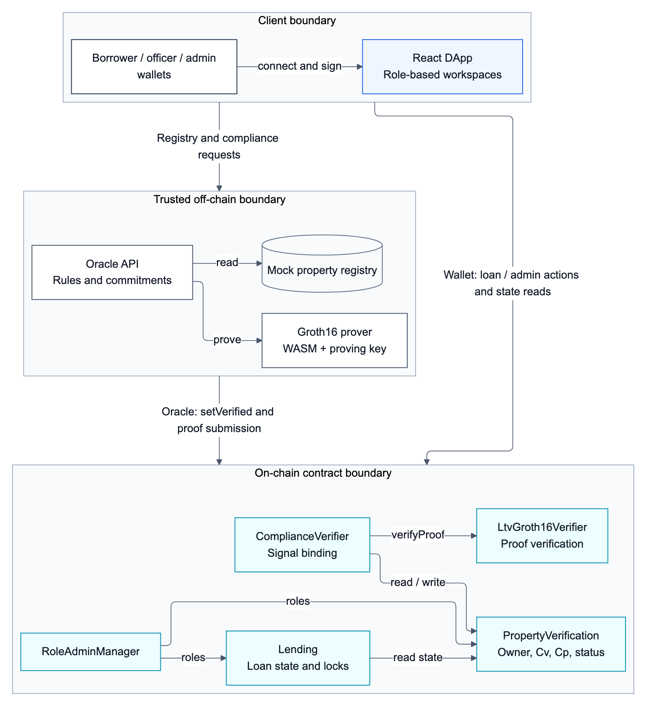
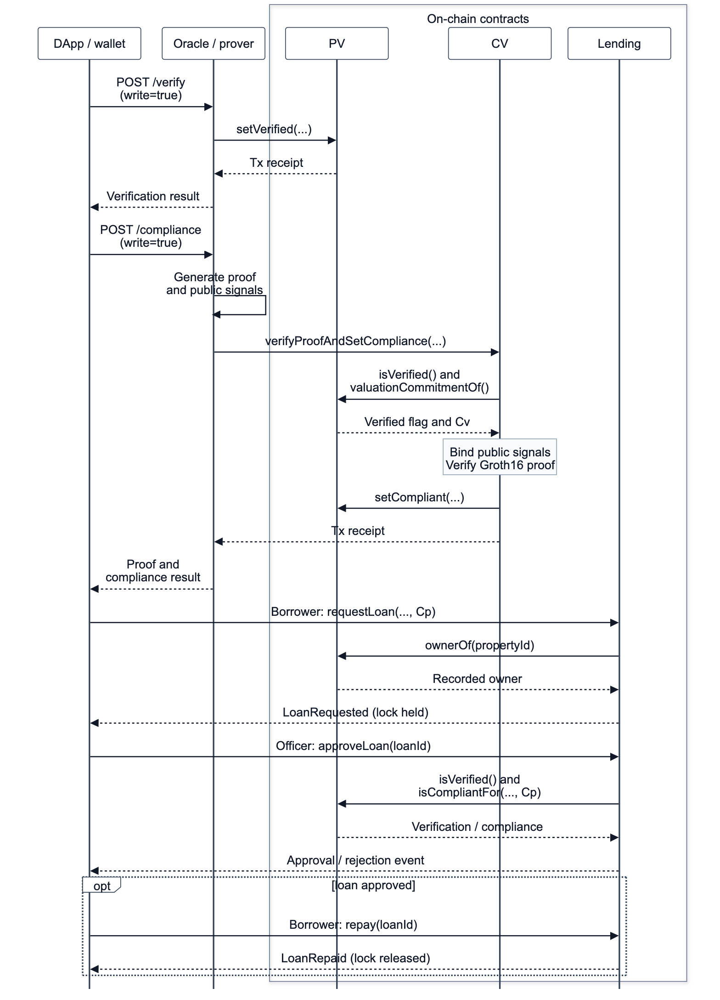
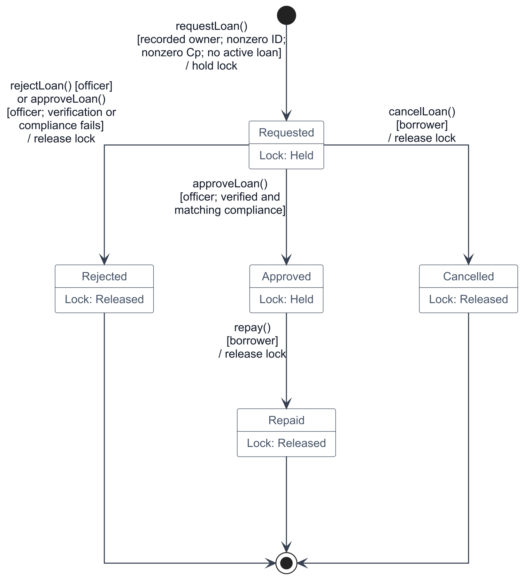
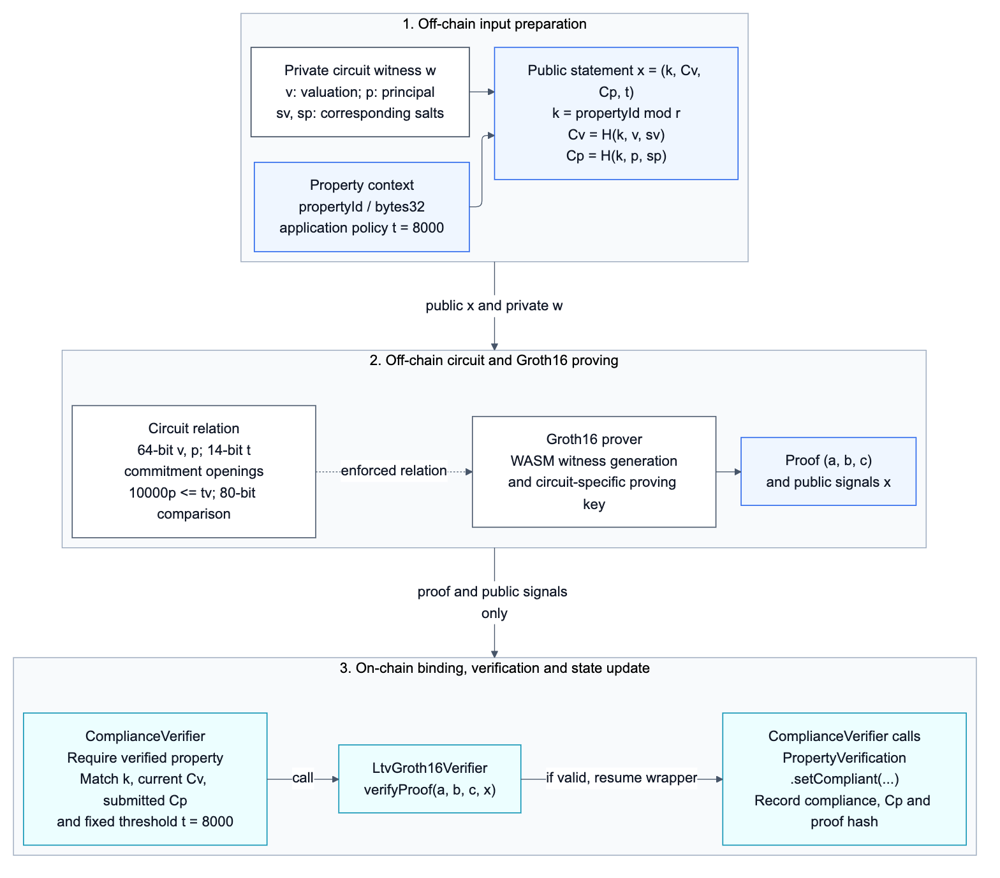
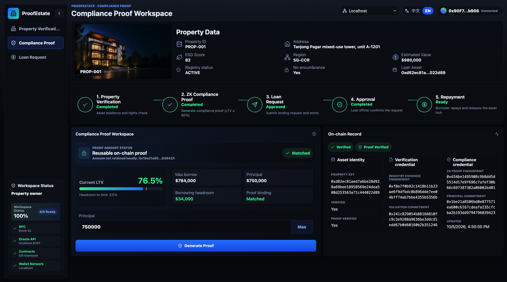
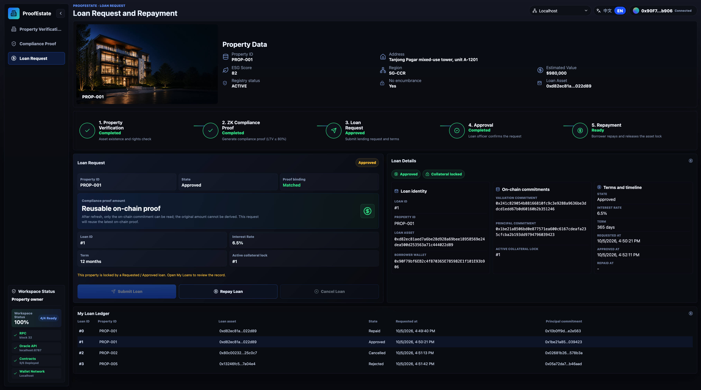

# ProofEstate: Blockchain-Based Real Estate Lending Platform with ZK Compliance and Property Verification

## Abstract

Public blockchains make lending decisions auditable, but direct verification of a loan-to-value (LTV) rule exposes financial inputs. A valid zero-knowledge proof must also be bound to the property record and requested principal before it can authorize the intended lending decision. This thesis investigates that application-security problem through ProofEstate, an implemented real-estate lending prototype.

ProofEstate combines a mock registry, trusted oracle, MiMC commitments, Groth16 proof, Solidity contracts, and React application. The circuit proves that a committed principal does not exceed 80% of a committed valuation. Before writing compliance, the verifier checks the property field identifier, current valuation commitment, principal commitment, and fixed threshold. Loan approval requires current verification and compliance matching the request. Ownership is checked when a loan is requested; approval and later refreshes have distinct boundaries.

Evaluation covers functional correctness, security and arithmetic boundaries, and local performance. The automated suites contain 37 passing contract and circuit tests, 12 oracle API tests, and six frontend component tests. A complete local workflow, circuit and gas inspection, four policy scenarios, and sequential 10/30/50-run timing sessions provide complementary evidence. The primary 30-run session reports median proof generation of 399.53 ms and a median read-only compliance response of 409.16 ms, excluding blockchain transactions. Proof verification and compliance update average 310,411 gas in the measured workload. Security and arithmetic tests establish substitution and threshold rejection, integer boundaries, and the limits of proof reuse, ownership continuity, compliance replacement, and post-approval revalidation.

The contribution is a concrete proof-to-state binding pattern and conditional approval argument, supported by reproducible local observations. The prototype omits valuation and principal plaintext from the blockchain, while its mock registry and unauthenticated API expose values and salts. Deterministic valuation blinding does not establish strong hiding. Proof freshness, approval-time ownership revalidation, continuous collateral monitoring, real settlement, and production performance remain open requirements. No comparative speedup or application-wide confidentiality is established.

**Keywords:** zero-knowledge proofs, smart contracts, real-estate lending, privacy-preserving compliance, Groth16, oracle, commitments

## 1. Introduction

### 1.1 Motivation

Smart contracts encode rules, restrict privileged actions, and preserve inspectable records of state transitions [1], [2]. These properties support auditable lending workflows in which property verification, approval, collateral locks, repayment, and role administration must follow explicit conditions.

The same transparency creates a privacy problem. Contract calldata, logs, and storage can be inspected by external observers. In real-estate lending, sensitive information can include property valuation, requested principal, borrower identity, ownership history, income evidence, and lender-specific risk decisions. A plaintext contract design could verify a loan-to-value (LTV) rule by accepting valuation and principal values directly, but that design would permanently reveal the financial facts used in the decision.

Zero-knowledge proofs provide a mechanism for separating validity from disclosure. A prover can demonstrate that private witness values satisfy a public statement without revealing those witness values. For a lending rule, this means a system can prove that a requested principal is within a maximum LTV threshold while keeping both the property valuation and the requested principal off chain.

ProofEstate implements this approach in an end-to-end prototype. It connects off-chain property and loan values to public smart-contract state through commitments, proof verification, and explicit application-level binding checks.

### 1.2 Research Question

The main research question is:

*Can a real-estate lending workflow enforce an LTV rule on chain without publishing plaintext property valuation or requested loan principal?*

The question is decomposed into five design and evaluation subquestions:

1. How can off-chain property facts be represented on chain without publishing plaintext valuation data?
2. How can a zero-knowledge proof be bound to a specific property and requested principal commitment?
3. How can approval require current, property- and principal-bound compliance, and what proof freshness is enforced?
4. What are the proof-generation, API-latency, circuit-size, and gas costs of the design in a reproducible local environment?
5. What trust assumptions remain after introducing zero-knowledge proofs?

### 1.3 Contributions

This thesis makes the following contributions:

1. An end-to-end architecture for privacy-preserving real-estate lending verification, combining a trusted oracle service, MiMC commitments, Groth16 proof generation, Solidity contracts, and a React DApp.
2. A concrete zero-knowledge LTV statement with four public inputs, four private inputs, property-bound commitments, range checks, and an inclusive 80 percent policy threshold.
3. An application-level binding design that connects proof public signals to current on-chain property state and principal commitments before a loan can be approved.
4. A reproducible evaluation package covering contract tests, oracle API tests, frontend tests, gas measurements, proof-generation benchmarks, circuit-size inspection, frontend build output, and local end-to-end workflow evidence.
5. A comparative analysis of plaintext on-chain verification, off-chain-only verification, the selected Groth16 design, alternative proof systems, and alternative oracle models.
6. A bounded security and privacy analysis that separates the implemented guarantees from remaining trust assumptions, residual risks, limitations, and production-hardening requirements.

### 1.4 Scope and Non-Goals

The implemented compliance rule is:

```text
loanPrincipal * 10000 <= propertyValue * 8000
```

This is equivalent to proving:

```text
loanPrincipal <= 80 percent of propertyValue
```

The rule is an illustrative application policy, not an assertion that 80% is the legally applicable LTV limit for a particular jurisdiction, borrower, or loan product. The fixed threshold isolates proof binding and lending-state enforcement within a tractable experimental design. ProofEstate does not implement real disbursement, fiat settlement, ETH/ERC20 transfers, KYC/AML, credit scoring, liquidation, delinquency handling, production registry integration, production monitoring, or decentralized oracle governance. These omissions define the boundary of the research prototype.

### 1.5 Thesis Organization

Chapter 2 reviews background and related work. Chapters 3 and 4 present design and implementation. Chapter 5 evaluates the prototype, and Chapter 6 analyzes security and privacy. Chapter 7 answers the research subquestions and discusses design trade-offs. Chapters 8 and 9 present limitations, future work, and conclusions. References and reproduction appendices follow.

## 2. Background and Related Work

### 2.1 Ethereum-Compatible Smart Contracts

Smart contracts are deterministic programs deployed to a blockchain. Ethereum-compatible contracts execute on the Ethereum Virtual Machine (EVM), where they can store state, validate transactions, emit events, and call other contracts. Because contract execution is replicated and validated by the network, smart contracts are useful when participants need shared state and predictable enforcement [1], [2].

ProofEstate uses Solidity contracts on a local Hardhat network, with optional Sepolia deployment support. The local network is the canonical evaluation environment because it provides deterministic execution, stable accounts, repeatable gas measurement, and independence from public testnet RPC or faucet conditions.

### 2.2 Role-Based Access Control

Lending workflows require distinct permissions for different actors. A property oracle should be able to write verification records, but it should not approve loans. A loan officer should be able to approve or reject requested loans, but it should not overwrite property valuations. A protocol administrator should manage roles, while accidental removal of the final administrator should be prevented.

ProofEstate uses role-based access control patterns based on OpenZeppelin Contracts [3]. The main roles are:

- `ORACLE_ROLE` for property verification writes;
- `COMPLIANCE_ROLE` for compliance writes by `ComplianceVerifier`;
- `LOAN_OFFICER_ROLE` for loan approval and rejection;
- `DEFAULT_ADMIN_ROLE` for role administration.

This role separation supports least privilege and makes the system's security boundary easier to audit.

### 2.3 Oracles

Blockchains cannot directly read external systems such as property registries, identity providers, land-title databases, or bank records. Oracles bridge external data into smart-contract applications. Decentralized oracle networks are commonly used to reduce reliance on a single operator, while centralized oracles are simpler and easier to reproduce in a prototype [12].

ProofEstate uses a centralized oracle service. It reads a mock property registry, evaluates deterministic verification rules, computes commitments, constructs proof inputs, generates Groth16 proof calldata, and can submit verification and compliance transactions. This choice is appropriate for a reproducible research prototype, but it introduces a clear trust assumption: the oracle sees plaintext witness values and is trusted to interpret registry facts honestly.

### 2.4 Commitments

A commitment can bind a value, with hiding dependent on its construction and secret randomness. ProofEstate uses hash-based commitments to refer to valuation and principal without directly publishing them in contract storage. The circuit computes:

```text
valuationCommitment = MiMC(propertyKeyField, propertyValue, valuationSalt)
principalCommitment = MiMC(propertyKeyField, loanPrincipal, principalSalt)
```

MiMC is selected because it is designed for low multiplicative complexity and is efficient in arithmetic-circuit settings [5]. Ethereum-native hashes such as Keccak are natural on chain, but expensive inside Circom-style arithmetic circuits. Including `propertyKeyField` in both commitments binds the hidden values to a property context and reduces straightforward replay across unrelated properties.

### 2.5 Zero-Knowledge Proofs

A zero-knowledge proof allows a prover to convince a verifier that a statement is true without revealing the private witness. ProofEstate uses Groth16, a succinct non-interactive argument system whose compact proofs and practical verifier cost make it widely used in blockchain applications [4].

Groth16's main trade-off is trusted setup. It requires proving and verification artifacts tied to a specific circuit. In ProofEstate, these artifacts are prototype-grade and suitable for local reproducibility and research evaluation. A production system would need a documented trusted setup ceremony or a proof system with different setup assumptions. The circuit is written in Circom and proof generation is performed with snarkjs [6], [7].

### 2.6 Loan-to-Value Policy

Loan-to-value ratio compares a loan amount with collateral value:

```text
LTV = loanPrincipal / propertyValue
```

ProofEstate implements an 80 percent maximum LTV policy. The circuit expresses the rule using integer multiplication in basis points:

```text
loanPrincipal * 10000 <= propertyValue * 8000
```

This avoids decimal arithmetic and gives the circuit a precise integer constraint. On chain, the contracts enforce the proved relation through proof verification and public-signal binding.

### 2.7 Related Systems

Compound and Aave implement collateralized borrowing, interest, liquidity pools, and repayment for crypto-native assets with public collateral values [10], [11]. DeFi research identifies transparency and composability as central properties of these systems [13]. ProofEstate instead examines collateral facts supplied off chain and a lending predicate whose financial inputs are omitted from the blockchain.

Chainlink connects external data and off-chain computation to contracts [12]. Town Crier and DECO study source assurance through trusted execution, authenticated web data, and zero-knowledge statements [14], [15]. ProofEstate uses a centralized mock-registry oracle to isolate proof and state integration; external data authenticity remains a separate trust assumption.

Groth16 offers compact proofs and efficient verification with circuit-specific setup [4]. PLONK supports a universal, updatable structured reference string [8], while STARK-style systems offer transparency with different proof-size and verification-cost trade-offs [9]. These choices affect artifact maintenance as well as runtime cost.

Zerocash uses zk-SNARKs to protect currency transaction metadata [16], while Hawk studies private smart contracts [17].

ProofEstate applies selective disclosure to a lending predicate: the chain records commitments, proof evidence, and workflow state while omitting valuation and principal plaintext. Related policy workflows include income, identity, and insurance eligibility. In this prototype, registry and API access still disclose the financial inputs; Section 6.6 examines that application boundary.

### 2.8 Research Gap and Positioning

ProofEstate examines how a proof of a private lending predicate authorizes a transition in a public lending state machine. The contribution combines an explicit proof statement, checks against current property and principal commitments, and executable tests of the resulting approval conditions. The cited lending protocols, oracle designs, and private-contract systems provide architectural context; the experiments evaluate the implemented prototype.

The design connects oracle-written property commitments, a fixed LTV proof, and role-gated loan transitions. Table 1 locates this integration within the related architectures.

*Table 1. Architectural context and the focus of this prototype.*

| Area | What existing work provides | Focus of this prototype |
| --- | --- | --- |
| DeFi lending | Collateral accounting and public loan transitions | Binding private property facts to lending compliance |
| Oracles | External data delivery and source attestations | Integrating oracle commitments with LTV proofs |
| ZK payments and private smart contracts | Hidden transactions and private computation | A focused compliance predicate with explicit state binding |
| Smart-contract access control | Roles and administrative permissions | Linking privileged actions to proof-bound loan transitions |

## 3. System Design

### 3.1 Design Requirements

ProofEstate is designed around five requirements:

1. The property valuation and requested principal must not be stored in plaintext on chain.
2. The on-chain verifier must reject proofs whose public signals do not match the target property and requested principal commitment.
3. Approval must require current verification and compliance matching the requested principal commitment. Refreshing verification must clear the stored compliance decision.
4. The prototype must be reproducible in a local environment without depending on public testnet availability.
5. The remaining trust assumptions must be explicit rather than hidden behind the zero-knowledge proof.

These requirements shape the architecture. The oracle handles off-chain registry interpretation and proof generation. Commitments represent private values on chain. The zero-knowledge proof verifies policy satisfaction. Smart contracts bind proof outputs to application state and enforce the loan lifecycle.

### 3.2 Architecture Overview

ProofEstate links off-chain facts to on-chain verification and enforcement (Figure 1).

The components are a React DApp, Node.js oracle API, mock property registry, Circom/snarkjs Groth16 prover, Solidity verification/compliance/lending/role contracts, and a local Hardhat chain for reproduction and evaluation.

The flow moves from registry lookup and oracle verification to commitment and proof generation, on-chain verification, loan request and decision, and repayment or closure. Figure 1 shows the architecture and its trust boundaries; Figure 2 traces the corresponding data and control flow.

### 3.3 Actors

The main actors are:

*Table 2. Operational actors.*

| Actor | Responsibility |
| --- | --- |
| Property owner / borrower | Initiates verification, compliance proof generation, loan request, cancellation, and repayment |
| Oracle service | Reads registry data, computes commitments, generates proofs, and writes verification/compliance transactions |
| Loan officer | Approves or rejects requested loans |
| Protocol admin | Manages protocol administration roles |
| Auditor / evaluator | Reviews contract state, events, benchmark results, screenshots, and documentation |

{width=6.2in}

*Figure 1. ProofEstate architecture and the registry, oracle/prover, client, and contract boundaries. The API handles plaintext witness data; the on-chain layer receives commitments, proofs, and public signals.*

{width=6.2in}

*Figure 2. Representative end-to-end sequence with write-enabled API calls. PV denotes PropertyVerification; CV, ComplianceVerifier; Cv and Cp, the valuation and principal commitments. The oracle/prover groups registry lookup and proving; CV summarizes binding and generated-verifier execution. Figure 3 details loan transitions; Figure 4 expands proving and verification.*

### 3.4 Workflow

The workflow in Figure 2 proceeds as follows:

1. **Verification.** The oracle checks the registry, then records the owner, result, and valuation commitment, clearing prior compliance.
2. **Proving.** For the requested principal, the oracle prepares commitments and witness inputs and generates a Groth16 proof.
3. **Compliance.** The wrapper checks current verification, binds all four public signals, verifies the proof, and records compliance for the principal commitment.
4. **Request.** `Lending` checks the recorded owner, nonzero property ID and commitment, and absence of an active loan, then creates Requested state and holds the lock.
5. **Decision.** Officer approval requires current verification and matching compliance, without rechecking ownership. Failed checks or manual rejection release the lock.
6. **Closure.** Borrowers cancel Requested loans or repay Approved loans. Both release the lock; repayment changes state without transferring funds.

### 3.5 Data Visibility Boundary

The chain receives property identifiers, ownership, commitments, proof evidence, and lifecycle state; valuation, principal, salts, and witness files remain off chain. This separates publication at the contract interface from confidentiality of the application.

The oracle handles plaintext inputs, and the mock registry and unauthenticated API expose financial values and proof inputs. Deterministic valuation blinding also permits candidate testing. Section 6.6 analyzes these disclosure boundaries.

### 3.6 Design Invariants

Five invariants bind the proved LTV predicate to the intended property state and loan request:

*Table 3. Contract and application invariants.*

| Invariant | Enforcement point |
| --- | --- |
| Plaintext valuation and principal are not written to contract storage | Commitments are stored; witness values remain off chain |
| A proof must match the current property and principal context | `ComplianceVerifier` checks all public signals before calling the generated verifier |
| A refreshed property verification clears the stored compliance decision | `PropertyVerification.setVerified` resets compliance and principal binding; this does not make an unchanged proof single-use |
| Loan approval requires proof-bound compliance for the same principal commitment | `Lending.approveLoan` calls `isCompliantFor(propertyId, principalCommitment)` |
| Contract authorization does not depend on the frontend | Contracts enforce roles and state; API input validation does not authenticate the user or authorize use of the oracle signer |

## 4. Implementation

### 4.1 Repository Structure

The repository is organized as follows:

```text
contracts/
backend/oracle/
circuits/
zk/
frontend/
scripts/
test/
docs/
```

The `contracts/` folder contains Solidity contracts and the generated Groth16 verifier. The `backend/oracle/` folder contains the oracle API and property-verification logic. The `circuits/` and `zk/` folders contain the Circom circuit, ZK build outputs, and proof-generation helpers. The `frontend/` folder contains the React DApp. The `scripts/` folder contains deployment, synchronization, local workflow, ZK build, and benchmark scripts. The `docs/` folder contains design, benchmark, security, deployment, and screenshot evidence.

### 4.2 Smart Contracts

The security-critical on-chain layer is divided into five core contracts.

#### PropertyVerification

`PropertyVerification` stores oracle-written property verification records and verifier-written compliance records. It tracks:

- whether a property is verified;
- owner address;
- evidence hash;
- valuation commitment;
- compliance status;
- proof hash;
- principal commitment;
- update timestamp.

`setVerified` requires `ORACLE_ROLE`. Every refresh clears the stored compliance flag, proof hash, and principal commitment. A proof bound to a different valuation commitment then fails the binding check. If the valuation commitment remains unchanged, the same previously valid proof can be submitted again. Clearing application state therefore does not establish cryptographic freshness.

`setCompliant` requires `COMPLIANCE_ROLE`. In deployment, that role is granted to `ComplianceVerifier`, preventing arbitrary accounts from writing compliance state directly.

#### ComplianceVerifier

`ComplianceVerifier` is the bridge between application state and the generated Groth16 verifier. It does not accept a proof merely because the verifier returns true. Before proof verification, it checks each public signal against the current application state:

*Table 4. Required public-signal bindings.*

| Public signal | Required value |
| ---: | --- |
| 0 | `propertyIdToField(propertyId)` |
| 1 | `PropertyVerification.valuationCommitmentOf(propertyId)` |
| 2 | submitted `principalCommitment` |
| 3 | fixed `MAX_LTV_BPS`, currently `8000` |

Only after these checks pass does it call `LtvGroth16Verifier.verifyProof`. If the proof is valid, it writes compliant status, proof hash, and principal commitment to `PropertyVerification`.

This binding is essential. Without it, a proof could be mathematically valid but unrelated to the target property, valuation, or principal used in loan approval.

#### Lending

`Lending` manages the loan lifecycle:

```text
Requested
-> Approved
-> Repaid
```

or:

```text
Requested
-> Rejected / Cancelled
```

The contract requires the caller to be the recorded property owner when requesting a loan. During approval, it checks:

- the property is verified;
- the property is compliant;
- compliance is bound to the same principal commitment;
- the caller has `LOAN_OFFICER_ROLE`;
- no invalid state transition is attempted.

Figure 3 summarizes the loan lifecycle. The contract enforces one active loan per property, preventing duplicate active borrowing against the same collateral within the prototype model.

{width=5.7in}

*Figure 3. Loan lifecycle and property-lock states; Cp is the principal commitment. Authorization or loan-state errors revert without a transition. At approval, an unverified property or absent/mismatched compliance causes rejection. Repayment records a state change without asset settlement.*

Ownership is checked at request time only. A later oracle ownership update can coexist with approval of the original borrower's pending request if valid compliance is restored. Moreover, only one principal commitment is stored per property: submitting compliance for another principal replaces the previous record and can cause a pending request to be rejected. Once a loan is approved, later verification or compliance changes do not automatically alter its state. These behaviors are verified by the security-boundary tests and are limitations of approval as a snapshot decision.

#### RoleAdminManager

`RoleAdminManager` coordinates protocol admin grants and revocations across `PropertyVerification`, `Lending`, and itself. It prevents removal of its final manager administrator. Its inherited role methods and the managed contracts' individual role methods can still create partial administrative configurations, so the manager count is not a proof of complete administrative continuity across all contracts.

#### Generated Groth16 Verifier

`LtvGroth16Verifier` is generated from the Groth16 proving artifacts. It performs the pairing-based proof verification used by `ComplianceVerifier`. The generated verifier is treated as part of the proof-system artifact set and is tied to the current circuit.

### 4.3 Oracle Service

The oracle service performs four responsibilities:

1. It reads mock property records.
2. It evaluates deterministic property verification rules.
3. It computes commitments and proof inputs.
4. It generates and optionally submits compliance proof transactions.

The service exposes API endpoints for health checks, property listing, property verification, and compliance proof generation. It validates property IDs, network labels, and principal values before building proof inputs. Invalid requests fail explicitly rather than causing unhandled server errors.

The oracle is trusted for source correctness, witness handling, and privileged writes. Its current API returns plaintext property data and proof inputs; input validation and an owner filter do not constitute access control. Future work must address both data-source authenticity and confidential witness delivery through authenticated interfaces, restricted responses, signed registry attestations, or threshold oracle verification.

### 4.4 ZK Circuit

The circuit source is:

```text
circuits/ltv.circom
```

It proves:

```text
loanPrincipal * 10000 <= propertyValue * maxLtvBps
```

The threshold is a public circuit input; the deployed wrapper fixes `maxLtvBps = 8000`. Figure 4 traces input preparation, proving, and on-chain verification.

The public inputs are:

*Table 5. Public circuit inputs.*

| Input | Meaning |
| --- | --- |
| `propertyKeyField` | property ID mapped into the SNARK scalar field |
| `valuationCommitment` | commitment to property valuation |
| `principalCommitment` | commitment to requested principal |
| `maxLtvBps` | maximum LTV threshold in basis points |

The private inputs are:

*Table 6. Private circuit inputs.*

| Input | Meaning |
| --- | --- |
| `propertyValue` | plaintext valuation from the mock registry |
| `loanPrincipal` | plaintext requested principal |
| `valuationSalt` | salt for valuation commitment |
| `principalSalt` | salt for principal commitment |

The circuit uses `MiMCSponge(3, 220, 1)` with `k = 0`. It applies 64-bit range checks to `propertyValue` and `loanPrincipal`, a 14-bit range check to `maxLtvBps`, and an 80-bit comparison for the multiplied values.

Circomlib's `LessThan` proves strict less-than. ProofEstate needs an inclusive less-than-or-equal condition. The circuit therefore checks:

```text
loanPrincipal * 10000 < propertyValue * maxLtvBps + 1
```

For integer arithmetic, this is equivalent to:

```text
loanPrincipal * 10000 <= propertyValue * maxLtvBps
```

{width=6.2in}

*Figure 4. Proof workflow. Field mapping and commitment preparation occur outside the circuit; H denotes MiMC Sponge and r is the BN254 scalar-field modulus. The circuit checks commitment openings, ranges, and LTV; contracts check the statement and proof before recording compliance.*

### 4.5 React DApp

The React DApp provides borrower, loan-officer, and administrator workspaces. Borrowers connect a wallet, browse properties, request verification and compliance proofs, and manage loan requests, cancellation, and repayment. Officers review, approve, or reject requests; administrators manage roles. Contract-readiness checks, commitment records, events, and audit views support inspection of the workflow.

The DApp improves usability and observability, but it does not replace contract validation. The contracts and oracle API remain responsible for enforcing security-critical checks. Figures 5 and 6 use local mock values for evaluation visibility; they do not show plaintext valuation or principal stored on chain.



*Figure 5. DApp compliance proof workspace after successful proof generation for `PROP-001` and principal `750000`. The view shows the calculated LTV, maximum borrow amount, principal commitment, proof verification status, and matched proof binding.*

### 4.6 Reproducibility Artifacts

The implementation is accompanied by contract and circuit specifications, automated tests, local deployment and workflow scripts, raw benchmark JSON, and DApp screenshot evidence. Appendix A gives the reproduction commands; Appendix B maps the supporting documents to their purposes. Runtime versions, measurement workloads, source metadata, and working-tree status are recorded for each evidence type to support reproducibility.

## 5. Evaluation

### 5.1 Evaluation Questions and Metrics

The evaluation is organized around six questions that correspond to the research question and design requirements:

*Table 7. Evaluation questions and evidence.*

| ID | Evaluation question | Evidence used |
| --- | --- | --- |
| EQ1 | Does the implementation enforce the intended role and state-transition rules? | Contract tests, role tests, loan lifecycle tests |
| EQ2 | Does the ZK proof bind to the intended property, valuation commitment, principal commitment, and LTV threshold? | Circuit design, proof-verifier tests, public-signal mismatch tests |
| EQ3 | Does the local workflow complete end to end without publishing plaintext valuation or principal on chain? | Local CLI workflow, DApp screenshots, contract state inspection |
| EQ4 | Do boundary and failure cases behave correctly? | Correctness matrix for compliant, boundary, non-compliant, and invalid-registry cases |
| EQ5 | What are the main local performance costs of the successful proof-generation path? | 30-run benchmark, 10/30/50 repeated-run stability snapshot, gas snapshot, circuit-size inspection |
| EQ6 | What assumptions and residual risks remain after introducing zero-knowledge proofs? | Security analysis, threat model, limitations, hosted Oracle API analysis |

The measured metrics are selected to match the prototype's security and performance claims rather than to estimate production throughput.

*Table 8. Metrics and their interpretation.*

| Metric category | Metric | Interpretation |
| --- | --- | --- |
| Functional correctness | Passing contract, oracle, and frontend tests | Whether implementation behavior matches intended role, proof, API, and UI assumptions |
| Boundary correctness | Compliant, exact-boundary, non-compliant, and invalid-registry cases | Whether the policy accepts and rejects the intended input classes |
| Proof performance | Groth16 proof-generation latency | Main off-chain cryptographic cost of the compliance path |
| API performance | `/verify` and `/compliance` latency | Local read-only oracle-service response time |
| On-chain cost | Gas for verification, compliance, and loan lifecycle methods | Cost distribution across proof verification and ordinary lending state transitions |
| Circuit complexity | Wires, constraints, public/private inputs | Size of the implemented proof statement and likely direction of scaling pressure |
| Reproducibility | Raw benchmark JSON, command, environment, git commit, dirty flag | Whether another evaluator can inspect and rerun the evidence path |

### 5.2 Experimental Setup and Measurement Method

The evaluation uses a local Hardhat chain and oracle service to measure functional behavior, proof generation, API latency, and gas under controlled conditions. This setup provides deterministic accounts and repeatable execution independently of public RPC availability.

The experiment matrix covers a below-limit principal, the exact LTV boundary, a principal one unit above the boundary, and an invalid registry record. The primary and boundary sessions each exclude five warm-ups and retain 30 measured iterations. Sequential stability sessions retain 10 and 50 iterations to examine variation across bounded repeated workloads; the primary 30-run session supplies the middle comparison. Appendix A provides the exact commands, and Appendix B identifies the summary and raw evidence files.

Warm-up iterations are excluded from summary statistics. Each iteration sequentially times input construction, a direct proof-generation invocation, and separate API requests. The API calls use `write: false`; neither API timing includes submission, transaction inclusion, or confirmation. The `/compliance` request generates its own proof, so its timing is not the enclosing duration of the separately timed direct proof. Differences between their medians cannot estimate API overhead. Sepolia transaction latency is excluded.

The benchmark uses the nearest-rank quantile definition: the reported 50th percentile is sorted observation `ceil(0.50*n)` and P95 is observation `ceil(0.95*n)`. For even sample counts, the reported “median” is therefore the lower central observation, rather than the mean of the two central observations. Standard deviation uses denominator `n`; P95 is suppressed for fewer than 20 measurements. These descriptive summaries do not provide confidence intervals or a statistical comparison between implementations.

Table 9 records the performance-measurement environment.

*Table 9. Local performance-measurement environment.*

| Item | Value |
| --- | --- |
| OS | Darwin 23.1.0 x64 |
| CPU | Intel(R) Core(TM) i7-9750H CPU @ 2.60GHz |
| Node | v20.20.2 |
| pnpm | 10.9.0 |
| Hardhat | 2.28.6 |
| snarkjs | 0.7.6 |
| circom | 2.2.3 at `$HOME/.cargo/bin/circom` |
| Git commit | `5f512070cbfc8c0b40d50d2be50d6595b17f29a7` |
| Git dirty flag | `true` during manuscript/documentation updates |
| Network label | `localhost` |

The automated functional suites were executed under Node v22.22.1. Latency and gas measurements use the Node 20 environment and their recorded workloads. Functional outcomes and performance observations evaluate distinct aspects of the implementation; each is reported with its own runtime and measurement scope.

### 5.3 Functional and Boundary Correctness

#### Functional checks

The automated evaluation comprises 37 contract and circuit tests, 12 oracle API tests, and six frontend component tests. Table 10 summarizes these results together with build, artifact, and workflow checks.

*Table 10. Functional evaluation results.*

| Evidence | Result |
| --- | --- |
| Contract and circuit tests | 37 passing |
| Oracle API tests | 12 passing |
| Frontend tests | 6 passing |
| Frontend production build | Passing |
| Gas snapshot | Passing |
| ZK compile | Passing with circom 2.2.3 |
| Local readiness check | Passing |
| Local CLI happy path | Passing, final state `Repaid` |
| DApp screenshot evidence | Captured local workflow states from readiness to audit log |

The contract tests cover deployment, role configuration, property verification, compliance verification, public signal mismatch rejection, tampered proof rejection, stale compliance clearing, loan lifecycle transitions, duplicate active-loan prevention, borrower-only restrictions, loan officer enforcement, and admin protection.

The oracle API tests cover service readiness, owner-scoped property listing, unsupported network rejection, property ID validation, principal validation, non-compliant behavior, and registry verification failure behavior.

The six frontend tests cover the wallet gate and selected table/detail components. They do not exercise the complete wallet transaction lifecycle or all application pages. The frontend production build passes, with a Vite chunk-size warning that does not fail the build.

Security-boundary coverage includes cross-property proof substitution, threshold-signal tampering, proof resubmission after an unchanged valuation refresh, ownership changes before approval, principal-compliance replacement, and compliance reset after approval. These cases evaluate both enforced rejection conditions and accepted behaviors that delimit the security claim. Arithmetic coverage includes exact-boundary acceptance on chain, circuit rejection one unit above the limit, the largest 64-bit valuation and its maximum compliant principal, and valuation/principal overflow with consistently recomputed commitments. Direct proving bypasses API validation to test the circuit constraints independently. All contract and circuit cases are part of the same 37-test suite in `test/proofestate.test.js`; Chapter 6 interprets the security implications.

#### Policy scenarios and arithmetic boundaries

`PROP-001` has a mock registry valuation of `980000`. Under the 80 percent LTV rule:

```text
980000 * 8000 / 10000 = 784000
```

The benchmark matrix uses this value to test the compliant path, exact boundary, one-unit-above-boundary failure, and registry-failure path.

*Table 11. Policy scenarios and recorded proving behavior.*

| Scenario | Property | Principal | Policy expectation | Recorded proving behavior |
| --- | --- | ---: | --- | --- |
| Compliant | `PROP-001` | 750000 | Within 80% limit | Proof generated |
| Exact boundary | `PROP-001` | 784000 | Equals 80% limit | Proof generated |
| Above boundary | `PROP-001` | 784001 | Exceeds 80% limit | Proving skipped: non-compliant |
| Registry failure | `PROP-004` | 100000 | Encumbrance rule fails | Proving skipped: `NO_ENCUMBRANCE` |

Each scenario contains 30 measured iterations and no recorded timing exceptions. Valuation and principal use the same abstract integer unit; no currency conversion or floating-point monetary arithmetic is performed.

Passing scenarios generate Groth16 proofs and rejected scenarios skip proving. In the timing harness, “failures” counts caught exceptions or non-success HTTP responses; an expected policy rejection is not a timing failure. The harness does not independently assert every API response's decision or verify every generated proof on chain. Recorded skip reasons and implementation tests provide separate behavioral evidence. Registry eligibility is checked by the oracle and is not included in the LTV circuit.

### 5.4 Proof and API Performance

#### Primary compliant path

Primary compliant path: `PROP-001`, principal `750000`, 5 warm-up runs and 30 measured runs.

*Table 12. Primary sequential latency measurements in milliseconds.*

| Metric | n | Fail. | Min ms | Median ms | Mean ms | P95 ms | Max ms | Std dev |
| --- | ---: | ---: | ---: | ---: | ---: | ---: | ---: | ---: |
| Build verification input | 30 | 0 | 1.91 | 3.05 | 3.22 | 4.77 | 7.94 | 1.09 |
| Build compliance inputs | 30 | 0 | 3.19 | 3.73 | 4.01 | 5.31 | 6.72 | 0.79 |
| Generate Groth16 proof | 30 | 0 | 372.42 | 399.53 | 407.55 | 469.53 | 481.21 | 24.66 |
| Oracle `/verify` latency | 30 | 0 | 5.02 | 5.98 | 6.78 | 11.45 | 12.54 | 1.91 |
| Oracle `/compliance` latency | 30 | 0 | 377.61 | 409.16 | 413.27 | 480.30 | 487.67 | 22.65 |

The results show that proof generation dominates local latency. Building verification and compliance inputs is fast, with median times below 5 ms. Oracle `/verify` is also fast because it evaluates registry rules and computes commitments. Oracle `/compliance` has a median latency of 409.16 ms because it includes Groth16 proof generation.

The two reported medians are similar in scale, which is consistent with proving being the main cost of a successful read-only compliance request. It does not measure API overhead: the API and direct measurements use separate proof invocations. A paired decomposition would require timing the prover inside each API request and reporting the residual from the same invocation.

#### Boundary and rejection paths

*Table 13. Boundary and rejection-path timings.*

| Case | Metric | n | Fail. | Median ms | Mean ms | Notes |
| --- | --- | ---: | ---: | ---: | ---: | --- |
| Boundary | Generate Groth16 proof | 30 | 0 | 437.08 | 471.37 | Proof generated at exactly 80% LTV |
| Boundary | Oracle `/compliance` latency | 30 | 0 | 432.62 | 451.57 | Includes proof generation |
| Non-compliant | Build compliance inputs | 30 | 0 | 3.24 | 3.37 | Rejects above 80% LTV |
| Non-compliant | Oracle `/compliance` latency | 30 | 0 | 5.38 | 5.54 | Proof generation skipped |
| Invalid registry | Build compliance inputs | 30 | 0 | 0.19 | 0.19 | Fails registry validation |
| Invalid registry | Oracle `/compliance` latency | 30 | 0 | 1.56 | 1.66 | Proof generation skipped |

Rejected paths are faster because the oracle does not invoke Groth16 proof generation when the LTV predicate or registry validation fails.

#### Bounded repeated-run stability

All stability runs use `PROP-001` with principal `750000` and the same local Oracle API. This is a repeated local workload, not a public-chain throughput or concurrent-user benchmark.

*Table 14. Sequential timing-session summaries.*

| Measured runs | Fail. | Median proof ms | Mean proof ms | P95 proof ms | Median `/compliance` ms | P95 `/compliance` ms |
| ---: | ---: | ---: | ---: | ---: | ---: | ---: |
| 10 | 0 | 441.43 | 455.58 | n/a | 428.45 | n/a |
| 30 | 0 | 399.53 | 407.55 | 469.53 | 409.16 | 480.30 |
| 50 | 0 | 406.01 | 413.36 | 440.06 | 408.36 | 475.02 |

The three sequential sessions record zero timing failures and proof-generation medians between 399.53 ms and 441.43 ms. They describe consistency in these bounded local workloads, without establishing a failure-rate bound, statistical equivalence, production scalability, or concurrent-traffic capacity.

### 5.5 On-Chain Gas Costs

Gas was measured with the Hardhat gas reporter under Node 20 using the workload documented in `docs/evaluation-notes.md`. The reproduction command is given in Appendix A. Method averages refer to the recorded transaction calls and storage states; they are not averages over the number of automated test cases.

*Table 15. Method gas averages for the measured workload.*

| Contract | Method | Average gas |
| --- | --- | ---: |
| `PropertyVerification` | `setVerified` | 115996 |
| `ComplianceVerifier` | `verifyProofAndSetCompliance` | 310411 |
| `Lending` | `requestLoan` | 233609 |
| `Lending` | `approveLoan` | 81464 |
| `Lending` | `cancelLoan` | 52694 |
| `Lending` | `rejectLoan` | 52620 |
| `Lending` | `repay` | 57219 |
| `RoleAdminManager` | `grantProtocolAdmin` | 120499 |
| `RoleAdminManager` | `revokeProtocolAdmin` | 55099 |

Deployment gas:

*Table 16. Deployment gas averages.*

| Contract | Average gas |
| --- | ---: |
| `PropertyVerification` | 771511 |
| `ComplianceVerifier` | 417315 |
| `LtvGroth16Verifier` | 411178 |
| `Lending` | 1152092 |
| `RoleAdminManager` | 719736 |

The average of 310,411 gas for `ComplianceVerifier.verifyProofAndSetCompliance` includes signal checks, the generated verifier call, state writes, and event emission. It is not an isolated pairing-verification cost. The reporter aggregates observed calls to each method: `setVerified` spans different storage states, and `approveLoan` can include approval and rejection paths. These averages describe the measured workload rather than a guaranteed cost for every successful transaction. Gas is not converted to currency or public-network latency.

### 5.6 Circuit and Frontend Footprint

#### Circuit structure

The circuit-size inspection reports:

*Table 17. Circuit structure.*

| Metric | Value |
| --- | ---: |
| Curve | bn-128 |
| Wires | 4198 |
| Constraints | 4196 |
| Private inputs | 4 |
| Public inputs | 4 |
| Public outputs | 0 |

The circuit is intentionally small because it proves only one LTV rule. Adding more compliance rules would likely increase circuit size, setup complexity, proof generation time, and verifier maintenance overhead.

#### Frontend distribution

The frontend bundle snapshot documents the evaluated client distribution. These sizes support artifact inspection; they are not measurements of page-load latency or evidence for the LTV enforcement claim.

*Table 18. Evaluated frontend bundle sizes.*

| Asset | Size | Gzip |
| --- | ---: | ---: |
| `dist/index.html` | 0.40 kB | 0.27 kB |
| `dist/assets/index-BFtmxQu3.css` | 64.46 kB | 12.05 kB |
| `dist/assets/ccip-DAv_GoVX.js` | 3.04 kB | 1.39 kB |
| `dist/assets/index-B72wscIt.js` | 636.26 kB | 189.62 kB |

`du -sh frontend/dist` reports `2.5M`.

### 5.7 End-to-End Workflow Evidence

The local CLI workflow completes oracle verification, compliance proof generation, on-chain proof verification, loan request, loan-officer approval, and repayment.

Final local workflow evidence:

*Table 19. Single local workflow observation.*

| Scenario | Command | Duration | Final state |
| --- | --- | ---: | --- |
| Happy path | `pnpm demo:flow PROP-001 750000` | 1.82s | `Repaid` |

The recorded duration covers this full sequence on the local Hardhat chain.



*Figure 6. DApp evidence for the borrower loan lifecycle. The ledger shows multiple local outcomes, including repaid, approved, cancelled, and rejected loans, while the selected loan detail preserves proof binding and commitment evidence.*

### 5.8 Threats to Validity

The principal threats concern registry realism, local execution, workload coverage, and reproducibility.

**Internal validity.** The mock registry and single oracle process make verification rules deterministic and testable. They simplify the errors and operational complexity of real title, appraisal, and lender data.

**External validity.** Local Hardhat measurements exclude public-network congestion, RPC variability, wallet confirmation delays, and transaction inclusion time. The reported latency therefore characterizes the local service and proving path.

**Construct validity.** The matrix covers policy acceptance, exact-boundary behavior, two rejection paths, and sequential proving sessions. Concurrent users, sustained throughput, and complete browser transaction flows remain outside the measured workload.

**Reproducibility and statistical scope.** Raw files retain workload parameters, environment, observations, source commit, and `dirty: true` metadata, including untracked benchmark and manuscript artifacts. This records the measurement context without supplying an immutable release snapshot. Hardware, scheduling, session order, warm-up, and dependency versions can affect latency. Small sequential sessions support descriptive statistics; rare failure rates, availability, and comparative speedups require broader experiments and matched baselines.

### 5.9 Summary of Findings

The automated suites and local workflow establish the evaluated role checks, proof bindings, and loan transitions. Policy cases accept below-limit and exact-boundary principals and reject over-limit or encumbered-property requests. Direct circuit tests also reject an over-limit witness independently of API validation.

The primary session reports medians of 399.53 ms for direct proving and 409.16 ms for read-only compliance, consistent with proving dominating the successful path. The complete compliance operation averages 310,411 gas, including binding checks, verification, writes, and events. These measurements characterize the selected local workload; API overhead, isolated verifier cost, comparative efficiency, and economic feasibility require separate experiments.

## 6. Security and Privacy Analysis

### 6.1 Security Claim and Argument

Let `x = (k, Cv, Cp, t)` be the public statement and `w = (v, p, sv, sp)` the witness. The implemented relation requires:

```text
0 <= v, p < 2^64; 0 <= t < 2^14
Cv = MiMCSponge(k, v, sv)
Cp = MiMCSponge(k, p, sp)
10000 * p <= t * v
```

Here `k` is the Keccak-derived property identifier reduced modulo the BN254 scalar field. Salts are field elements and the wrapper fixes `t = 8000`. Both scaled products are below `2^78`; the inclusive comparison adds one to the right-hand product, still below the 80-bit comparison bound and far below the scalar-field modulus. The range constraints therefore make the intended comparison an integer inequality rather than a modular-arithmetic coincidence. The circuit permits zero values, whereas the oracle rejects a zero principal and its registry rules require a minimum valuation. Those application rules are not additional circuit predicates.

**Conditional approval property.** Assume Groth16 soundness for the deployed circuit and uncompromised setup, binding of the selected commitment construction, an honest oracle valuation record, and maintained role configuration in which only the designated `ComplianceVerifier` can write compliance. When `Lending.approveLoan` transitions a request to Approved, the property is currently verified and its stored principal commitment equals the request commitment. That compliance record was accepted for a witness satisfying the 80% relation and the current valuation commitment.

The argument follows the write path. Only the designated verifier can create a compliant record under the assumed role configuration. It checks all four signals and verifies the proof before writing that record. Any verification refresh clears compliance, and approval checks current verification and commitment equality. Thus a mismatched or absent current compliance record cannot cause an Approved transition. This is an argument from the implemented control flow, supported by tests, rather than a formal verification of the full protocol.

The property does not establish authentic legal ownership, ownership continuity between request and approval, proof age, exclusive use of a proof, secrecy of API responses, or ongoing collateral sufficiency after approval. Property-field binding additionally assumes that the relevant identifiers do not collide under Keccak and field reduction; the field mapping is not injective over all 256-bit identifiers. Administrators can change role configuration, and an extra compliance writer would invalidate the stated argument.

### 6.2 Assets and Data Exposure

The integrity-sensitive assets are property verification and ownership records, compliance state, the principal binding, loan lifecycle state, the active collateral lock, and role configuration. The oracle signing key, RPC credentials, deployment secrets, and hosted prover and transaction budgets are operational assets. The threat analysis distinguishes contract authorization from authorization to invoke the API that uses the privileged signer.

Valuation, principal, salts, and witness material are confidentiality-sensitive inputs. Their absence from blockchain transactions and storage is an implemented publication boundary, not evidence that the surrounding application protects them: the mock registry and API expose financial values, and the API also returns proof inputs. Section 6.6 analyzes these disclosure channels.

Public chain data includes the property key, owner address, valuation and principal commitments, proof hash and public signals, verification and compliance flags, events, and loan state. This visibility permits auditability and linkage even though plaintext valuation, principal, salts, and witness files are not supplied to the contracts.

### 6.3 Threat Model

The attacker may:

- call public contract methods directly;
- call oracle API endpoints with malformed inputs;
- submit proof calldata for a different property;
- submit proof calldata for a different principal commitment;
- tamper with public signals;
- attempt to reuse stale compliance after property verification changes;
- attempt duplicate active borrowing against one property;
- act from a wallet without the required role;
- act as a malicious or mistaken loan officer;
- call a hosted Oracle API with write-enabled requests to consume prover resources or Sepolia test ETH;
- exploit stale frontend configuration.

The attacker is not assumed to break Ethereum execution, break Groth16 soundness under valid setup assumptions, compromise the trusted oracle machine, or compromise private keys outside the application model.

### 6.4 Implemented Mitigations

*Table 20. Mitigations and unmitigated API exposure.*

| Threat | Mitigation |
| --- | --- |
| Unauthorized property verification | `setVerified` requires `ORACLE_ROLE` |
| Unauthorized compliance write | `setCompliant` requires `COMPLIANCE_ROLE` |
| Public signal mismatch | `ComplianceVerifier` checks all four public signals |
| Tampered proof | Generated verifier must return true |
| Proof for wrong property | Property field and valuation commitment must match on-chain state |
| Proof for wrong principal | Public signal 2 must match the submitted principal commitment |
| Stale compliance after property refresh | `setVerified` clears compliance and principal binding |
| Duplicate active borrowing | `Lending` enforces one active loan per property |
| Unauthorized loan approval | Approval/rejection requires `LOAN_OFFICER_ROLE` |
| Unauthorized cancellation or repayment | Borrower-only checks |
| Removal of final manager administrator | `RoleAdminManager` retains its final manager admin; managed-contract roles can still become partial |
| Malformed API input | Oracle validates network, property ID, and principal |
| Hosted Oracle write abuse | No implemented caller authorization or quota mechanism; input validation does not prevent consumption of signer funds or prover resources |

### 6.5 Security Properties and Evidence

The security claim can be decomposed into concrete properties. Each property is supported by an implemented mechanism and evaluated by tests or inspection, but each also has a remaining limitation.

*Table 21. Security properties, evidence and limitations.*

| Security property | Implemented mechanism | Evidence | Remaining limitation |
| --- | --- | --- | --- |
| No direct valuation publication on chain | MiMC commitment and private circuit input | Circuit and contract inspection | Registry/API expose valuation; deterministic salt permits candidate testing |
| No direct principal publication on chain | MiMC commitment and private circuit input | Circuit and contract inspection | Compliance API exposes principal and salts; anonymity is not provided |
| Property binding | Public signal 0 must match `propertyIdToField(propertyId)` | Contract tests for signal mismatch | Property key remains public |
| Valuation-state binding | Public signal 1 must match current on-chain valuation commitment | Contract tests; stale compliance clearing | Depends on honest oracle verification write |
| Principal binding | Public signal 2 must match the submitted principal commitment | Contract tests; approval mismatch tests | Same proof can be reused for same property/principal pair |
| Policy binding | Public signal 3 must equal fixed `MAX_LTV_BPS = 8000` | Contract tests for threshold tampering | Policy is fixed; multiple policies are future work |
| Compliance write integrity | Only `ComplianceVerifier` has `COMPLIANCE_ROLE` | Deployment and role tests | Generated verifier must correspond to intended circuit |
| Loan approval gating | Owner checked at request; verification, compliance, principal binding, officer role, and state checked at approval | Loan lifecycle and security-boundary tests | Owner is not rechecked at approval; approved state is not continuously revalidated |
| Collateral lock | `activeLoanByProperty` prevents duplicate active borrowing | Contract tests | No real lien, liquidation, or legal collateral integration |
| Manager administrator retention | Removal of final manager admin is blocked | RoleAdminManager tests | Partial roles across managed contracts remain possible; no multisig or timelock |

The adversarial test matrix used for the prototype is summarized below. It consolidates contract, Oracle API, frontend, and benchmark evidence into security-relevant attack or misuse cases.

*Table 22. Prototype adversarial scenarios.*

| Category | Scenario | Expected behavior | Evidence |
| --- | --- | --- | --- |
| Role misuse | Non-oracle, non-verifier, non-loan-officer, or non-borrower calls a privileged function | Revert or guarded failure | Contract tests |
| Proof misuse | Proof is tampered with or public signals bind to the wrong property, valuation, principal, or threshold | Compliance update rejected | Contract tests |
| Boundary abuse | Principal is exactly at, or one unit above, the 80 percent LTV boundary | Boundary passes; the oracle skips over-limit proving and a direct over-limit witness fails | Circuit/contract tests; benchmark matrix |
| Registry failure | Encumbered property record is submitted | Oracle rejects and skips proof generation | Oracle API tests; benchmark matrix |
| State replay | Property verification is refreshed after compliance | Stale compliance and principal binding are cleared | Contract tests |
| Collateral reuse | Borrower attempts another active loan for the same property | Duplicate active borrowing is rejected | Contract tests |
| API abuse | Malformed property ID, unsupported network, or invalid principal is submitted | API returns validation failure without server error | Oracle API tests |
| Frontend wallet gate | User has not connected a wallet or entered the app | Wallet-gate component displays the corresponding state | Component tests; not full application authorization evidence |

The security-boundary evaluation also examines accepted proof-lifecycle behaviors. Table 23 reports the observed state transitions and their implications for the scope of the security claim.

*Table 23. Proof-lifecycle boundary cases and observed behavior.*

| Boundary scenario | Observed contract behavior | Implication |
| --- | --- | --- |
| Verification refresh retains the valuation commitment | Stored compliance clears; the same proof can restore it | State reset does not imply proof freshness |
| Owner changes after request, with the valuation commitment retained | Original borrower's request can still be approved after proof resubmission | Ownership is not bound into the proof or rechecked at approval |
| Another compliant principal is submitted before approval | On approval, the old request becomes Rejected and its lock is released | The property has one mutable compliance slot, not independent loan attestations |
| Verification refresh occurs after approval | Approved loan and active lock remain | Approval is a snapshot; later compliance does not trigger servicing actions |

These deterministic tests characterize the implemented controls and accepted lifecycle behavior under the stated trust assumptions. Their coverage is limited to the specified scenarios.

### 6.6 Privacy Boundary

The circuit excludes witness values from the public-signal vector, and the transaction interface and stored records omit their plaintext. Application confidentiality additionally requires the commitments and auxiliary interfaces to prevent value recovery. The registry and API expose those values in this prototype.

The valuation salt is deterministically derived from property context and an owner hash; an observer with those inputs can recompute it. Given a small domain of plausible valuations, the observer can test candidates against the public commitment. Groth16 zero knowledge does not hide information already revealed by the statement, a weakly blinded commitment, or another interface. Fresh random principal salts improve blinding only when kept secret, and the current compliant API response returns both salts and the witness values in `proofInputs`.

The public mock dataset and unauthenticated API disclose valuation and principal-related data. Wallet addresses, property identifiers, proof hashes, events, and lifecycle state remain linkable. The demonstrated result is omission of financial plaintext from the blockchain under a trusted prover; full-system confidentiality and valuation entropy have not been evaluated.

### 6.7 Replay and Freshness Analysis

The four public-signal checks in Table 4 bind the proof to the selected property, current valuation commitment, submitted principal commitment, and fixed threshold. A mismatch is rejected before cryptographic verification.

When `PropertyVerification.setVerified` refreshes a property record, it clears the existing compliance flag and principal commitment. A later approval requires a compliant record bound to the current valuation commitment, but the proof need not have been generated after the refresh. If that commitment is unchanged, old proof calldata can recreate the record, as the proof-reuse test demonstrates.

The statement contains no borrower address, loan ID, chain or deployment domain, timestamp, expiry, registry version, or single-use nonce. Proofs remain reusable wherever their signals and verification key are compatible. Request-time ownership and the collateral lock constrain lending, while freshness requires explicit scope and nonce/version/domain validation on chain. Ownership continuity additionally requires an approval-time check.

### 6.8 Hosted Oracle API Exposure

The hosted Oracle API used for optional Sepolia validation is a testnet service. It lacks caller authentication, request signing, rate limiting, per-origin transaction policy, and operator approval for individual writes.

When write-enabled requests are allowed, a public caller can trigger proving or verification/compliance transactions through the configured Oracle signer. Contract roles authorize that signer rather than the API caller, leaving test ETH, prover CPU, and service capacity exposed.

The absence of real asset settlement limits financial exposure but does not prevent data disclosure, unauthorized signer use, or denial of service. Deployment beyond a controlled demonstration requires authenticated and authorized callers, restricted response schemas, quotas, transaction allowlists, monitoring, and explicit key-management controls. CORS does not authorize callers.

### 6.9 Residual Risk Summary

The implemented checks constrain role misuse, signal substitution, invalid approval, and duplicate active borrowing under the stated assumptions. Three risks remain: source and witness trust, proof lifecycle control, and API authorization. Table 23 and Sections 6.6-6.8 show how proof reuse, ownership changes, compliance replacement, and witness or signer exposure arise. Approval consequently describes the checked transition; confidentiality and continuing collateral validation require the further controls prioritized in Chapter 8.

## 7. Discussion and Architectural Trade-offs

The evaluation establishes local behavior and measured costs, while the security analysis identifies the conditions under which approval is justified. This chapter connects those findings to the research subquestions, explains the architectural choices, and distinguishes the reusable pattern from the limits of this implementation.

### 7.1 Answers to the Research Subquestions

**Representation of off-chain facts.** Valuation and principal are represented by property-bound MiMC commitments, while the oracle writes the property verification record. The circuit checks the committed witness rather than publishing the financial inputs. This answers the publication question at the contract interface; it does not establish source authenticity or confidentiality against registry/API access or candidate testing of deterministically blinded valuations.

**Binding the proof to the lending context.** The wrapper checks the property field, current valuation commitment, submitted principal commitment, and fixed LTV threshold before the generated verifier is called. Approval then checks compliance against the request's principal commitment. The public-signal mismatch and substitution tests support this link between proof validity and application state. The mechanism establishes binding under the commitment, identifier-mapping, setup, and role assumptions in Section 6.1.

**Current compliance and proof freshness.** An absent or mismatched compliance record cannot authorize approval, and a verification refresh clears the stored record. This is current-state enforcement rather than proof-age enforcement: when the valuation commitment is unchanged, an earlier proof can restore compliance. Ownership is checked at request time, and the approved loan is not automatically revalidated after later changes. Table 23 records the observed lifecycle limits; Section 6.7 explains the additional context needed for single-use, expiring, or loan-specific proofs.

**Measured implementation costs.** The primary local session reports median direct proving of 399.53 ms and read-only compliance response latency of 409.16 ms. The complete compliance operation averages 310,411 gas, including binding checks, verification, writes, and events. Circuit and frontend footprint measurements document the artifact. These results answer the cost question for the selected local implementation; independent invocations and the absence of matched baselines prevent conclusions about API overhead, comparative efficiency, public-chain latency, or production capacity.

**Remaining trust assumptions.** Zero knowledge constrains the proved relation but does not authenticate a real property valuation, protect a privileged service interface, or define legal collateral ownership. The argument depends on the oracle and registry record, proof-system setup, commitment and identifier assumptions, and maintained role configuration. The mock registry, exposed witness delivery, proof lifecycle, and approval snapshot are consequential application boundaries. Their operational implications motivate the priorities in Section 8.2.

Taken together, the answers support a proof-to-state binding pattern for a local lending prototype. The evidence supports omission of financial plaintext from the blockchain and conditional approval enforcement, while broader application confidentiality and lending readiness remain unestablished.

### 7.2 Architecture and Trust Trade-offs

*Table 24. Qualitative architectural comparison.*

| Architecture | Financial input disclosure | Chain check | Main trust assumption | Status |
| --- | --- | --- | --- | --- |
| Plaintext on-chain verification | Public valuation and principal | Direct LTV check | Authentic source and correct contract | Conceptual |
| Off-chain-only verification | Backend access controls | None | Backend operator | Conceptual |
| ProofEstate Groth16 design | Plaintext omitted; hiding not established | Proof and state binding | Oracle, setup, binding, roles | Implemented |
| PLONK-style ZK | Commitments and interfaces | Verifier and binding | Setup model and correct verifier | Not implemented |
| STARK-style ZK | Commitments and interfaces | Verifier and binding | Hash/proof assumptions and correct verifier | Not implemented |
| Threshold oracle | Attestation and proof design | Attestation checks | Honest threshold and governance | Not implemented |

The comparison describes mechanisms and implementation status. No matched implementations, comparative latency/gas measurements, or production-security ratings are reported. Four criteria informed the implementation:

*Table 25. Criteria informing the implementation.*

| Criterion | Reason for importance | Effect on design choice |
| --- | --- | --- |
| Minimal disclosure | The research question requires omitting valuation and principal plaintext from the blockchain | Rejects plaintext on-chain verification |
| Auditable enforcement | Loan approval should depend on contract-checkable state, not only backend discretion | Rejects off-chain-only approval |
| Reproducibility | The system must be implementable and evaluable within a dissertation prototype | Favors a centralized oracle and a narrow Groth16 circuit |
| Implementation tractability | The prototype must include contracts, circuit, oracle, DApp, tests, and benchmarks | Defers threshold oracles, multiple policies, and larger proof systems to future work |

Plaintext on-chain verification would make the LTV calculation directly inspectable, but would publish its financial inputs. Off-chain-only approval could avoid that publication, but would leave enforcement to backend application logic. ProofEstate places the predicate check and approval conditions in the contract path, retaining off-chain responsibility for valuation authenticity and witness handling.

Groth16 fits the implemented fixed circuit and generated EVM verifier, with circuit-specific setup [4]. PLONK-style and STARK-style systems offer different setup and transparency choices [8], [9]. Empirical comparison requires matched implementations. Changing the proof system also requires new artifacts, verifier integration, and validation of the application binding checks.

The centralized oracle simplifies local integration while concentrating source, witness, and signer trust. Signed registry attestations or threshold validation are potential alternatives. Their evaluation requires authenticated sources, governance, protected witness delivery, and explicit failure handling.

### 7.3 Generalization and Applicability

The reusable design pattern is:

```text
private facts
-> trusted or attested source
-> commitment
-> zero-knowledge policy proof
-> verification against current application state
-> authorized state transition
```

Potential applications include income threshold checks, identity eligibility, insurance claims, and other asset-backed lending. The transferable contribution is the connection between a proved predicate and the precise state transition it may authorize. The real-estate registry rules, illustrative 80% threshold, and role configuration are application-specific.

Each adaptation must define its authenticated data source, confidential witness path, policy circuit, commitment construction, proof scope and expiry, and authorization rules. The present implementation does not demonstrate those other applications. Its accepted replay and ownership-change cases also show why reusing the cryptographic relation alone is insufficient to establish the application-level guarantee.

## 8. Limitations and Future Work

### 8.1 Limitations of Scope and Evidence

Evaluation uses a mock registry, centralized oracle, fixed 80% predicate, and prototype Groth16 setup. Authentic property records, legal title, and lending eligibility remain external responsibilities. Disbursement, asset settlement, delinquency, and liquidation are outside the workflow.

The tests establish conditional approval and blockchain plaintext omission. Registry/API disclosure, reusable proofs, request-time ownership, and approval snapshots constrain these results. Local sequential measurements and component tests leave public-network behavior, concurrency, and complete browser transactions unevaluated.

### 8.2 Prioritized Future Work

1. **Source authenticity and confidential service operation.** Authenticate and authorize API callers, restrict witness-bearing responses, protect signer keys, and enforce transaction/prover quotas. Replace deterministic valuation blinding with reviewed secret randomness and protected witness delivery. Integrate authenticated registry attestations and evaluate threshold validation against an explicit trust model.
2. **Proof lifecycle and ownership continuity.** Specify reusable, expiring, registry-version-specific, or loan-specific proof semantics. Bind the required borrower, loan, nonce/version, and deployment domain; validate or consume that context on chain. Recheck ownership at approval and define compliance replacement, revocation, and revalidation after collateral changes.
3. **Settlement and operational controls.** Add asset accounting, payment and repayment flows, default and liquidation rules, and transfer protections. Extend the workflow with required identity policies, coherent role administration, production key management, monitoring, and incident response. Evaluate these capabilities alongside the approval controls.
4. **Broader experimental validation.** Record an immutable release snapshot and measure authenticated service behavior, concurrent users, public-chain inclusion, and end-to-end wallet flows. Compare matched implementations and expand timing sessions with an appropriate statistical design. Additional policies and proof systems can then be evaluated against the strengthened workflow.

### 8.3 Ethical and Deployment Boundary

The evaluation uses mock records, test accounts, local Hardhat execution, and optional Sepolia validation. No real borrower or land-registry data or asset transfers are involved.

Production use requires jurisdiction-specific review of identity, consumer protection, appraisal, liens, settlement, and default procedures.

## 9. Conclusion

ProofEstate demonstrates how a zero-knowledge LTV relation can be connected to an auditable lending state machine. The implemented proof establishes that a committed principal is at most 80% of a committed valuation. Application-level checks bind that proof to the property's current valuation commitment and the requested principal commitment before approval can occur, under the stated oracle, setup, commitment, and role assumptions.

The evaluation comprises 37 contract and circuit tests, 12 oracle API tests, six frontend component tests, a complete local workflow, circuit and gas inspection, four policy scenarios, and sequential timing sessions. The primary reported proof-generation median is 399.53 ms and the read-only API compliance median is 409.16 ms; these exclude chain transactions. Complete proof verification and compliance update average 310,411 gas in the measured workload. The measurements quantify the selected local implementation without establishing comparative speedups, public-network latency, or production capacity.

The strongest supported privacy result is the omission of valuation and principal plaintext from the blockchain; the registry, deterministic valuation salt, and API remain disclosure channels. The security-boundary evaluation makes freshness, ownership, proof replacement, and approval-snapshot limitations explicit. Production confidentiality, robust oracle trust, proof lifecycle control, real settlement, and public-network scalability remain open engineering and evaluation requirements.

## References

[1] G. Wood, "Ethereum: A Secure Decentralised Generalised Transaction Ledger," Ethereum Yellow Paper. Available at: https://github.com/ethereum/yellowpaper

[2] V. Buterin, "Ethereum Whitepaper: A Next-Generation Smart Contract and Decentralized Application Platform," 2014. Available at: https://ethereum.org/whitepaper/

[3] OpenZeppelin, "Access Control," OpenZeppelin Contracts 5.x Documentation. Available at: https://docs.openzeppelin.com/contracts/5.x/access-control

[4] J. Groth, "On the Size of Pairing-Based Non-interactive Arguments," EUROCRYPT 2016, LNCS 9666, pp. 305-326, 2016. DOI: 10.1007/978-3-662-49896-5_11.

[5] M. R. Albrecht, L. Grassi, C. Rechberger, A. Roy, and T. Tiessen, "MiMC: Efficient Encryption and Cryptographic Hashing with Minimal Multiplicative Complexity," ASIACRYPT 2016, pp. 191-219, 2016. DOI: 10.1007/978-3-662-53887-6_7.

[6] iden3, "Circom 2 Documentation." Available at: https://docs.circom.io/

[7] iden3, "snarkjs: zkSNARK implementation in JavaScript and WASM." Available at: https://github.com/iden3/snarkjs

[8] A. Gabizon, Z. J. Williamson, and O. Ciobotaru, "PLONK: Permutations over Lagrange-bases for Oecumenical Noninteractive arguments of Knowledge," IACR Cryptology ePrint Archive, Report 2019/953, 2019. Available at: https://eprint.iacr.org/2019/953

[9] E. Ben-Sasson, I. Bentov, Y. Horesh, and M. Riabzev, "Scalable, transparent, and post-quantum secure computational integrity," IACR Cryptology ePrint Archive, Report 2018/046, 2018. Available at: https://eprint.iacr.org/2018/046

[10] Compound Finance, "Compound Protocol." Available at: https://github.com/compound-finance/compound-protocol

[11] Aave, "Aave V3 Technical Paper." Available at: https://github.com/aave/aave-v3-core/blob/master/techpaper/Aave_V3_Technical_Paper.pdf

[12] Chainlink, "Chainlink 2.0 and the future of Decentralized Oracle Networks." Available at: https://chain.link/whitepaper

[13] F. Schär, "Decentralized Finance: On Blockchain- and Smart Contract-Based Financial Markets," Federal Reserve Bank of St. Louis Review, vol. 103, no. 2, pp. 153-174, 2021. DOI: 10.20955/r.103.153-74.

[14] F. Zhang, E. Cecchetti, K. Croman, A. Juels, and E. Shi, "Town Crier: An Authenticated Data Feed for Smart Contracts," Proceedings of the 2016 ACM SIGSAC Conference on Computer and Communications Security, pp. 270-282, 2016. DOI: 10.1145/2976749.2978326.

[15] F. Zhang, D. Maram, H. Malvai, S. Goldfeder, and A. Juels, "DECO: Liberating Web Data Using Decentralized Oracles for TLS," Proceedings of the 2020 ACM SIGSAC Conference on Computer and Communications Security, pp. 1919-1938, 2020. DOI: 10.1145/3372297.3417239.

[16] E. Ben-Sasson, A. Chiesa, C. Garman, M. Green, I. Miers, E. Tromer, and M. Virza, "Zerocash: Decentralized Anonymous Payments from Bitcoin," 2014 IEEE Symposium on Security and Privacy, pp. 459-474, 2014. DOI: 10.1109/SP.2014.36.

[17] A. Kosba, A. Miller, E. Shi, Z. Wen, and C. Papamanthou, "Hawk: The Blockchain Model of Cryptography and Privacy-Preserving Smart Contracts," 2016 IEEE Symposium on Security and Privacy, pp. 839-858, 2016. DOI: 10.1109/SP.2016.55.

## Appendix A: Key Reproduction Commands

### A.1 Compile, Test, and Run the Workflow

Run the following from the repository root with the recorded dependency versions. The chain, oracle, and workflow commands require the separate terminals described in the repository README.

```bash
nvm use
pnpm install --frozen-lockfile
pnpm compile
pnpm test:all
pnpm test:gas
```

Local end-to-end workflow:

```bash
pnpm chain:local
pnpm demo:deploy
pnpm oracle:api
pnpm demo:ready
pnpm demo:flow PROP-001 750000
```

### A.2 Reproduce the Timing Matrix

The benchmark commands require the local Oracle API. The reported measurements retain their recorded environment; a reproduction run produces measurements for the environment in which it is executed.

Primary compliant path, with five warm-ups and 30 measured iterations:

```bash
pnpm benchmark:local --warmups=5 --runs=30 \
  --property=PROP-001 --principal=750000 \
  --api=http://127.0.0.1:8787
```

Exact boundary, one-unit-above-boundary rejection, and invalid registry record:

```bash
pnpm benchmark:local --warmups=5 --runs=30 \
  --property=PROP-001 --principal=784000 \
  --api=http://127.0.0.1:8787
pnpm benchmark:local --warmups=5 --runs=30 \
  --property=PROP-001 --principal=784001 \
  --api=http://127.0.0.1:8787
pnpm benchmark:local --warmups=5 --runs=30 \
  --property=PROP-004 --principal=100000 \
  --api=http://127.0.0.1:8787
```

Bounded 10/50-run stability sessions; the primary command supplies the 30-run comparison:

```bash
pnpm benchmark:local --warmups=5 --runs=10 \
  --property=PROP-001 --principal=750000 \
  --api=http://127.0.0.1:8787
pnpm benchmark:local --warmups=5 --runs=50 \
  --property=PROP-001 --principal=750000 \
  --api=http://127.0.0.1:8787
```

## Appendix B: Evidence Documents

*Table 26. Repository evidence documents.*

| Document | Purpose |
| --- | --- |
| `docs/evaluation-notes.md` | Final functional and environment evidence |
| `docs/benchmarks/final-benchmarks.md` | Final benchmark summary |
| `docs/benchmarks/raw/local-2026-09-25T08-40-22-730Z.json` | Primary final compliant-path raw benchmark data |
| `docs/smart-contract-interface-spec.md` | Contract interface specification |
| `docs/zk-proof-design.md` | ZK proof design |
| `docs/security-evaluation-report.md` | Security evaluation |
| `docs/design-decisions.md` | Architecture decisions and comparison |
| `docs/limitations-and-extensions.md` | Limitations, future work, and generalization |
| `docs/screenshots/README.md` | Local DApp screenshot evidence index |

## Appendix C: DApp Screenshot Evidence

The DApp screenshots were captured against the local Hardhat and oracle workflow. They serve as visual evidence for the browser-based workflow and complement the CLI, test, benchmark, and gas evidence reported in Section 5. Any plaintext values visible in these screenshots are local mock evaluation values, not plaintext values stored by the contracts.

*Table 27. Screenshot evidence inventory.*

| Screenshot | Evidence shown |
| --- | --- |
| `docs/screenshots/01-property-verification-success.png` | `PROP-001` verification completed with property data, verification rules, on-chain record, valuation commitment, and proof status |
| `docs/screenshots/02-property-verification-rejection-case.png` | `PROP-010` inactive registry status case showing verification waiting state and unverified on-chain record |
| `docs/screenshots/03-zk-compliance-proof-verified.png` | ZK compliance proof completed for principal `750000`, LTV below the maximum borrow amount, reusable on-chain proof, and proof binding matched |
| `docs/screenshots/04-borrower-loan-lifecycle.png` | Borrower loan request and repayment workspace with loan details, proof binding, collateral lock, and lifecycle ledger |
| `docs/screenshots/05-loan-officer-approval-workspace.png` | Loan officer approval workspace with loan book, approval decision, commitments, terms, and timeline |
| `docs/screenshots/06-admin-role-access-management.png` | Admin role management, role directory, grant/revoke controls, target inspector, role records, and admin readiness |
| `docs/screenshots/07-contract-network-operations.png` | Contract and network operations view showing service metrics, contract coverage, local RPC readiness, oracle service readiness, and contract matrix |
| `docs/screenshots/08-audit-logs-overview.png` | Audit log overview showing portfolio metrics, issued exposure, on-chain activity, proof coverage, permission changes, and loan ledger |
| `docs/screenshots/09-onchain-event-traceability.png` | On-chain event log showing proof/property/loan events, event fields, operator role, contract address, block, and transaction hash |
